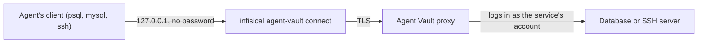

A database or SSH service lets an agent reach a PostgreSQL database, a MySQL database, or an SSH server during a [session](/documentation/platform/agent-vault/sessions), with clients such as `psql`, `mysql`, and `ssh`. The agent never holds the password or key: the [proxy](/documentation/platform/agent-vault/proxies) logs in to the server with the service's account.

These services work differently from [HTTP APIs](/documentation/platform/agent-vault/http-apis) and [MCP servers](/documentation/platform/agent-vault/mcp-servers). The agent runs `infisical agent-vault connect`, which opens a port on the agent's own machine for each service and prints the command that reaches it. Each connection to that port goes to the proxy over TLS, and the proxy connects to the server from inside your network.



## Prerequisites

- The [Admin role](/documentation/platform/agent-vault/access-control#product-membership) in your Agent Vault project
- An [access bundle](/documentation/platform/agent-vault/access-bundles) to add the service to
- A running [proxy](/documentation/platform/agent-vault/proxies#create-a-proxy-and-start-it) that can reach the server, and whose HTTP port the agent can reach
- An account on the server with only the access your agents need, such as a read-only database role

## Add a database or SSH server

<Steps>
  <Step>
    In your Agent Vault project, go to **Access Bundles**. Select your access bundle, then select **Add Service**.
  </Step>
  <Step>
    On the **Choose a template** panel, select the **Other Protocols** tab, then select **PostgreSQL**, **MySQL**, or **SSH**.
  </Step>
  <Step>
    On the **Details** step, enter a **Name** and the [server's details](#server-details). Select **Continue**.
  </Step>
  <Step>
    On the **Credential** step, set up the [account](#credentials) the proxy logs in as. Select **Continue**.
  </Step>
  <Step>
    On the **Review** step, select **Add Service**.
  </Step>
</Steps>

Next, [connect your agent](#connect-your-agent) to the service.

## Server details

- **Name:** The name the agent connects with, as in `infisical agent-vault connect analytics` (at most 63 characters)
- **Host:** The server's host name or IP address, as the proxy reaches it (no scheme, port, or path)
- **Port:** The server's port (defaults to `5432` for PostgreSQL, `3306` for MySQL, and `22` for SSH)
- **Database** (PostgreSQL and MySQL): The database the proxy logs in to
- **TLS** (PostgreSQL and MySQL): How the proxy connects to the database, described in [TLS to the database](#tls-to-the-database)

A PostgreSQL service always connects to its database, whichever database the agent's client asks for. A MySQL service only starts in its database, and the agent can switch to any other database the account can use, so limit the account's grants to the databases the agent needs.

### TLS to the database

TLS applies only to the connection between the proxy and the database. The connection between the agent's machine and the proxy always uses TLS.

- **Use TLS** (on by default): The proxy connects to the database over TLS
- **Verify Certificate** (on by default): The proxy checks the database's certificate, against the system's trusted certificate authorities or the certificate authority you paste
- **Certificate Authority (optional):** A PEM certificate authority that signed the database's certificate, for a database with a private certificate

If you turn **Use TLS** off, a PostgreSQL service still uses TLS when the database offers it, without checking the certificate, and a MySQL service connects without TLS.

## Credentials

### Username and password

Enter the account's **Username** and **Password**. Any of the three service types can use a username and password. To give each member their own account, leave the username, the password, or both to each member, as described in [member-provided values](/documentation/platform/agent-vault/http-apis#member-provided-values). To use a password that several services share, type `{{` in **Password** and select a [variable](/documentation/platform/agent-vault/variables).

### SSH key

An SSH service can log in with a key instead of a password. Under **Credential Type**, select **SSH Key**, then enter the **Username**, paste the **Private Key**, and optionally paste an SSH certificate for the key in **Certificate (optional)**.

- The key must not have a passphrase
- You set the key on the service; members can't each provide their own key, and a key can't use a variable

If the proxy can't read the key, `infisical agent-vault connect` reports it when the agent connects.

## Connect your agent

`infisical agent-vault connect` opens a port on `127.0.0.1` for each service you name, or for every database and SSH service in the session with `--all`, and prints a command for each one. The ports stay open until the command stops.

<Steps>
  <Step>
    Start the agent with `infisical agent-vault run`, as described in [Create a session](/documentation/platform/agent-vault/sessions#create-a-session). The agent gets the session token, the proxy's address, and the proxy's certificate authority from `run`, so `connect` needs no flags.
  </Step>
  <Step>
    Have the agent run `infisical agent-vault connect` in the background, for example:

    ```bash
    infisical agent-vault connect --all &
    ```

    ```text
    analytics  psql "postgres://agent@127.0.0.1:52817/app?sslmode=disable"
    orders     mysql -h 127.0.0.1 -P 52819 -u agent orders
    bastion    ssh -p 52818 -o StrictHostKeyChecking=no -o UserKnownHostsFile=/dev/null agent@127.0.0.1
    ```

    Agents don't know about this command on their own. Tell your agent to run it in its instructions, or in a [skill](/documentation/platform/agent-vault/skills).
  </Step>
  <Step>
    The agent runs the printed commands. Any username works, and the agent must not pass a password: the proxy logs in with the service's account.
  </Step>
</Steps>

### Connect outside `infisical agent-vault run`

Pass the session token and the proxy's address:

```bash
infisical agent-vault connect analytics --session-token <session-token> --proxy <proxy-host>:17323
```

Before it sends the session token, `connect` checks the proxy's certificate authority against the fingerprints Infisical lists for the session's proxies. If the machine can't reach Infisical, pass the fingerprint from the proxy's page in Infisical with `--ca-fingerprint SHA256:...`. Without a fingerprint it can check, `connect` refuses to connect.

## What gets recorded

The proxy records each statement, SSH command, and file transfer in the [session's logs](/documentation/platform/agent-vault/session-logs#database-and-ssh-connections), with the result or output but never a query's rows.

## Limitations

- **SSH port forwarding isn't controlled:** An agent can forward ports through an SSH service to anything the SSH server reaches, and the forwarded traffic isn't recorded, so set `AllowTcpForwarding no` and `PermitTunnel no` for the service's account on the SSH server
- **SSH host keys aren't checked:** The proxy accepts the SSH server's host key without checking it, so run the proxy on a network you trust to reach the server
- **SSH errors aren't shown:** The agent doesn't see what a command writes to standard error, and the session log doesn't record it or the command's exit code
- **Password logins only use SSH's password method:** An SSH server that only allows keyboard-interactive logins rejects a password, so use an [SSH key](#ssh-key) instead
- **Database logins:** PostgreSQL services log in with a plain-text, MD5, or SCRAM-SHA-256 password, and MySQL services with the `mysql_native_password`, `caching_sha2_password`, `sha256_password`, or `ed25519` method
- **No SOCKS5-only proxies:** `connect` uses the proxy's HTTP port, so it doesn't work with a proxy whose HTTP port the agent can't reach, such as a proxy set up for [E2B](/documentation/platform/agent-vault/guides/e2b)

## Troubleshooting

<AccordionGroup>
  <Accordion title="The connect command says it can't verify the proxy">
    `connect` couldn't check the proxy's certificate authority. Run it under `infisical agent-vault run`, or pass the fingerprint from the proxy's page in Infisical with `--ca-fingerprint`.
  </Accordion>
  <Accordion title="The connect command says the proxy doesn't serve database and SSH services">
    The proxy runs an older version of the Infisical CLI. Update the CLI on the proxy's machine and restart the proxy.
  </Accordion>
  <Accordion title="The client says the server closed the connection">
    The proxy couldn't log in to the server. Check that:

    - The service's **Host** and **Port** are reachable from the proxy's machine
    - The account's username and password, or key, are correct
    - The TLS settings match the database, for example **Verify Certificate** is off or **Certificate Authority (optional)** is set for a database with a private certificate

    The proxy's own log names the service and the error.
  </Accordion>
  <Accordion title="The agent's connection closes after a service changes">
    The proxy closes open connections to a service when you remove the service or change its host, port, database, or TLS settings, and when the session ends. A new password or key applies to new connections, and open connections stay open.
  </Accordion>
</AccordionGroup>
