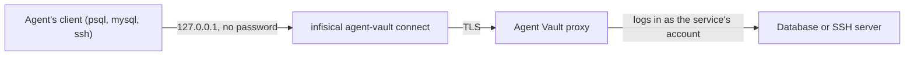

A database or SSH service lets an agent reach a PostgreSQL database, a MySQL database, or an SSH server during a [session](/documentation/platform/agent-vault/sessions), with clients such as `psql`, `mysql`, and `ssh`. The agent never holds the password or key: the [proxy](/documentation/platform/agent-vault/proxies) logs in to the server with the service's account.

These services work differently from [HTTP APIs](/documentation/platform/agent-vault/http-apis) and [MCP servers](/documentation/platform/agent-vault/mcp-servers). The agent runs [`infisical agent-vault connect`](/cli/reference#agent-vault-connect), which opens a port on the agent's own machine for each service and prints the port's address. Each connection to that port goes to the proxy over TLS, and the proxy connects to the server from inside your network.



To add one of these services to an access bundle, follow the page for its type:

<CardGroup cols={3}>
  <Card title="PostgreSQL" icon="database" href="/documentation/platform/agent-vault/postgresql">
    Let an AI agent query a PostgreSQL database without holding its password.
  </Card>
  <Card title="MySQL" icon="database" href="/documentation/platform/agent-vault/mysql">
    Let an AI agent query a MySQL database without holding its password.
  </Card>
  <Card title="SSH" icon="terminal" href="/documentation/platform/agent-vault/ssh">
    Let an AI agent run commands on an SSH server without holding its password or key.
  </Card>
</CardGroup>

## Connect your agent

`infisical agent-vault connect` opens a port on `127.0.0.1` for each service you name, or for every database and SSH service in the session with `--all`. The command keeps running, and the ports stay open until it stops.

<Steps>
  <Step>
    Start the agent with [`infisical agent-vault run`](/cli/reference#agent-vault-run), as described in [Create a session](/documentation/platform/agent-vault/create-a-session). The agent gets the session token, the proxy's address, and the proxy's certificate authority from `run`, so `connect` needs no flags.
  </Step>
  <Step>
    Have the agent run `infisical agent-vault connect` with the names of the services it needs, or with `--all`:

    ```bash
    infisical agent-vault connect --all
    ```

    Once the ports are open, the command prints each service's local address and an example command that reaches it:

    ```text
    analytics (PostgreSQL)
      Address:  127.0.0.1:52817
      Example:  psql "postgres://agent@127.0.0.1:52817/?sslmode=disable"

    orders (MySQL)
      Address:  127.0.0.1:52819
      Example:  mysql -h 127.0.0.1 -P 52819 -u agent

    bastion (SSH)
      Address:  127.0.0.1:52818
      Example:  ssh -p 52818 -o StrictHostKeyChecking=no -o UserKnownHostsFile=/dev/null agent@127.0.0.1
    ```

    The agent's [list of services](/documentation/platform/agent-vault/service-discovery) tells it to run this command for each database and SSH service. To make sure the agent uses the services, also tell it (in its instructions or in a [skill](/documentation/platform/agent-vault/skills)) to run the command, read the printed addresses, and keep the command running while it uses the services.
  </Step>
  <Step>
    The agent connects its client to the printed address, as in the example command. Any username works, and the agent must not pass a password: the proxy logs in with the service's account.
  </Step>
</Steps>

To close the ports, stop the command with Ctrl+C.

The ports accept connections from any user on the machine. On a shared machine, run the agent in its own container or VM.

### Pick a local port

By default, each service gets a free port, which changes each time `connect` starts. To use the same port every time, name one service and pass `--port`:

```bash
infisical agent-vault connect analytics --port 5432
```

`--port` works only with one named service. If another program already uses the port, `connect` stops with an error.

### Services the proxy refuses

Before it opens any port, `connect` checks each service with the proxy. The proxy refuses a service it can't serve, such as a service with [member-provided values](/documentation/platform/agent-vault/http-apis#member-provided-values) you haven't set, or an [SSH key](/documentation/platform/agent-vault/ssh#ssh-key) it can't use.

- If you name services, `connect` stops with the proxy's reason and opens no ports
- With `--all`, `connect` skips each refused service and prints its name and the reason (it stops with an error only if the proxy refuses every service)

If a service has a [hook](/documentation/platform/agent-vault/hooks), the proxy asks the hook each time the agent opens a connection. If the hook server refuses the connection or doesn't give a usable answer, `connect` prints the service's name and a message, and the connection closes.

### Connect outside `infisical agent-vault run`

Pass the session token and the proxy's address:

```bash
infisical agent-vault connect analytics --session-token <session-token> --proxy <proxy-host>:17323
```

Other users on the machine can see a token passed as a flag in the process list, such as with `ps`. Prefer setting the token in `INFISICAL_AGENT_VAULT_SESSION_TOKEN` over passing `--session-token`.

Before it sends the session token to the proxy, `connect` checks the proxy's certificate authority against the fingerprints Infisical lists for the session's proxies:

- If you use EU Cloud or self-host Infisical and aren't logged in to that instance on this machine, pass `--domain` or set `INFISICAL_DOMAIN` (see [Agent Vault commands](/cli/reference#agent-vault))
- If the machine can't reach Infisical, pass `--ca-fingerprint SHA256:...` with the fingerprint from the **Certificate Authority** column on the **Proxies** page

If you pass `--ca-fingerprint`, `connect` checks the proxy against that fingerprint only. Without a fingerprint that matches, `connect` refuses to connect.

## Session logs

The proxy records each statement, SSH command, and file transfer in the [session's logs](/documentation/platform/agent-vault/session-logs#database-and-ssh-connections), with the result or output but never a query's rows. Statements and commands are recorded as written, so if the agent types a password in one, such as in `ALTER USER`, the log holds the password.

## Limitations

- **No SOCKS5-only proxies:** `connect` uses the proxy's HTTP port, so it doesn't work with a proxy whose HTTP port the agent can't reach, such as a proxy set up for [E2B](/documentation/platform/agent-vault/guides/e2b)

## Troubleshooting

<AccordionGroup>
  <Accordion title="The connect command says it can't verify the proxy">
    `connect` couldn't check the proxy's certificate authority. Run it under `infisical agent-vault run`, or pass `--ca-fingerprint` with the fingerprint from the **Certificate Authority** column on the **Proxies** page. If the message says `connect` couldn't reach Infisical, check `--domain`.
  </Accordion>
  <Accordion title="The connect command says the session is no longer valid">
    The session has ended or was revoked, or it belongs to a different Agent Vault project than the proxy. [Start a new session](/documentation/platform/agent-vault/create-a-session), or run the agent again under `infisical agent-vault run`.
  </Accordion>
  <Accordion title="The connect command says the proxy doesn't serve database and SSH services">
    The proxy runs an older version of the Infisical CLI. Update the CLI on the proxy's machine and restart the proxy.
  </Accordion>
  <Accordion title="The agent's connection closes after a service changes">
    The proxy closes open connections to a service when you remove the service or change its host, port, database, or TLS settings, and when the session ends. A new password or key applies to new connections, and open connections stay open.
  </Accordion>
</AccordionGroup>
