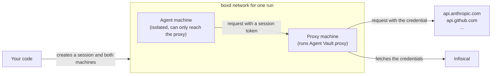

import SandboxAgentVaultSetup from "/snippets/agent-vault/SandboxAgentVaultSetup.mdx";

[boxd machines](https://docs.boxd.sh/use-cases/sandboxes?ref=infisical) are virtual machines you create from code to run an agent. The agent in a machine runs commands that a prompt can influence, so any API key you give the machine can leak through a [prompt injection](/documentation/platform/agent-vault/why-agent-vault).

With Agent Vault, there are no API keys within the agent's environment. Each run uses two machines: one that runs an Agent Vault [proxy](/documentation/platform/agent-vault/proxies), and one that runs the agent. Both machines join a [network](https://docs.boxd.sh/guides/vm-to-vm?ref=infisical#networks) that only the two of them share.

The agent's machine is [isolated](https://docs.boxd.sh/use-cases/sandboxes?ref=infisical#cut-off-from-your-fleet-by-design), which leaves out boxd's tools and credentials, and its [egress allowlist](https://docs.boxd.sh/guides/egress-allowlist?ref=infisical) is set to `none`, so it can't reach the internet or your other machines. It can only connect to the proxy's machine. Every request the agent makes goes through the proxy, and the proxy attaches the real credential to requests for the APIs you allowed.



For each run, your code does the following:

1. Creates an Agent Vault [session](/documentation/platform/agent-vault/sessions) for the run
2. Creates a machine for the proxy on a new network, and starts the proxy in it
3. Creates an isolated machine for the agent on the same network, with no internet access
4. Starts the agent with the session token
5. Stops the proxy when the agent finishes, so the proxy uploads the rest of the [session logs](/documentation/platform/agent-vault/session-logs)
6. Revokes the session and deletes both machines (each machine also has a 15-minute delete timer, in case your code stops first)

Every proxy starts from the same proxy token, so you set up the proxy once, no matter how many machines you run.

<Accordion title="Why not run the same proxy for every machine?">
  To reach one shared proxy, every agent's machine would need a network path to the proxy, and the proxy would accept requests from every agent. Anyone who gets a session token from one agent's machine could then send requests through the proxy from another machine until the session ends.

  Only the agent's machine shares a network with its proxy's machine, so nothing outside the run can send requests through the proxy.
</Accordion>

## Prerequisites

- The **Admin** role in an [Agent Vault project](/documentation/platform/agent-vault/access-control#product-membership)
- An [access bundle](/documentation/platform/agent-vault/access-bundles) with a service for each key the agent uses, including its model provider's key, such as **Anthropic** for Claude Code (see the [quickstart](/documentation/platform/agent-vault/quickstart))
- A [boxd](https://boxd.sh?ref=infisical) organization, and a [boxd API key](https://docs.boxd.sh/cli/authentication?ref=infisical#api-keys) for it in the `BOXD_API_KEY` environment variable where your code runs
- The boxd SDK version 0.3.1 or later for your language: [Python](https://pypi.org/project/boxd/) or [TypeScript](https://www.npmjs.com/package/@boxd-sh/sdk)
- For Python, the [Infisical Python SDK](/sdks/languages/python), and for TypeScript, the [Infisical Node.js SDK](/sdks/languages/node)

## Step 1: Set up Agent Vault

<SandboxAgentVaultSetup />

## Step 2: Give your code the credentials

Set the following environment variables where the code that starts your machines runs:

- `INFISICAL_AGENT_VAULT_PROXY_TOKEN`: the proxy token
- `INFISICAL_UNIVERSAL_AUTH_CLIENT_ID` and `INFISICAL_UNIVERSAL_AUTH_CLIENT_SECRET`: the machine identity's client ID and client secret

Your code passes the proxy token only to the proxy's machine, and never passes the machine identity's credentials or your boxd API key to a machine. The agent's machine can't read the environment or files of the proxy's machine.

## Step 3: Create the snapshot

Both machines start from the same [boxd snapshot](https://docs.boxd.sh/guides/snapshots?ref=infisical). The default boxd image already has Node.js and Claude Code, and the snapshot adds the [Infisical CLI](/cli/overview). This function creates the snapshot the first time your code runs. At the top, replace `<boxd-org>` with the name of your boxd organization:

<CodeGroup>

```python Python expandable
# machine_image.py
import time

from boxd import Boxd
from boxd.errors import NotFoundError

BOXD_ORG = "<boxd-org>"
SNAPSHOT = "agent-vault-agent"

SETUP = "sudo npm install -g --prefix /usr/local @infisical/cli"


def ensure_snapshot(boxd: Boxd) -> None:
    try:
        if boxd.snapshots.get(SNAPSHOT, org=BOXD_ORG).status == "ready":
            return
    except NotFoundError:
        pass
    builder = boxd.machines.create(
        f"{SNAPSHOT}-builder",
        org=BOXD_ORG,
        # Deletes the builder even if your code stops before it cleans up.
        delete_after=30 * 60,
    )
    try:
        boxd.machines.wait_until_ready(builder.id)
        setup = boxd.machines.exec(builder.id, SETUP, timeout=600)
        if setup.exit_code != 0:
            raise RuntimeError(f"Installing the Infisical CLI failed:\n{setup.stdout}{setup.stderr}")
        boxd.snapshots.create(builder.id, SNAPSHOT)
        deadline = time.monotonic() + 10 * 60
        while True:
            status = boxd.snapshots.get(SNAPSHOT, org=BOXD_ORG).status
            if status == "ready":
                break
            if status == "failed":
                raise RuntimeError("Creating the snapshot failed. Change SNAPSHOT to a new name and try again.")
            if time.monotonic() > deadline:
                raise TimeoutError(
                    "The snapshot wasn't ready after 10 minutes. Change SNAPSHOT to a new name and try again."
                )
            time.sleep(2)
    finally:
        boxd.machines.delete(builder.id)
```

```typescript TypeScript expandable
// machineImage.ts
import { type Boxd, NotFoundError } from "@boxd-sh/sdk";

export const BOXD_ORG = "<boxd-org>";
export const SNAPSHOT = "agent-vault-agent";

const SETUP = "sudo npm install -g --prefix /usr/local @infisical/cli";

export async function ensureSnapshot(boxd: Boxd): Promise<void> {
  try {
    if ((await boxd.snapshots.get(SNAPSHOT, { org: BOXD_ORG })).status === "ready") return;
  } catch (err) {
    if (!(err instanceof NotFoundError)) throw err;
  }
  const builder = await boxd.machines.create({
    name: `${SNAPSHOT}-builder`,
    org: BOXD_ORG,
    // Deletes the builder even if your code stops before it cleans up.
    deleteAfter: 30 * 60,
  });
  try {
    await boxd.machines.waitUntilReady(builder.id);
    const setup = await boxd.machines.exec(builder.id, { command: SETUP, timeout: 600_000 });
    if (setup.exitCode !== 0) throw new Error(`Installing the Infisical CLI failed:\n${setup.stdout}${setup.stderr}`);
    await boxd.snapshots.create(builder.id, SNAPSHOT);
    const deadline = Date.now() + 10 * 60 * 1000;
    while (true) {
      const { status } = await boxd.snapshots.get(SNAPSHOT, { org: BOXD_ORG });
      if (status === "ready") break;
      if (status === "failed") {
        throw new Error("Creating the snapshot failed. Change SNAPSHOT to a new name and try again.");
      }
      if (Date.now() > deadline) {
        throw new Error("The snapshot wasn't ready after 10 minutes. Change SNAPSHOT to a new name and try again.");
      }
      await new Promise((resolve) => setTimeout(resolve, 2000));
    }
  } finally {
    await boxd.machines.delete(builder.id);
  }
}
```

</CodeGroup>

- **Changing the snapshot:** the function reuses the snapshot if one with the same name exists, so after you change `SETUP`, change `SNAPSHOT` to a new name

## Step 4: Run an agent in a machine

This function runs one prompt in a new machine. At the top, replace `<project-id>` with the ID of your Agent Vault project ([find the project ID](/documentation/platform/agent-vault/projects#find-the-project-id)) and `<access-bundle-name>` with your access bundle's name. If you use EU Cloud or self-host Infisical, also replace `https://app.infisical.com` with the URL of your instance:

<CodeGroup>

```python Python expandable
# run_agent.py
import os
import uuid

from boxd import Boxd, Machine
from infisical_sdk import InfisicalSDKClient

from machine_image import BOXD_ORG, SNAPSHOT

INFISICAL_URL = "https://app.infisical.com"
PROJECT_ID = "<project-id>"
ACCESS_BUNDLE = "<access-bundle-name>"

START_PROXY = "setsid nohup infisical agent-vault proxy > /tmp/proxy.log 2>&1 & echo $! > /tmp/proxy.pid"

STOP_PROXY = (
    "pid=$(cat /tmp/proxy.pid); kill -TERM $pid; "
    "for i in $(seq 30); do kill -0 $pid 2>/dev/null || exit 0; sleep 0.5; done; exit 1"
)

AGENT_ENV = {
    # Claude Code won't start without a key; the proxy replaces this one.
    "ANTHROPIC_API_KEY": "agent-vault",
    # Skips Claude Code's update checks and telemetry, which fail without internet access.
    "CLAUDE_CODE_DISABLE_NONESSENTIAL_TRAFFIC": "1",
    "DISABLE_AUTOUPDATER": "1",
}


def run_agent(boxd: Boxd, prompt: str) -> str:
    # The machine identity's credentials stay here and never enter a machine.
    infisical = InfisicalSDKClient(host=INFISICAL_URL)
    infisical.auth.universal_auth.login(
        client_id=os.environ["INFISICAL_UNIVERSAL_AUTH_CLIENT_ID"],
        client_secret=os.environ["INFISICAL_UNIVERSAL_AUTH_CLIENT_SECRET"],
    )

    # One session per run. The ttl outlasts the machines' 15-minute delete
    # timer, so the agent can't lose access mid-run.
    session = infisical.agent_vault.sessions.create(
        project_id=PROJECT_ID, access_bundle=ACCESS_BUNDLE, ttl="20m"
    )

    # Only the two machines of this run join this network.
    network = f"agent-vault-{uuid.uuid4().hex[:12]}"
    proxy_machine = agent_machine = None
    try:
        proxy_machine = boxd.machines.create(
            f"{network}-proxy",
            org=BOXD_ORG,
            from_snapshot=SNAPSHOT,
            spec=Machine.spec().network(network),
            # Deletes the machine even if your code stops before it cleans up.
            delete_after=15 * 60,
        )
        # An isolated machine with the egress allowlist set to none can only
        # connect to the machines on its network, here the proxy's machine.
        agent_machine = boxd.machines.create(
            f"{network}-agent",
            org=BOXD_ORG,
            from_snapshot=SNAPSHOT,
            spec=Machine.spec().isolated().network(network).egress("none"),
            delete_after=15 * 60,
        )
        boxd.machines.wait_until_ready(proxy_machine.id)
        boxd.machines.wait_until_ready(agent_machine.id)

        boxd.machines.exec(
            proxy_machine.id,
            START_PROXY,
            env={
                "INFISICAL_AGENT_VAULT_PROXY_TOKEN": os.environ["INFISICAL_AGENT_VAULT_PROXY_TOKEN"],
                "INFISICAL_DOMAIN": INFISICAL_URL,
            },
        )
        proxy_address = f"{proxy_machine.name}.boxd:17323"

        # The proxy serves only after it has loaded its settings from Infisical.
        wait = boxd.machines.exec(
            agent_machine.id,
            "for i in $(seq 60); do "
            f"curl -fs -m 2 http://{proxy_address}/_agent-vault/ca > /dev/null && exit 0; "
            "sleep 0.5; done; exit 1",
        )
        if wait.exit_code != 0:
            log = boxd.machines.exec(proxy_machine.id, "cat /tmp/proxy.log").stdout
            raise RuntimeError(f"The Agent Vault proxy didn't start:\n{log}")

        boxd.machines.files.upload(agent_machine.id, "/tmp/prompt.txt", prompt)
        agent = boxd.machines.exec(
            agent_machine.id,
            f"infisical agent-vault run --telemetry=false --proxy {proxy_address} "
            "-- claude -p --permission-mode bypassPermissions < /tmp/prompt.txt",
            cwd="/home/boxd",
            env={**AGENT_ENV, "INFISICAL_AGENT_VAULT_SESSION_TOKEN": session.token},
            timeout=14 * 60,
        )
        if agent.exit_code != 0:
            raise RuntimeError(f"The agent failed:\n{agent.stdout}{agent.stderr}")
        return agent.stdout
    finally:
        try:
            if proxy_machine:
                boxd.machines.exec(proxy_machine.id, STOP_PROXY)
        except Exception:
            pass
        # Revoke first, so the session ends even if deleting fails.
        try:
            infisical.agent_vault.sessions.revoke(session_id=session.id)
        finally:
            try:
                if agent_machine:
                    boxd.machines.delete(agent_machine.id)
            finally:
                if proxy_machine:
                    boxd.machines.delete(proxy_machine.id)
```

```typescript TypeScript expandable
// runAgent.ts
import { randomUUID } from "node:crypto";

import { type Boxd, Machine } from "@boxd-sh/sdk";
import { InfisicalSDK } from "@infisical/sdk";

import { BOXD_ORG, SNAPSHOT } from "./machineImage.js";

const INFISICAL_URL = "https://app.infisical.com";
const PROJECT_ID = "<project-id>";
const ACCESS_BUNDLE = "<access-bundle-name>";

const START_PROXY = "setsid nohup infisical agent-vault proxy > /tmp/proxy.log 2>&1 & echo $! > /tmp/proxy.pid";

const STOP_PROXY =
  "pid=$(cat /tmp/proxy.pid); kill -TERM $pid; " +
  "for i in $(seq 30); do kill -0 $pid 2>/dev/null || exit 0; sleep 0.5; done; exit 1";

const AGENT_ENV = {
  // Claude Code won't start without a key; the proxy replaces this one.
  ANTHROPIC_API_KEY: "agent-vault",
  // Skips Claude Code's update checks and telemetry, which fail without internet access.
  CLAUDE_CODE_DISABLE_NONESSENTIAL_TRAFFIC: "1",
  DISABLE_AUTOUPDATER: "1",
};

export async function runAgent(boxd: Boxd, prompt: string): Promise<string> {
  // The machine identity's credentials stay here and never enter a machine.
  const infisical = new InfisicalSDK({ siteUrl: INFISICAL_URL });
  await infisical.auth().universalAuth.login({
    clientId: process.env.INFISICAL_UNIVERSAL_AUTH_CLIENT_ID!,
    clientSecret: process.env.INFISICAL_UNIVERSAL_AUTH_CLIENT_SECRET!,
  });

  // One session per run. The ttl outlasts the machines' 15-minute delete
  // timer, so the agent can't lose access mid-run.
  const session = await infisical.agentVault().sessions.create({
    projectId: PROJECT_ID,
    accessBundle: ACCESS_BUNDLE,
    ttl: "20m",
  });

  // Only the two machines of this run join this network.
  const network = `agent-vault-${randomUUID().replaceAll("-", "").slice(0, 12)}`;
  let proxyMachine: Machine | undefined;
  let agentMachine: Machine | undefined;
  try {
    proxyMachine = await boxd.machines.create({
      name: `${network}-proxy`,
      org: BOXD_ORG,
      fromSnapshot: SNAPSHOT,
      spec: Machine.spec().network(network),
      // Deletes the machine even if your code stops before it cleans up.
      deleteAfter: 15 * 60,
    });
    // An isolated machine with the egress allowlist set to none can only
    // connect to the machines on its network, here the proxy's machine.
    agentMachine = await boxd.machines.create({
      name: `${network}-agent`,
      org: BOXD_ORG,
      fromSnapshot: SNAPSHOT,
      spec: Machine.spec().isolated().network(network).egress("none"),
      deleteAfter: 15 * 60,
    });
    await boxd.machines.waitUntilReady(proxyMachine.id);
    await boxd.machines.waitUntilReady(agentMachine.id);

    await boxd.machines.exec(proxyMachine.id, {
      command: START_PROXY,
      env: {
        INFISICAL_AGENT_VAULT_PROXY_TOKEN: process.env.INFISICAL_AGENT_VAULT_PROXY_TOKEN!,
        INFISICAL_DOMAIN: INFISICAL_URL,
      },
    });
    const proxyAddress = `${proxyMachine.name}.boxd:17323`;

    // The proxy serves only after it has loaded its settings from Infisical.
    const wait = await boxd.machines.exec(agentMachine.id, {
      command:
        "for i in $(seq 60); do " +
        `curl -fs -m 2 http://${proxyAddress}/_agent-vault/ca > /dev/null && exit 0; ` +
        "sleep 0.5; done; exit 1",
    });
    if (wait.exitCode !== 0) {
      const log = await boxd.machines.exec(proxyMachine.id, { command: "cat /tmp/proxy.log" });
      throw new Error(`The Agent Vault proxy didn't start:\n${log.stdout}`);
    }

    await boxd.machines.files.upload(agentMachine.id, "/tmp/prompt.txt", prompt);
    const agent = await boxd.machines.exec(agentMachine.id, {
      command:
        `infisical agent-vault run --telemetry=false --proxy ${proxyAddress} ` +
        "-- claude -p --permission-mode bypassPermissions < /tmp/prompt.txt",
      cwd: "/home/boxd",
      env: { ...AGENT_ENV, INFISICAL_AGENT_VAULT_SESSION_TOKEN: session.token },
      timeout: 14 * 60 * 1000,
    });
    if (agent.exitCode !== 0) throw new Error(`The agent failed:\n${agent.stdout}${agent.stderr}`);
    return agent.stdout;
  } finally {
    if (proxyMachine) {
      await boxd.machines.exec(proxyMachine.id, { command: STOP_PROXY }).catch(() => {});
    }
    // Revoke first, so the session ends even if deleting fails.
    try {
      await infisical.agentVault().sessions.revoke(session.id);
    } finally {
      try {
        if (agentMachine) await boxd.machines.delete(agentMachine.id);
      } finally {
        if (proxyMachine) await boxd.machines.delete(proxyMachine.id);
      }
    }
  }
}
```

</CodeGroup>

The agent reaches the proxy at `<proxy-machine-name>.boxd:17323`, the proxy machine's name on the network the two machines share. For more about creating sessions from code, see [Create sessions with the API](/documentation/platform/agent-vault/sessions-api). For the flags the agent starts with, see the [`agent-vault run` CLI reference](/cli/reference#agent-vault-run).

<Note>
To run a different agent, install it in [the snapshot](#step-3-create-the-snapshot), replace the `claude` command with the agent's non-interactive command, such as `codex exec`, and replace the Claude Code settings in the agent's environment variables.

For an agent you built yourself, run it the same way, or [set the proxy in its HTTP client](/documentation/platform/agent-vault/guides/custom-agent#step-4-send-requests-through-the-proxy).
</Note>

## Step 5: Verify it works

Call the function with a prompt that needs an API in the access bundle:

<CodeGroup>

```python Python
# main.py
from boxd import Boxd

from machine_image import ensure_snapshot
from run_agent import run_agent

boxd = Boxd()
ensure_snapshot(boxd)
print(run_agent(boxd, "Reply with the word OK."))
```

```typescript TypeScript
// main.ts
import { Boxd } from "@boxd-sh/sdk";

import { ensureSnapshot } from "./machineImage.js";
import { runAgent } from "./runAgent.js";

const boxd = new Boxd();
await ensureSnapshot(boxd);
console.log(await runAgent(boxd, "Reply with the word OK."));
```

</CodeGroup>

Claude Code replies, even though its machine has no Anthropic API key and can only connect to the proxy.

<Check>
  Each run now gets its own two machines and its own session. The only credential in the agent's machine is a session token, and your code revokes the session when the run ends.
</Check>

To check which requests the agent made, [view the session's logs](/documentation/platform/agent-vault/sessions#view-session-logs) in your Agent Vault project. Requests that got a credential have the outcome **Brokered**.

## Security considerations

### Network access from the agent's machine

The agent's machine can only connect to the proxy's machine on the network the two machines share. Under the default [traffic policy](/documentation/platform/agent-vault/proxies#traffic-policy), **Any host**, the proxy forwards the agent's requests to any host the proxy's machine can reach. That includes hosts on the internet, and also [private addresses](/documentation/platform/agent-vault/proxies#requests-to-private-addresses), such as `localhost` on the proxy's machine and the other machines on its network. To allow only the hosts of the services in the session's access bundle, set the traffic policy to **Service hosts only**, and add any other hosts the agent needs, such as `registry.npmjs.org`, to the proxy's [exceptions](/documentation/platform/agent-vault/proxies#exceptions). We recommend **Service hosts only** if the proxy's machine can reach anything the agent shouldn't use.

### Compromised machines

Each proxy's machine holds a copy of the proxy token. If you think someone took control of a machine, [rotate the proxy's token](/documentation/platform/agent-vault/proxies#rotate-a-proxys-token), then update `INFISICAL_AGENT_VAULT_PROXY_TOKEN` where your code runs.

## Troubleshooting

<AccordionGroup>
  <Accordion title="The proxy doesn't start">
    The function's error includes the proxy's log. If the log says `The provided access token is malformed`, the proxy token is wrong. Check the following:

    - `INFISICAL_AGENT_VAULT_PROXY_TOKEN` has the current proxy token (a token stops working when you rotate it)
    - If you use EU Cloud or self-host Infisical, `INFISICAL_URL` in your code is the URL of your instance
    - The snapshot has a recent Infisical CLI (change `SNAPSHOT` to a new name to build one with the latest CLI)
  </Accordion>
  <Accordion title="Creating the session fails">
    Check the following:

    - `PROJECT_ID` in your code is the ID of the Agent Vault project that holds the access bundle
    - The machine identity is a member of that project and has a grant on the access bundle
  </Accordion>
  <Accordion title="Creating a machine fails">
    Check that `BOXD_API_KEY` is a key for the organization in `BOXD_ORG` in your code.
  </Accordion>
  <Accordion title="Requests fail with a 403 partway through a run">
    The session expired or was revoked. Set the session's `ttl` a few minutes longer than the agent's timeout, so the session lasts as long as the agent can run.
  </Accordion>
  <Accordion title="Requests to a host fail with a 403 from the start">
    If the proxy's traffic policy is **Service hosts only**, the proxy blocks hosts that no service in the access bundle covers. Add a service for the host, or add the host to the proxy's [exceptions](/documentation/platform/agent-vault/proxies#exceptions).
  </Accordion>
</AccordionGroup>

## Next steps

<CardGroup cols={2}>
  <Card title="Create sessions with the API" icon="key-round" href="/documentation/platform/agent-vault/sessions-api">
    Create a session for each agent run from your own code.
  </Card>
  <Card title="Session logs" icon="list" href="/documentation/platform/agent-vault/session-logs">
    Record every request an agent makes during a session.
  </Card>
</CardGroup>
