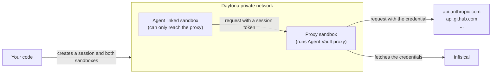

import SandboxAgentVaultSetup from "/snippets/agent-vault/SandboxAgentVaultSetup.mdx";

[Daytona sandboxes](https://www.daytona.io/docs/en/sandboxes/) are temporary, isolated environments you create from code to run an agent. The sandboxed agent runs commands that a prompt can influence, so any API key you give the sandbox can leak through a [prompt injection](/documentation/platform/agent-vault/why-agent-vault).

With Agent Vault, there are no API keys within the agent's environment. Each run uses two sandboxes: one that runs an Agent Vault [proxy](/documentation/platform/agent-vault/proxies), and one [linked sandbox](https://www.daytona.io/docs/en/sandboxes/#linked-sandboxes) that runs the agent.

Daytona connects linked sandboxes over a private network. The agent's sandbox can only connect to the proxy, so every request the agent makes goes through the proxy, and the proxy attaches the real credential to requests for the APIs you allowed.



For each run, your code does the following:

1. Creates an Agent Vault [session](/documentation/platform/agent-vault/sessions) for the run
2. Creates a sandbox for the proxy, and starts the proxy in it
3. Creates a sandbox for the agent, linked to the proxy's sandbox, that can only connect to the proxy
4. Starts the agent with the session token
5. Stops the proxy when the agent finishes, so the proxy uploads the rest of the [session logs](/documentation/platform/agent-vault/session-logs)
6. Revokes the session and deletes the proxy's sandbox, which also deletes the agent's sandbox

Every proxy starts from the same proxy token, so you set up the proxy once, no matter how many sandboxes you run.

<Accordion title="Why not run the same proxy for every sandbox?">
  To reach one shared proxy, every agent sandbox would need internet access to the proxy, and the proxy would have to accept connections from the internet. Anyone who gets a session token could then use the proxy from anywhere until the session ends.

  Only sandboxes linked to the proxy's sandbox can reach the proxy, so nothing outside the run can send requests through it.
</Accordion>

## Prerequisites

- The **Admin** role in [Agent Vault](/documentation/platform/agent-vault/access-control#product-membership)
- An [access bundle](/documentation/platform/agent-vault/access-bundles) with a service for each key the agent uses, including its model provider's key, such as **Anthropic** for Claude Code (see the [quickstart](/documentation/platform/agent-vault/quickstart))
- A [Daytona](https://www.daytona.io) organization on [Tier 3 or 4](https://www.daytona.io/docs/en/network-limits/#tier-based-network-restrictions), because on Tiers 1 and 2 you can't limit a sandbox to reaching the proxy, and the proxy can't reach Infisical
- A [Daytona API key](https://www.daytona.io/docs/en/api-keys/) in the `DAYTONA_API_KEY` environment variable on the machine that runs your code
- The Daytona SDK for your language: [Python](https://pypi.org/project/daytona/), [TypeScript](https://www.npmjs.com/package/@daytona/sdk), [Go](https://pkg.go.dev/github.com/daytona/clients/sdk-go) (with [`api-client-go`](https://pkg.go.dev/github.com/daytona/clients/api-client-go)), [Ruby](https://rubygems.org/gems/daytona), or [Java](https://central.sonatype.com/artifact/io.daytona/sdk) (with [Jackson](https://github.com/FasterXML/jackson-databind))
- For Python, the [Infisical Python SDK](/sdks/languages/python)

## Step 1: Set up Agent Vault

<SandboxAgentVaultSetup />

## Step 2: Give your code the credentials

Set the following environment variables where the code that starts your sandboxes runs:

- `INFISICAL_AGENT_VAULT_PROXY_TOKEN`: the proxy token
- `INFISICAL_UNIVERSAL_AUTH_CLIENT_ID` and `INFISICAL_UNIVERSAL_AUTH_CLIENT_SECRET`: the machine identity's client ID and client secret

Your code passes the proxy token only to the proxy's sandbox, and never passes the machine identity's credentials to a sandbox. The agent's sandbox can't read the environment or files of the proxy's sandbox.

## Step 3: Create the snapshot

Both sandboxes start from the same [Daytona snapshot](https://www.daytona.io/docs/en/snapshots/), which has the [Infisical CLI](/cli/overview) and your agent. This function creates a snapshot with Claude Code installed the first time your code runs:

<CodeGroup>

```python Python
# sandbox_image.py
from daytona import CreateSnapshotParams, Daytona, DaytonaNotFoundError, Image

SNAPSHOT = "agent-vault-agent"

IMAGE = Image.base("node:24-bookworm-slim").run_commands(
    "apt-get update && apt-get install -y --no-install-recommends ca-certificates curl iproute2 && rm -rf /var/lib/apt/lists/*",
    "npm install -g @infisical/cli @anthropic-ai/claude-code",
)


def ensure_snapshot(daytona: Daytona) -> None:
    try:
        daytona.snapshot.get(SNAPSHOT)
    except DaytonaNotFoundError:
        daytona.snapshot.create(CreateSnapshotParams(name=SNAPSHOT, image=IMAGE), on_logs=print)
```

```typescript TypeScript
// sandboxImage.ts
import { Daytona, DaytonaNotFoundError, Image } from "@daytona/sdk";

export const SNAPSHOT = "agent-vault-agent";

const IMAGE = Image.base("node:24-bookworm-slim").runCommands(
  "apt-get update && apt-get install -y --no-install-recommends ca-certificates curl iproute2 && rm -rf /var/lib/apt/lists/*",
  "npm install -g @infisical/cli @anthropic-ai/claude-code",
);

export async function ensureSnapshot(daytona: Daytona): Promise<void> {
  try {
    await daytona.snapshot.get(SNAPSHOT);
  } catch (err) {
    if (!(err instanceof DaytonaNotFoundError)) throw err;
    await daytona.snapshot.create({ name: SNAPSHOT, image: IMAGE }, { onLogs: console.log });
  }
}
```

```go Go expandable
// sandbox_image.go
package main

import (
	"context"
	"errors"
	"fmt"

	"github.com/daytona/clients/sdk-go/pkg/daytona"
	sdkerrors "github.com/daytona/clients/sdk-go/pkg/errors"
	"github.com/daytona/clients/sdk-go/pkg/types"
)

const snapshot = "agent-vault-agent"

func ensureSnapshot(ctx context.Context, client *daytona.Client) error {
	_, err := client.Snapshot.Get(ctx, snapshot)
	if !errors.Is(err, sdkerrors.ErrNotFound) {
		return err
	}
	image := daytona.Base("node:24-bookworm-slim").
		Run("apt-get update && apt-get install -y --no-install-recommends ca-certificates curl iproute2 && rm -rf /var/lib/apt/lists/*").
		Run("npm install -g @infisical/cli @anthropic-ai/claude-code")
	_, logs, err := client.Snapshot.Create(ctx, &types.CreateSnapshotParams{Name: snapshot, Image: image})
	if err != nil {
		return err
	}
	for line := range logs {
		fmt.Println(line)
	}
	return nil
}
```

```ruby Ruby
# sandbox_image.rb
require "daytona"

SNAPSHOT = "agent-vault-agent"

IMAGE = Daytona::Image.base("node:24-bookworm-slim").run_commands(
  "apt-get update && apt-get install -y --no-install-recommends ca-certificates curl iproute2 && rm -rf /var/lib/apt/lists/*",
  "npm install -g @infisical/cli @anthropic-ai/claude-code"
)

def ensure_snapshot(daytona)
  daytona.snapshot.get(SNAPSHOT)
rescue DaytonaApiClient::ApiError => e
  raise unless e.code == 404

  daytona.snapshot.create(
    Daytona::CreateSnapshotParams.new(name: SNAPSHOT, image: IMAGE),
    on_logs: proc { |chunk| puts chunk }
  )
end
```

```java Java
// SandboxImage.java
import io.daytona.sdk.Daytona;
import io.daytona.sdk.Image;
import io.daytona.sdk.exception.DaytonaNotFoundException;

public class SandboxImage {
    static final String SNAPSHOT = "agent-vault-agent";

    static final Image IMAGE = Image.base("node:24-bookworm-slim").runCommands(
        "apt-get update && apt-get install -y --no-install-recommends ca-certificates curl iproute2 && rm -rf /var/lib/apt/lists/*",
        "npm install -g @infisical/cli @anthropic-ai/claude-code");

    static void ensureSnapshot(Daytona daytona) {
        try {
            daytona.snapshot().get(SNAPSHOT);
        } catch (DaytonaNotFoundException e) {
            daytona.snapshot().create(SNAPSHOT, IMAGE, System.out::println);
        }
    }
}
```

</CodeGroup>

- **Changing the image:** the function reuses the snapshot if one with the same name exists, so after you change the image, change `SNAPSHOT` to a new name

## Step 4: Run an agent in a sandbox

This function runs one prompt in a new sandbox. Replace `<access-bundle-name>` at the top with your access bundle's name. If you use EU Cloud or self-host Infisical, also replace `https://app.infisical.com` with the URL of your instance:

<CodeGroup>

```python Python expandable
# run_agent.py
import os

from daytona import CreateSandboxFromSnapshotParams, Daytona
from infisical_sdk import InfisicalSDKClient

from sandbox_image import SNAPSHOT

INFISICAL_URL = "https://app.infisical.com"
ACCESS_BUNDLE = "<access-bundle-name>"

# Prints the proxy's address on the network it shares with the agent's sandbox.
# The address appears shortly after the agent's sandbox is linked.
GET_LINK_ADDRESS = (
    "for i in $(seq 60); do "
    "ip -4 -o addr show eth1 2>/dev/null | awk '{print $4}' | cut -d/ -f1 | grep . && exit 0; "
    "sleep 0.5; done; exit 1"
)

STOP_PROXY = (
    "pid=$(cat /tmp/proxy.pid); kill -TERM $pid; "
    "for i in $(seq 30); do kill -0 $pid 2>/dev/null || exit 0; sleep 0.5; done; exit 1"
)

AGENT_ENV = {
    # Claude Code won't start without a key; the proxy replaces this one.
    "ANTHROPIC_API_KEY": "agent-vault",
    # Makes the fetch built into Node.js send requests through the proxy.
    "NODE_USE_ENV_PROXY": "1",
    # Skips Claude Code's update checks and telemetry, which fail without internet access.
    "CLAUDE_CODE_DISABLE_NONESSENTIAL_TRAFFIC": "1",
    "DISABLE_AUTOUPDATER": "1",
}


def run_agent(daytona: Daytona, prompt: str) -> str:
    # The machine identity's credentials stay here and never enter a sandbox.
    infisical = InfisicalSDKClient(host=INFISICAL_URL)
    infisical.auth.universal_auth.login(
        client_id=os.environ["INFISICAL_UNIVERSAL_AUTH_CLIENT_ID"],
        client_secret=os.environ["INFISICAL_UNIVERSAL_AUTH_CLIENT_SECRET"],
    )

    # One session per run. The ttl outlasts the sandboxes' 15-minute ttl, so the
    # agent can't lose access mid-run.
    session = infisical.agent_vault.sessions.create(access_bundle=ACCESS_BUNDLE, ttl="20m")

    proxy_sandbox = None
    try:
        # Deleting this sandbox also deletes the agent's sandbox linked to it.
        proxy_sandbox = daytona.create(
            CreateSandboxFromSnapshotParams(
                snapshot=SNAPSHOT,
                ephemeral=True,
                ttl_minutes=15,
                env_vars={
                    "INFISICAL_AGENT_VAULT_PROXY_TOKEN": os.environ["INFISICAL_AGENT_VAULT_PROXY_TOKEN"],
                    "INFISICAL_DOMAIN": INFISICAL_URL,
                },
            )
        )
        proxy_sandbox.process.exec("nohup infisical agent-vault proxy > /tmp/proxy.log 2>&1 & echo $! > /tmp/proxy.pid")

        agent_sandbox = daytona.create(
            CreateSandboxFromSnapshotParams(
                snapshot=SNAPSHOT,
                linked_sandbox=proxy_sandbox.id,
                ephemeral=True,
                network_block_all=True,
            )
        )
        link = proxy_sandbox.process.exec(GET_LINK_ADDRESS)
        if link.exit_code != 0:
            raise RuntimeError("The proxy's sandbox didn't get an address on the linked network.")
        proxy_ip = link.result.strip()
        # Blocking all traffic also blocks the proxy, so allow only the proxy's address.
        agent_sandbox.update_network_settings(network_allow_list=f"{proxy_ip}/32")
        proxy_address = f"{proxy_ip}:17323"

        # The proxy serves only after it has loaded its settings from Infisical.
        wait = agent_sandbox.process.exec(
            "for i in $(seq 60); do "
            f"curl -fs http://{proxy_address}/_agent-vault/ca > /dev/null && exit 0; "
            "sleep 0.5; done; exit 1"
        )
        if wait.exit_code != 0:
            log = proxy_sandbox.process.exec("cat /tmp/proxy.log").result
            raise RuntimeError(f"The Agent Vault proxy didn't start:\n{log}")

        agent_sandbox.fs.upload_file(prompt.encode(), "/tmp/prompt.txt")
        # Claude Code won't skip its permission prompts as root, so the agent
        # runs as the image's node user.
        agent = agent_sandbox.process.exec(
            "runuser -u node -- sh -c '"
            f"infisical agent-vault run --telemetry=false --proxy {proxy_address} "
            "-- claude -p --permission-mode bypassPermissions < /tmp/prompt.txt'",
            cwd="/home/node",
            env={**AGENT_ENV, "INFISICAL_AGENT_VAULT_SESSION_TOKEN": session.token},
            timeout=14 * 60,
        )
        if agent.exit_code != 0:
            raise RuntimeError(f"The agent failed:\n{agent.result}")
        return agent.result
    finally:
        try:
            if proxy_sandbox:
                proxy_sandbox.process.exec(STOP_PROXY)
        except Exception:
            pass
        # Revoke first, so the session ends even if deleting fails.
        try:
            infisical.agent_vault.sessions.revoke(session_id=session.id)
        finally:
            if proxy_sandbox:
                proxy_sandbox.delete()
```

```typescript TypeScript expandable
// runAgent.ts
import type { Daytona, Sandbox } from "@daytona/sdk";

import { SNAPSHOT } from "./sandboxImage.js";

const INFISICAL_URL = "https://app.infisical.com";
const ACCESS_BUNDLE = "<access-bundle-name>";

// Prints the proxy's address on the network it shares with the agent's sandbox.
// The address appears shortly after the agent's sandbox is linked.
const GET_LINK_ADDRESS =
  "for i in $(seq 60); do " +
  "ip -4 -o addr show eth1 2>/dev/null | awk '{print $4}' | cut -d/ -f1 | grep . && exit 0; " +
  "sleep 0.5; done; exit 1";

const STOP_PROXY =
  "pid=$(cat /tmp/proxy.pid); kill -TERM $pid; " +
  "for i in $(seq 30); do kill -0 $pid 2>/dev/null || exit 0; sleep 0.5; done; exit 1";

const AGENT_ENV = {
  // Claude Code won't start without a key; the proxy replaces this one.
  ANTHROPIC_API_KEY: "agent-vault",
  // Makes the fetch built into Node.js send requests through the proxy.
  NODE_USE_ENV_PROXY: "1",
  // Skips Claude Code's update checks and telemetry, which fail without internet access.
  CLAUDE_CODE_DISABLE_NONESSENTIAL_TRAFFIC: "1",
  DISABLE_AUTOUPDATER: "1",
};

async function infisical(path: string, { token, body }: { token?: string; body?: unknown } = {}) {
  const headers: Record<string, string> = {};
  if (token) headers.Authorization = `Bearer ${token}`;
  if (body !== undefined) headers["Content-Type"] = "application/json";
  const response = await fetch(`${INFISICAL_URL}${path}`, {
    method: "POST",
    headers,
    body: body === undefined ? undefined : JSON.stringify(body),
    signal: AbortSignal.timeout(30_000),
  });
  if (!response.ok) throw new Error(`Infisical returned ${response.status}: ${await response.text()}`);
  return response.json();
}

export async function runAgent(daytona: Daytona, prompt: string): Promise<string> {
  // The machine identity's credentials stay here and never enter a sandbox.
  const { accessToken } = await infisical("/api/v1/auth/universal-auth/login", {
    body: {
      clientId: process.env.INFISICAL_UNIVERSAL_AUTH_CLIENT_ID,
      clientSecret: process.env.INFISICAL_UNIVERSAL_AUTH_CLIENT_SECRET,
    },
  });

  // One session per run. The ttl outlasts the sandboxes' 15-minute ttl, so the
  // agent can't lose access mid-run.
  const { session } = await infisical("/api/v1/agent-vault/sessions", {
    token: accessToken,
    body: { accessBundles: [ACCESS_BUNDLE], ttl: "20m" },
  });

  let proxySandbox: Sandbox | undefined;
  try {
    // Deleting this sandbox also deletes the agent's sandbox linked to it.
    proxySandbox = await daytona.create({
      snapshot: SNAPSHOT,
      ephemeral: true,
      ttlMinutes: 15,
      envVars: {
        INFISICAL_AGENT_VAULT_PROXY_TOKEN: process.env.INFISICAL_AGENT_VAULT_PROXY_TOKEN!,
        INFISICAL_DOMAIN: INFISICAL_URL,
      },
    });
    await proxySandbox.process.executeCommand(
      "nohup infisical agent-vault proxy > /tmp/proxy.log 2>&1 & echo $! > /tmp/proxy.pid",
    );

    const agentSandbox = await daytona.create({
      snapshot: SNAPSHOT,
      linkedSandbox: proxySandbox.id,
      ephemeral: true,
      networkBlockAll: true,
    });
    const link = await proxySandbox.process.executeCommand(GET_LINK_ADDRESS);
    if (link.exitCode !== 0) throw new Error("The proxy's sandbox didn't get an address on the linked network.");
    const proxyIp = link.result.trim();
    // Blocking all traffic also blocks the proxy, so allow only the proxy's address.
    await agentSandbox.updateNetworkSettings({ networkAllowList: `${proxyIp}/32` });
    const proxyAddress = `${proxyIp}:17323`;

    // The proxy serves only after it has loaded its settings from Infisical.
    const wait = await agentSandbox.process.executeCommand(
      "for i in $(seq 60); do " +
        `curl -fs http://${proxyAddress}/_agent-vault/ca > /dev/null && exit 0; ` +
        "sleep 0.5; done; exit 1",
    );
    if (wait.exitCode !== 0) {
      const log = await proxySandbox.process.executeCommand("cat /tmp/proxy.log");
      throw new Error(`The Agent Vault proxy didn't start:\n${log.result}`);
    }

    await agentSandbox.fs.uploadFile(Buffer.from(prompt), "/tmp/prompt.txt");
    // Claude Code won't skip its permission prompts as root, so the agent
    // runs as the image's node user.
    const agent = await agentSandbox.process.executeCommand(
      "runuser -u node -- sh -c '" +
        `infisical agent-vault run --telemetry=false --proxy ${proxyAddress} ` +
        "-- claude -p --permission-mode bypassPermissions < /tmp/prompt.txt'",
      "/home/node",
      { ...AGENT_ENV, INFISICAL_AGENT_VAULT_SESSION_TOKEN: session.token },
      14 * 60,
    );
    if (agent.exitCode !== 0) throw new Error(`The agent failed:\n${agent.result}`);
    return agent.result;
  } finally {
    await proxySandbox?.process.executeCommand(STOP_PROXY).catch(() => {});
    // Revoke first, so the session ends even if deleting fails.
    try {
      await infisical(`/api/v1/agent-vault/sessions/${session.id}/revoke`, { token: accessToken });
    } finally {
      await proxySandbox?.delete();
    }
  }
}
```

```go Go expandable
// run_agent.go
package main

import (
	"bytes"
	"context"
	"encoding/json"
	"errors"
	"fmt"
	"io"
	"net/http"
	"os"
	"strings"
	"time"

	apiclient "github.com/daytona/clients/api-client-go"
	"github.com/daytona/clients/sdk-go/pkg/daytona"
	"github.com/daytona/clients/sdk-go/pkg/options"
	"github.com/daytona/clients/sdk-go/pkg/types"
)

const (
	infisicalURL = "https://app.infisical.com"
	accessBundle = "<access-bundle-name>"
)

// Prints the proxy's address on the network it shares with the agent's sandbox.
// The address appears shortly after the agent's sandbox is linked.
const getLinkAddress = "for i in $(seq 60); do " +
	"ip -4 -o addr show eth1 2>/dev/null | awk '{print $4}' | cut -d/ -f1 | grep . && exit 0; " +
	"sleep 0.5; done; exit 1"

const stopProxy = "pid=$(cat /tmp/proxy.pid); kill -TERM $pid; " +
	"for i in $(seq 30); do kill -0 $pid 2>/dev/null || exit 0; sleep 0.5; done; exit 1"

var agentEnv = map[string]string{
	// Claude Code won't start without a key; the proxy replaces this one.
	"ANTHROPIC_API_KEY": "agent-vault",
	// Makes the fetch built into Node.js send requests through the proxy.
	"NODE_USE_ENV_PROXY": "1",
	// Skips Claude Code's update checks and telemetry, which fail without internet access.
	"CLAUDE_CODE_DISABLE_NONESSENTIAL_TRAFFIC": "1",
	"DISABLE_AUTOUPDATER":                      "1",
}

func infisical(ctx context.Context, path, token string, body, out any) error {
	var reader io.Reader
	if body != nil {
		encoded, err := json.Marshal(body)
		if err != nil {
			return err
		}
		reader = bytes.NewReader(encoded)
	}
	ctx, cancel := context.WithTimeout(ctx, 30*time.Second)
	defer cancel()
	req, err := http.NewRequestWithContext(ctx, http.MethodPost, infisicalURL+path, reader)
	if err != nil {
		return err
	}
	if token != "" {
		req.Header.Set("Authorization", "Bearer "+token)
	}
	if body != nil {
		req.Header.Set("Content-Type", "application/json")
	}
	resp, err := http.DefaultClient.Do(req)
	if err != nil {
		return err
	}
	defer resp.Body.Close()
	if resp.StatusCode >= 300 {
		text, _ := io.ReadAll(resp.Body)
		return fmt.Errorf("infisical returned %d: %s", resp.StatusCode, text)
	}
	if out == nil {
		return nil
	}
	return json.NewDecoder(resp.Body).Decode(out)
}

func runAgent(ctx context.Context, client *daytona.Client, prompt string) (output string, err error) {
	// The machine identity's credentials stay here and never enter a sandbox.
	var login struct {
		AccessToken string `json:"accessToken"`
	}
	err = infisical(ctx, "/api/v1/auth/universal-auth/login", "", map[string]string{
		"clientId":     os.Getenv("INFISICAL_UNIVERSAL_AUTH_CLIENT_ID"),
		"clientSecret": os.Getenv("INFISICAL_UNIVERSAL_AUTH_CLIENT_SECRET"),
	}, &login)
	if err != nil {
		return "", err
	}

	// One session per run. The ttl outlasts the sandboxes' 15-minute ttl, so the
	// agent can't lose access mid-run.
	var created struct {
		Session struct {
			ID    string `json:"id"`
			Token string `json:"token"`
		} `json:"session"`
	}
	err = infisical(ctx, "/api/v1/agent-vault/sessions", login.AccessToken, map[string]any{
		"accessBundles": []string{accessBundle},
		"ttl":           "20m",
	}, &created)
	if err != nil {
		return "", err
	}
	session := created.Session

	var proxySandbox *daytona.Sandbox
	// Deferred calls run in reverse order: stop the proxy, revoke the session, then delete the sandbox.
	defer func() {
		if proxySandbox != nil {
			err = errors.Join(err, proxySandbox.Delete(context.Background()))
		}
	}()
	defer func() {
		revokeErr := infisical(context.Background(), "/api/v1/agent-vault/sessions/"+session.ID+"/revoke", login.AccessToken, nil, nil)
		err = errors.Join(err, revokeErr)
	}()
	defer func() {
		if proxySandbox != nil {
			_, _ = proxySandbox.Process.ExecuteCommand(context.Background(), stopProxy)
		}
	}()

	// Deleting this sandbox also deletes the agent's sandbox linked to it.
	ttl := 15
	proxySandbox, err = client.Create(ctx, types.SnapshotParams{
		Snapshot: snapshot,
		SandboxBaseParams: types.SandboxBaseParams{
			Ephemeral:  true,
			TtlMinutes: &ttl,
			EnvVars: map[string]string{
				"INFISICAL_AGENT_VAULT_PROXY_TOKEN": os.Getenv("INFISICAL_AGENT_VAULT_PROXY_TOKEN"),
				"INFISICAL_DOMAIN":                  infisicalURL,
			},
		},
	})
	if err != nil {
		return "", err
	}
	startProxy := "nohup infisical agent-vault proxy > /tmp/proxy.log 2>&1 & echo $! > /tmp/proxy.pid"
	if _, err := proxySandbox.Process.ExecuteCommand(ctx, startProxy); err != nil {
		return "", err
	}

	agentSandbox, err := client.Create(ctx, types.SnapshotParams{
		Snapshot: snapshot,
		SandboxBaseParams: types.SandboxBaseParams{
			LinkedSandbox:   proxySandbox.ID,
			Ephemeral:       true,
			NetworkBlockAll: true,
		},
	})
	if err != nil {
		return "", err
	}
	link, err := proxySandbox.Process.ExecuteCommand(ctx, getLinkAddress)
	if err != nil {
		return "", err
	}
	if link.ExitCode != 0 {
		return "", errors.New("the proxy's sandbox didn't get an address on the linked network")
	}
	proxyIP := strings.TrimSpace(link.Result)
	// Blocking all traffic also blocks the proxy, so allow only the proxy's address.
	allow := apiclient.NewUpdateSandboxNetworkSettings()
	allow.SetNetworkAllowList(proxyIP + "/32")
	if err := agentSandbox.UpdateNetworkSettings(ctx, *allow); err != nil {
		return "", err
	}
	proxyAddress := proxyIP + ":17323"

	// The proxy serves only after it has loaded its settings from Infisical.
	wait, err := agentSandbox.Process.ExecuteCommand(ctx, "for i in $(seq 60); do "+
		"curl -fs http://"+proxyAddress+"/_agent-vault/ca > /dev/null && exit 0; "+
		"sleep 0.5; done; exit 1")
	if err != nil {
		return "", err
	}
	if wait.ExitCode != 0 {
		log, _ := proxySandbox.Process.ExecuteCommand(ctx, "cat /tmp/proxy.log")
		return "", fmt.Errorf("the Agent Vault proxy didn't start:\n%s", log.Result)
	}

	if err := agentSandbox.FileSystem.UploadFile(ctx, []byte(prompt), "/tmp/prompt.txt"); err != nil {
		return "", err
	}
	env := map[string]string{"INFISICAL_AGENT_VAULT_SESSION_TOKEN": session.Token}
	for key, value := range agentEnv {
		env[key] = value
	}
	// Claude Code won't skip its permission prompts as root, so the agent
	// runs as the image's node user.
	agent, err := agentSandbox.Process.ExecuteCommand(ctx,
		"runuser -u node -- sh -c '"+
			"infisical agent-vault run --telemetry=false --proxy "+proxyAddress+
			" -- claude -p --permission-mode bypassPermissions < /tmp/prompt.txt'",
		options.WithCwd("/home/node"),
		options.WithCommandEnv(env),
		options.WithExecuteTimeout(14*time.Minute),
	)
	if err != nil {
		return "", err
	}
	if agent.ExitCode != 0 {
		return "", fmt.Errorf("the agent failed with exit code %d:\n%s", agent.ExitCode, agent.Result)
	}
	return agent.Result, nil
}
```

```ruby Ruby expandable
# run_agent.rb
require "daytona"
require "json"
require "net/http"
require "stringio"
require_relative "sandbox_image"

INFISICAL_URL = "https://app.infisical.com"
ACCESS_BUNDLE = "<access-bundle-name>"

# Prints the proxy's address on the network it shares with the agent's sandbox.
# The address appears shortly after the agent's sandbox is linked.
GET_LINK_ADDRESS = "for i in $(seq 60); do " \
                   "ip -4 -o addr show eth1 2>/dev/null | awk '{print $4}' | cut -d/ -f1 | grep . && exit 0; " \
                   "sleep 0.5; done; exit 1"

STOP_PROXY = "pid=$(cat /tmp/proxy.pid); kill -TERM $pid; " \
             "for i in $(seq 30); do kill -0 $pid 2>/dev/null || exit 0; sleep 0.5; done; exit 1"

AGENT_ENV = {
  # Claude Code won't start without a key; the proxy replaces this one.
  "ANTHROPIC_API_KEY" => "agent-vault",
  # Makes the fetch built into Node.js send requests through the proxy.
  "NODE_USE_ENV_PROXY" => "1",
  # Skips Claude Code's update checks and telemetry, which fail without internet access.
  "CLAUDE_CODE_DISABLE_NONESSENTIAL_TRAFFIC" => "1",
  "DISABLE_AUTOUPDATER" => "1"
}.freeze

def infisical(path, token: nil, body: nil)
  uri = URI("#{INFISICAL_URL}#{path}")
  request = Net::HTTP::Post.new(uri)
  request["Authorization"] = "Bearer #{token}" if token
  if body
    request["Content-Type"] = "application/json"
    request.body = JSON.generate(body)
  end
  response = Net::HTTP.start(uri.host, uri.port, use_ssl: true, read_timeout: 30) { |http| http.request(request) }
  raise "Infisical returned #{response.code}: #{response.body}" unless response.is_a?(Net::HTTPSuccess)

  response.body.to_s.empty? ? nil : JSON.parse(response.body)
end

def run_agent(daytona, prompt)
  # The machine identity's credentials stay here and never enter a sandbox.
  access_token = infisical(
    "/api/v1/auth/universal-auth/login",
    body: {
      clientId: ENV.fetch("INFISICAL_UNIVERSAL_AUTH_CLIENT_ID"),
      clientSecret: ENV.fetch("INFISICAL_UNIVERSAL_AUTH_CLIENT_SECRET")
    }
  )["accessToken"]

  # One session per run. The ttl outlasts the sandboxes' 15-minute ttl, so the
  # agent can't lose access mid-run.
  session = infisical(
    "/api/v1/agent-vault/sessions",
    token: access_token,
    body: { accessBundles: [ACCESS_BUNDLE], ttl: "20m" }
  )["session"]

  proxy_sandbox = nil
  begin
    # Deleting this sandbox also deletes the agent's sandbox linked to it.
    proxy_sandbox = daytona.create(
      Daytona::CreateSandboxFromSnapshotParams.new(
        snapshot: SNAPSHOT,
        ephemeral: true,
        ttl_minutes: 15,
        env_vars: {
          "INFISICAL_AGENT_VAULT_PROXY_TOKEN" => ENV.fetch("INFISICAL_AGENT_VAULT_PROXY_TOKEN"),
          "INFISICAL_DOMAIN" => INFISICAL_URL
        }
      )
    )
    proxy_sandbox.process.exec(command: "nohup infisical agent-vault proxy > /tmp/proxy.log 2>&1 & echo $! > /tmp/proxy.pid")

    agent_sandbox = daytona.create(
      Daytona::CreateSandboxFromSnapshotParams.new(
        snapshot: SNAPSHOT,
        linked_sandbox: proxy_sandbox.id,
        ephemeral: true,
        network_block_all: true
      )
    )
    link = proxy_sandbox.process.exec(command: GET_LINK_ADDRESS)
    raise "The proxy's sandbox didn't get an address on the linked network." unless link.exit_code.zero?

    proxy_ip = link.result.strip
    # Blocking all traffic also blocks the proxy, so allow only the proxy's address.
    agent_sandbox.update_network_settings(network_allow_list: "#{proxy_ip}/32")
    proxy_address = "#{proxy_ip}:17323"

    # The proxy serves only after it has loaded its settings from Infisical.
    wait = agent_sandbox.process.exec(
      command: "for i in $(seq 60); do " \
               "curl -fs http://#{proxy_address}/_agent-vault/ca > /dev/null && exit 0; " \
               "sleep 0.5; done; exit 1"
    )
    unless wait.exit_code.zero?
      log = proxy_sandbox.process.exec(command: "cat /tmp/proxy.log").result
      raise "The Agent Vault proxy didn't start:\n#{log}"
    end

    agent_sandbox.fs.upload_file_stream(StringIO.new(prompt), "/tmp/prompt.txt")
    # Claude Code won't skip its permission prompts as root, so the agent
    # runs as the image's node user.
    agent = agent_sandbox.process.exec(
      command: "runuser -u node -- sh -c '" \
               "infisical agent-vault run --telemetry=false --proxy #{proxy_address} " \
               "-- claude -p --permission-mode bypassPermissions < /tmp/prompt.txt'",
      cwd: "/home/node",
      env: AGENT_ENV.merge("INFISICAL_AGENT_VAULT_SESSION_TOKEN" => session["token"]),
      timeout: 14 * 60
    )
    raise "The agent failed:\n#{agent.result}" unless agent.exit_code.zero?

    agent.result
  ensure
    begin
      proxy_sandbox&.process&.exec(command: STOP_PROXY)
    rescue StandardError
      nil
    end
    # Revoke first, so the session ends even if deleting fails.
    begin
      infisical("/api/v1/agent-vault/sessions/#{session['id']}/revoke", token: access_token)
    ensure
      proxy_sandbox&.delete
    end
  end
end
```

```java Java expandable
// RunAgent.java
import com.fasterxml.jackson.databind.JsonNode;
import com.fasterxml.jackson.databind.ObjectMapper;
import io.daytona.api.client.model.UpdateSandboxNetworkSettings;
import io.daytona.sdk.Daytona;
import io.daytona.sdk.Sandbox;
import io.daytona.sdk.model.CreateSandboxFromSnapshotParams;
import io.daytona.sdk.model.SessionExecuteRequest;
import java.net.URI;
import java.net.http.HttpClient;
import java.net.http.HttpRequest;
import java.net.http.HttpResponse;
import java.nio.charset.StandardCharsets;
import java.time.Duration;
import java.util.HashMap;
import java.util.List;
import java.util.Map;
import java.util.UUID;

public class RunAgent {
    static final String INFISICAL_URL = "https://app.infisical.com";
    static final String ACCESS_BUNDLE = "<access-bundle-name>";

    // Prints the proxy's address on the network it shares with the agent's sandbox.
    // The address appears shortly after the agent's sandbox is linked.
    static final String GET_LINK_ADDRESS = "for i in $(seq 60); do "
        + "ip -4 -o addr show eth1 2>/dev/null | awk '{print $4}' | cut -d/ -f1 | grep . && exit 0; "
        + "sleep 0.5; done; exit 1";

    static final String STOP_PROXY = "pid=$(cat /tmp/proxy.pid); kill -TERM $pid; "
        + "for i in $(seq 30); do kill -0 $pid 2>/dev/null || exit 0; sleep 0.5; done; exit 1";

    static final Map<String, String> AGENT_ENV = Map.of(
        // Claude Code won't start without a key; the proxy replaces this one.
        "ANTHROPIC_API_KEY", "agent-vault",
        // Makes the fetch built into Node.js send requests through the proxy.
        "NODE_USE_ENV_PROXY", "1",
        // Skips Claude Code's update checks and telemetry, which fail without internet access.
        "CLAUDE_CODE_DISABLE_NONESSENTIAL_TRAFFIC", "1",
        "DISABLE_AUTOUPDATER", "1");

    static final HttpClient HTTP = HttpClient.newHttpClient();
    static final ObjectMapper JSON = new ObjectMapper();

    static JsonNode infisical(String path, String token, Object body) throws Exception {
        HttpRequest.Builder request = HttpRequest.newBuilder(URI.create(INFISICAL_URL + path))
            .timeout(Duration.ofSeconds(30));
        if (token != null) request.header("Authorization", "Bearer " + token);
        if (body != null) {
            request.header("Content-Type", "application/json");
            request.POST(HttpRequest.BodyPublishers.ofString(JSON.writeValueAsString(body)));
        } else {
            request.POST(HttpRequest.BodyPublishers.noBody());
        }
        HttpResponse<String> response = HTTP.send(request.build(), HttpResponse.BodyHandlers.ofString());
        if (response.statusCode() >= 300) {
            throw new RuntimeException("Infisical returned " + response.statusCode() + ": " + response.body());
        }
        return response.body().isEmpty() ? null : JSON.readTree(response.body());
    }

    record CommandResult(Integer exitCode, String output) {
        boolean succeeded() {
            return exitCode != null && exitCode == 0;
        }
    }

    // The Java SDK gives up on executeCommand after 10 seconds, so longer commands run in the background.
    static CommandResult run(Sandbox sandbox, String command, Duration timeout) throws InterruptedException {
        String id = UUID.randomUUID().toString();
        sandbox.getFs().uploadFile(command.getBytes(StandardCharsets.UTF_8), "/tmp/" + id + ".sh");
        sandbox.getProcess().createSession(id);
        String commandId = sandbox.getProcess()
            .executeSessionCommand(id, new SessionExecuteRequest("sh /tmp/" + id + ".sh", true))
            .getCmdId();
        Integer exitCode = null;
        for (long deadline = System.nanoTime() + timeout.toNanos();
                exitCode == null && System.nanoTime() < deadline; Thread.sleep(1_000)) {
            exitCode = sandbox.getProcess().getSessionCommand(id, commandId).getExitCode();
        }
        String output = sandbox.getProcess().getSessionCommandLogs(id, commandId).getOutput();
        return new CommandResult(exitCode, output == null ? "" : output);
    }

    public static String runAgent(Daytona daytona, String prompt) throws Exception {
        // The machine identity's credentials stay here and never enter a sandbox.
        String accessToken = infisical("/api/v1/auth/universal-auth/login", null, Map.of(
            "clientId", System.getenv("INFISICAL_UNIVERSAL_AUTH_CLIENT_ID"),
            "clientSecret", System.getenv("INFISICAL_UNIVERSAL_AUTH_CLIENT_SECRET")))
            .get("accessToken").asText();

        // One session per run. The ttl outlasts the sandboxes' 15-minute ttl, so the
        // agent can't lose access mid-run.
        JsonNode session = infisical("/api/v1/agent-vault/sessions", accessToken, Map.of(
            "accessBundles", List.of(ACCESS_BUNDLE),
            "ttl", "20m")).get("session");

        Sandbox proxySandbox = null;
        try {
            // Deleting this sandbox also deletes the agent's sandbox linked to it.
            CreateSandboxFromSnapshotParams proxyParams = new CreateSandboxFromSnapshotParams();
            proxyParams.setSnapshot(SandboxImage.SNAPSHOT);
            proxyParams.setAutoDeleteInterval(0);
            proxyParams.setTtlMinutes(15);
            proxyParams.setEnvVars(Map.of(
                "INFISICAL_AGENT_VAULT_PROXY_TOKEN", System.getenv("INFISICAL_AGENT_VAULT_PROXY_TOKEN"),
                "INFISICAL_DOMAIN", INFISICAL_URL));
            proxySandbox = daytona.create(proxyParams);
            proxySandbox.getProcess().executeCommand(
                "nohup infisical agent-vault proxy > /tmp/proxy.log 2>&1 & echo $! > /tmp/proxy.pid");

            CreateSandboxFromSnapshotParams agentParams = new CreateSandboxFromSnapshotParams();
            agentParams.setSnapshot(SandboxImage.SNAPSHOT);
            agentParams.setLinkedSandbox(proxySandbox.getId());
            agentParams.setAutoDeleteInterval(0);
            agentParams.setNetworkBlockAll(true);
            Sandbox agentSandbox = daytona.create(agentParams);

            CommandResult link = run(proxySandbox, GET_LINK_ADDRESS, Duration.ofSeconds(45));
            if (!link.succeeded()) {
                throw new RuntimeException("The proxy's sandbox didn't get an address on the linked network.");
            }
            String proxyIp = link.output().trim();
            // Blocking all traffic also blocks the proxy, so allow only the proxy's address.
            agentSandbox.updateNetworkSettings(new UpdateSandboxNetworkSettings().networkAllowList(proxyIp + "/32"));
            String proxyAddress = proxyIp + ":17323";

            // The proxy serves only after it has loaded its settings from Infisical.
            CommandResult wait = run(agentSandbox,
                "for i in $(seq 60); do "
                    + "curl -fs http://" + proxyAddress + "/_agent-vault/ca > /dev/null && exit 0; "
                    + "sleep 0.5; done; exit 1",
                Duration.ofSeconds(45));
            if (!wait.succeeded()) {
                String log = proxySandbox.getProcess().executeCommand("cat /tmp/proxy.log").getResult();
                throw new RuntimeException("The Agent Vault proxy didn't start:\n" + log);
            }

            agentSandbox.getFs().uploadFile(prompt.getBytes(StandardCharsets.UTF_8), "/tmp/prompt.txt");
            Map<String, String> env = new HashMap<>(AGENT_ENV);
            env.put("INFISICAL_AGENT_VAULT_SESSION_TOKEN", session.get("token").asText());
            StringBuilder envFile = new StringBuilder();
            env.forEach((key, value) -> envFile.append("export ").append(key).append("='").append(value).append("'\n"));
            agentSandbox.getFs().uploadFile(envFile.toString().getBytes(StandardCharsets.UTF_8), "/tmp/agent.env");
            // Claude Code won't skip its permission prompts as root, so the agent
            // runs as the image's node user.
            CommandResult agent = run(agentSandbox,
                "cd /home/node && . /tmp/agent.env && runuser -u node -- sh -c '"
                    + "infisical agent-vault run --telemetry=false --proxy " + proxyAddress
                    + " -- claude -p --permission-mode bypassPermissions < /tmp/prompt.txt'",
                Duration.ofMinutes(14));
            if (!agent.succeeded()) {
                throw new RuntimeException("The agent failed:\n" + agent.output());
            }
            return agent.output();
        } finally {
            try {
                if (proxySandbox != null) run(proxySandbox, STOP_PROXY, Duration.ofSeconds(30));
            } catch (Exception e) {
            }
            // Revoke first, so the session ends even if deleting fails.
            try {
                infisical("/api/v1/agent-vault/sessions/" + session.get("id").asText() + "/revoke", accessToken, null);
            } finally {
                if (proxySandbox != null) proxySandbox.delete();
            }
        }
    }
}
```

</CodeGroup>

For more about creating sessions from code, see [Create sessions with the API](/documentation/platform/agent-vault/sessions-api). For the flags the agent starts with, see the [`agent-vault run` CLI reference](/cli/reference#agent-vault-run).

<Note>
To run a different agent, install it in [the snapshot](#step-3-create-the-snapshot), replace the `claude` command with the agent's non-interactive command, such as `codex exec`, and replace the Claude Code settings in the agent's environment variables.

For an agent you built yourself, run it the same way, or [set the proxy in its HTTP client](/documentation/platform/agent-vault/guides/custom-agent#step-4-send-requests-through-the-proxy).
</Note>

## Step 5: Verify it works

Call the function with a prompt that needs an API in the access bundle:

<CodeGroup>

```python Python
# main.py
from daytona import Daytona

from run_agent import run_agent
from sandbox_image import ensure_snapshot

daytona = Daytona()
ensure_snapshot(daytona)
print(run_agent(daytona, "Reply with the word OK."))
```

```typescript TypeScript
// main.ts
import { Daytona } from "@daytona/sdk";

import { runAgent } from "./runAgent.js";
import { ensureSnapshot } from "./sandboxImage.js";

const daytona = new Daytona();
await ensureSnapshot(daytona);
console.log(await runAgent(daytona, "Reply with the word OK."));
```

```go Go expandable
// main.go
package main

import (
	"context"
	"fmt"
	"log"

	"github.com/daytona/clients/sdk-go/pkg/daytona"
)

func main() {
	ctx := context.Background()
	client, err := daytona.NewClient()
	if err != nil {
		log.Fatal(err)
	}
	if err := ensureSnapshot(ctx, client); err != nil {
		log.Fatal(err)
	}
	output, err := runAgent(ctx, client, "Reply with the word OK.")
	if err != nil {
		log.Fatal(err)
	}
	fmt.Println(output)
}
```

```ruby Ruby
# main.rb
require_relative "run_agent"

daytona = Daytona::Daytona.new
ensure_snapshot(daytona)
puts run_agent(daytona, "Reply with the word OK.")
```

```java Java
// Main.java
import io.daytona.sdk.Daytona;

public class Main {
    public static void main(String[] args) throws Exception {
        try (Daytona daytona = new Daytona()) {
            SandboxImage.ensureSnapshot(daytona);
            System.out.println(RunAgent.runAgent(daytona, "Reply with the word OK."));
        }
    }
}
```

</CodeGroup>

Claude Code replies, even though its sandbox has no Anthropic API key and can only connect to the proxy.

<Check>
  Each run now gets its own two sandboxes and its own session. The only credential in the agent's sandbox is a session token, and your code revokes the session when the run ends.
</Check>

To check which requests the agent made, [view the session's logs](/documentation/platform/agent-vault/sessions#view-session-logs) in Agent Vault. Requests that got a credential have the outcome **Brokered**.

## Security considerations

### Network access from the agent's sandbox

The agent's sandbox can only connect to the proxy's address on the network between the two sandboxes. With the **Access bundle hosts only** traffic policy, the agent can reach two kinds of hosts through the proxy: the hosts of the services in the session's access bundle, and the proxy's exceptions.

### Compromised sandboxes

Each proxy's sandbox holds a copy of the proxy token. If you think someone took control of a sandbox, [rotate the proxy's token](/documentation/platform/agent-vault/proxies#rotate-a-proxys-token), then update `INFISICAL_AGENT_VAULT_PROXY_TOKEN` where your code runs.

## Troubleshooting

<AccordionGroup>
  <Accordion title="The proxy doesn't start">
    The function's error includes the proxy's log. If the log says `The provided access token is malformed`, the proxy token is wrong. Check the following:

    - `INFISICAL_AGENT_VAULT_PROXY_TOKEN` has the current proxy token (a token stops working when you rotate it)
    - If you use EU Cloud or self-host Infisical, `INFISICAL_URL` in your code is the URL of your instance
    - The snapshot has a recent Infisical CLI (change `SNAPSHOT` to a new name to build one with the latest CLI)
  </Accordion>
  <Accordion title="Requests fail with a 403 partway through a run">
    The session expired or was revoked. Set the session's `ttl` a few minutes longer than the proxy sandbox's time to live, so the session lasts as long as the sandboxes can run.
  </Accordion>
  <Accordion title="Requests to a host fail with a 403 from the start">
    The proxy's traffic policy blocks hosts that no service in the access bundle covers. Add a service for the host, or add the host to the proxy's [exceptions](/documentation/platform/agent-vault/proxies#exceptions).
  </Accordion>
</AccordionGroup>

## Next steps

<CardGroup cols={2}>
  <Card title="Create sessions with the API" icon="key-round" href="/documentation/platform/agent-vault/sessions-api">
    Create a session for each agent run from your own code.
  </Card>
  <Card title="Session logs" icon="list" href="/documentation/platform/agent-vault/session-logs">
    Record every request an agent makes during a session.
  </Card>
</CardGroup>
