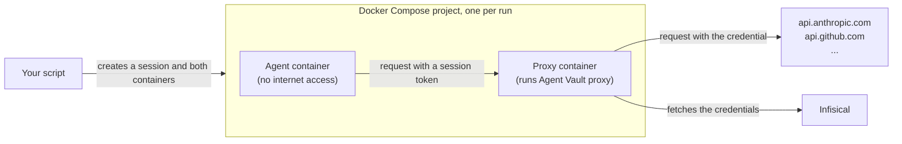

import SandboxAgentVaultSetup from "/snippets/agent-vault/SandboxAgentVaultSetup.mdx";

You can run an agent in a Docker container to keep it away from the rest of your machine. The agent still runs commands that a prompt can influence, so any API key you give the container can leak through a [prompt injection](/documentation/platform/agent-vault/why-agent-vault).

With Agent Vault, the agent's container has no API keys. Each run is its own Docker Compose project with two containers: one for an Agent Vault [proxy](/documentation/platform/agent-vault/proxies), and one for the agent. The agent's container is only on a private network with its proxy and can't reach the internet, so every request the agent makes goes through the proxy, and the proxy attaches the real credential to requests for the APIs you allowed.



For each run, your script does the following:

1. Creates an Agent Vault [session](/documentation/platform/agent-vault/sessions) for the run
2. Starts the proxy's container, then the agent's container with the session token
3. Stops the proxy when the agent finishes, so the proxy uploads the rest of the [session logs](/documentation/platform/agent-vault/session-logs)
4. Removes both containers and the run's network, then revokes the session

Every proxy starts from the same proxy token, so you create the proxy in Infisical once, no matter how many agents you run.

<Accordion title="Why not run the same proxy for every agent?">
  You can, as long as every agent's container is on a network with the proxy. This guide runs a proxy beside each agent instead, the same way the [Modal](/documentation/platform/agent-vault/guides/modal) and [Daytona](/documentation/platform/agent-vault/guides/daytona) guides do, so the proxy starts and stops with its run.

  Each run also gets its own private network, so nothing outside the run can send requests through its proxy.
</Accordion>

## Prerequisites

- The **Admin** role in [Agent Vault](/documentation/platform/agent-vault/access-control#product-membership)
- An [access bundle](/documentation/platform/agent-vault/access-bundles) with a service for each key the agent uses, including its model provider's key, such as **Anthropic** for Claude Code (see the [quickstart](/documentation/platform/agent-vault/quickstart))
- [Docker Engine](https://docs.docker.com/engine/install/) with [Docker Compose](https://docs.docker.com/compose/install/) v2, or [Docker Desktop](https://docs.docker.com/desktop/)
- [`curl`](https://curl.se) and [`jq`](https://jqlang.org) on the machine that runs Docker

## Step 1: Set up Agent Vault

<SandboxAgentVaultSetup />

## Step 2: Give your script the credentials

Set the following environment variables in the shell that runs your script:

```bash
export INFISICAL_AGENT_VAULT_PROXY_TOKEN=<proxy-token>
export INFISICAL_UNIVERSAL_AUTH_CLIENT_ID=<client-id>
export INFISICAL_UNIVERSAL_AUTH_CLIENT_SECRET=<client-secret>
```

Docker Compose passes the proxy token only to the proxy's container, and the machine identity's credentials never enter a container.

## Step 3: Write the agent's Dockerfile

Create a directory for the Compose project. In that directory, create a `Dockerfile` for the agent's image, which has the [Infisical CLI](/cli/overview) and your agent. This example installs Claude Code:

```dockerfile
# Dockerfile
FROM node:24-bookworm-slim
RUN apt-get update && apt-get install -y --no-install-recommends ca-certificates curl && rm -rf /var/lib/apt/lists/*
RUN npm install -g @infisical/cli@<cli-version> @anthropic-ai/claude-code
USER node
WORKDIR /home/node
ENTRYPOINT ["infisical", "agent-vault", "run", "--telemetry=false", "--"]
CMD ["claude", "-p", "--permission-mode", "bypassPermissions"]
```

- **Infisical CLI:** replace `<cli-version>` with `0.44.7` or later, because earlier versions can't start a proxy from a proxy token
- **The `node` user:** Claude Code won't skip its permission prompts as root, so the agent runs as the image's `node` user
- **The entrypoint:** `infisical agent-vault run` sends the agent's requests through the proxy, and the agent's command follows `--`

## Step 4: Define the containers

Create a `compose.yaml` file in the same directory:

```yaml compose.yaml expandable
services:
  agent-vault-proxy:
    image: infisical/cli:<cli-version>
    command: ["agent-vault", "proxy"]
    environment:
      INFISICAL_AGENT_VAULT_PROXY_TOKEN:
      INFISICAL_DOMAIN:
    networks: [agent, internet]
    healthcheck:
      # The proxy serves its certificate only after it has loaded its settings from Infisical.
      test: ["CMD", "wget", "-q", "-O", "/dev/null", "http://127.0.0.1:17323/_agent-vault/ca"]
      interval: 2s
      timeout: 3s
      retries: 3
      start_period: 60s

  agent:
    image: agent-vault-agent
    build: .
    environment:
      INFISICAL_AGENT_VAULT_PROXY_ADDRESS: agent-vault-proxy:17323
      INFISICAL_AGENT_VAULT_SESSION_TOKEN:
      # Claude Code won't start without a key; the proxy replaces this one.
      ANTHROPIC_API_KEY: agent-vault
      # Makes the fetch built into Node.js send requests through the proxy.
      NODE_USE_ENV_PROXY: "1"
      # Skips Claude Code's update checks and telemetry, which fail without internet access.
      CLAUDE_CODE_DISABLE_NONESSENTIAL_TRAFFIC: "1"
      DISABLE_AUTOUPDATER: "1"
    networks: [agent]
    depends_on:
      agent-vault-proxy:
        condition: service_healthy

networks:
  agent:
    internal: true
  internet: {}
```

Replace `<cli-version>` with the same version as in the `Dockerfile`. The file sets up the containers as follows:

- **Networks:** the `agent` network is `internal`, so containers on it can't reach the internet, and only the proxy is also on the `internet` network
- **Credentials:** the variables with no value, such as `INFISICAL_AGENT_VAULT_PROXY_TOKEN`, get their values from the shell that runs your script
- **Starting order:** Docker Compose starts the agent only after the proxy is ready

Then build the agent's image:

```bash
docker compose build
```

## Step 5: Run an agent

This script runs one prompt in a new Compose project. Create it in the same directory, and replace `<access-bundle-name>` at the top with your access bundle's name. If you use EU Cloud or self-host Infisical, also replace `https://app.infisical.com` with `https://eu.infisical.com` for EU Cloud or the URL of your self-hosted instance:

```bash run-agent.sh expandable
#!/bin/sh
set -eu

export INFISICAL_DOMAIN="https://app.infisical.com"
ACCESS_BUNDLE="<access-bundle-name>"
PROJECT="agent-run-$(date +%s)-$$"

ACCESS_TOKEN=$(curl -fsS "$INFISICAL_DOMAIN/api/v1/auth/universal-auth/login" \
  -H "Content-Type: application/json" \
  -d "{\"clientId\": \"$INFISICAL_UNIVERSAL_AUTH_CLIENT_ID\", \"clientSecret\": \"$INFISICAL_UNIVERSAL_AUTH_CLIENT_SECRET\"}" \
  | jq -r .accessToken)

# The ttl only needs to outlast the longest run, because the script revokes the session when the run ends.
SESSION=$(curl -fsS "$INFISICAL_DOMAIN/api/v1/agent-vault/sessions" \
  -H "Authorization: Bearer $ACCESS_TOKEN" \
  -H "Content-Type: application/json" \
  -d "{\"accessBundles\": [\"$ACCESS_BUNDLE\"], \"ttl\": \"20m\"}")
SESSION_ID=$(echo "$SESSION" | jq -r .session.id)

cleanup() {
  status=$?
  # Removing the containers deletes the proxy's log, so print it first if the run failed.
  [ "$status" -eq 0 ] || docker compose -p "$PROJECT" logs --no-log-prefix agent-vault-proxy || true
  # The down command doesn't remove the agent's container, so remove it first.
  docker rm -f "$PROJECT-agent" >/dev/null 2>&1 || true
  docker compose -p "$PROJECT" down || true
  curl -fsS -o /dev/null -X POST "$INFISICAL_DOMAIN/api/v1/agent-vault/sessions/$SESSION_ID/revoke" \
    -H "Authorization: Bearer $ACCESS_TOKEN"
}
trap cleanup EXIT
trap "exit 130" INT
trap "exit 143" TERM

export INFISICAL_AGENT_VAULT_SESSION_TOKEN=$(echo "$SESSION" | jq -r .session.token)
# Run the agent in the background so that canceling the script stops the agent right away.
echo "$1" | docker compose -p "$PROJECT" run --rm -T --name "$PROJECT-agent" agent &
wait $!
```

For more about creating sessions from code, see [Create sessions with the API](/documentation/platform/agent-vault/sessions-api). For the flags the agent starts with, see the [`agent-vault run` CLI reference](/cli/reference#agent-vault-run).

<Note>
To run a different agent, install it in [the agent's `Dockerfile`](#step-3-write-the-agent’s-dockerfile), replace the `CMD` with the agent's non-interactive command, such as `codex exec`, and replace the Claude Code settings in the agent's environment variables in `compose.yaml`.

For an agent you built yourself, run it the same way, or [set the proxy in its HTTP client](/documentation/platform/agent-vault/guides/custom-agent#step-4-send-requests-through-the-proxy).
</Note>

## Step 6: Verify it works

Make the script executable, then run it with a prompt that needs an API in the access bundle:

```bash
chmod +x run-agent.sh
./run-agent.sh "Reply with the word OK."
```

Claude Code replies, even though its container has no Anthropic API key and no internet access.

<Check>
  Each run now gets its own containers, network, and session. The only credential in the agent's container is a session token, and the script revokes the session when the run ends.
</Check>

To check which requests the agent made, [set up session logs](/documentation/platform/agent-vault/session-logs), then [view the session's logs](/documentation/platform/agent-vault/sessions#view-session-logs) in Agent Vault. Requests that got a credential have the outcome **Brokered**.

## Security considerations

### Network access from the agent's container

The agent's container can't reach the internet. It can't look up hostnames on the internet either, because on an internal network, Docker only answers DNS lookups for the names of containers. Under the default [traffic policy](/documentation/platform/agent-vault/proxies#traffic-policy), **Any host**, the proxy forwards the agent's requests to any host on the internet. To allow only the hosts of the services in the session's access bundle, set the traffic policy to **Access bundle hosts only**, and add any other hosts the agent needs, such as `registry.npmjs.org`, to the proxy's [exceptions](/documentation/platform/agent-vault/proxies#exceptions).

The agent can still connect to services on the Docker host that listen on all of the host's addresses, such as `0.0.0.0`, through the gateway address of the run's network. To keep the agent away from a service on the host, have the service listen only on `127.0.0.1`, or block traffic from Docker's networks to the host with a firewall rule.

### Isolation between containers

Docker containers share the host's kernel. If an agent escapes its container, it can read the proxy token and the machine identity's credentials from the host. If the agent runs code you don't trust, run its container with a stronger runtime, such as [gVisor](https://gvisor.dev/docs/user_guide/quick_start/docker/), or run the agent in a sandbox, such as [Modal](/documentation/platform/agent-vault/guides/modal) or [Daytona](/documentation/platform/agent-vault/guides/daytona).

### Compromised hosts

If you think someone took control of the machine that runs Docker, [rotate the proxy's token](/documentation/platform/agent-vault/proxies#rotate-a-proxy’s-token) and update `INFISICAL_AGENT_VAULT_PROXY_TOKEN` where your script runs. Then [create a new client secret](/documentation/platform/identities/universal-auth) for the machine identity and revoke the old one.

## Troubleshooting

<AccordionGroup>
  <Accordion title="The proxy doesn't start">
    The script fails with `dependency failed to start`, and prints the proxy's log. If the log says `The provided access token is malformed`, the proxy token is wrong. Check the following:

    - `INFISICAL_AGENT_VAULT_PROXY_TOKEN` has the current proxy token (a token stops working when you rotate it)
    - If you use EU Cloud or self-host Infisical, `INFISICAL_DOMAIN` in the script is the URL of your instance
    - The image tag in `compose.yaml` is an Infisical CLI version that can start a proxy from a proxy token
  </Accordion>
  <Accordion title="Requests fail with a 403 partway through a run">
    The session expired before the agent finished. Set the session's `ttl` in the script longer than your longest run.
  </Accordion>
  <Accordion title="Requests to a host fail with a 403 from the start">
    If the proxy's traffic policy is **Access bundle hosts only**, the proxy blocks hosts that no service in the access bundle covers. Add a service for the host, or add the host to the proxy's [exceptions](/documentation/platform/agent-vault/proxies#exceptions).
  </Accordion>
  <Accordion title="The agent says its API key is invalid">
    The agent has only a placeholder, so the error is about the key in the access bundle. The proxy's log shows `decision=brokered` and `status=401` for the provider's host. Update the key in the access bundle's service for that provider, such as **Anthropic** for Claude Code.
  </Accordion>
  <Accordion title="The proxy's log shows a 404 from api.anthropic.com">
    When Claude Code starts, it requests `/api/claude_code/settings` from `api.anthropic.com`, and the request can return a 404. Claude Code runs without the response, so you can ignore this line.
  </Accordion>
</AccordionGroup>

## Next steps

<CardGroup cols={2}>
  <Card title="Create sessions with the API" icon="key-round" href="/documentation/platform/agent-vault/sessions-api">
    Create a session for each agent run from your own code.
  </Card>
  <Card title="Session logs" icon="list" href="/documentation/platform/agent-vault/session-logs">
    Record every request an agent makes during a session.
  </Card>
</CardGroup>
