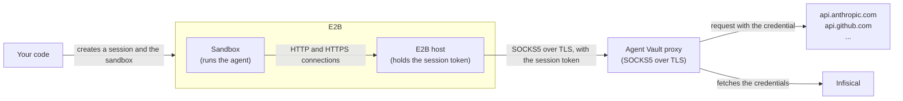

import SandboxAgentVaultSetup from "/snippets/agent-vault/SandboxAgentVaultSetup.mdx";

[E2B sandboxes](https://e2b.dev/docs/sandbox) are isolated virtual machines you create from code to run an agent. The agent in a sandbox runs commands that a prompt can influence, so any API key you give the sandbox can leak through a [prompt injection](/documentation/platform/agent-vault/why-agent-vault).

With Agent Vault, you don't give the sandbox any API keys. E2B's [bring your own proxy](https://e2b.dev/docs/network/byop) option sends the sandbox's outbound connections to a SOCKS5 proxy you run. You run an Agent Vault [proxy](/documentation/platform/agent-vault/proxies) with its SOCKS5 port turned on, and the proxy attaches the real credential to requests for the APIs you allowed.

E2B connects to the proxy from its own servers, not from inside the sandbox, so nothing in the sandbox is configured to use the proxy, and code in the sandbox can't route around it.



For each run, your code does the following:

1. Gets the proxy's certificate authority (CA) from Infisical
2. Creates an Agent Vault [session](/documentation/platform/agent-vault/sessions) for the run
3. Creates a sandbox that sends its traffic to the proxy, with the session token as the SOCKS5 password
4. Adds the proxy's CA to the sandbox's trust store, and runs the agent
5. Revokes the session and kills the sandbox when the agent finishes

One proxy serves every sandbox, so you set it up once.

<Accordion title="Why the proxy can face the internet here">
  E2B only connects to proxies that are reachable from the internet, so the proxy can't be on a private network. The setup in this guide keeps that safe:

  - **TLS on the SOCKS5 port:** The SOCKS5 port only accepts TLS, so the session token and the traffic are encrypted on the way to the proxy
  - **No token in the sandbox:** E2B holds the session token on its servers, so the agent can't read it
  - **Short sessions:** Your code creates a session for each run and revokes it when the run ends, so a leaked token only works until then
  - **A local HTTP port:** The proxy's HTTP port stays local to the proxy's machine, and only the SOCKS5 port is public
  - **Private destinations blocked:** Through the SOCKS5 port, the proxy refuses requests to private and internal addresses, such as cloud metadata endpoints, unless a service names the host

  You can also limit the SOCKS5 port with a firewall to the Google Cloud address ranges of E2B's region, as [E2B describes](https://e2b.dev/docs/faq/egress-ip-ranges). Other Google Cloud customers share those ranges, so the firewall adds to these protections rather than replacing them.
</Accordion>

## Prerequisites

- The **Admin** role in [Agent Vault](/documentation/platform/agent-vault/access-control#product-membership)
- An [access bundle](/documentation/platform/agent-vault/access-bundles) with a service for each key the agent uses, including its model provider's key, such as **Anthropic** for Claude Code (see the [quickstart](/documentation/platform/agent-vault/quickstart))
- An [E2B](https://e2b.dev) account with [bring your own proxy](https://e2b.dev/docs/network/byop) turned on (E2B lists it as a private beta, so you may need to ask E2B to turn it on), and an [E2B API key](https://e2b.dev/docs/api-key) in the `E2B_API_KEY` environment variable on the machine that runs your code
- The E2B SDK version 2.57.0 or later for your language: [Python](https://pypi.org/project/e2b/) (with [`requests`](https://pypi.org/project/requests/)) or [TypeScript](https://www.npmjs.com/package/e2b)
- A Linux machine or Kubernetes cluster to run the proxy, reachable from the internet, with a DNS name that points to it

## Step 1: Set up Agent Vault

<SandboxAgentVaultSetup />

## Step 2: Run the proxy on a public machine

Run the proxy where E2B can reach it from the internet, with its SOCKS5 port turned on. E2B runs sandboxes in Google Cloud's `us-west1` region by default, so a machine in or near that region adds the least latency to each request.

These commands turn on the SOCKS5 port, on port `1080`. With `--socks5-tls-name`, the proxy makes the port's TLS certificate from its CA for that DNS name. Replace `<proxy-dns-name>` with the machine's DNS name, and `<your-instance-url>` with the URL of your Infisical instance:

<Tabs>
  <Tab title="systemd">
    Save the token in `/etc/infisical/agent-vault-proxy.env`:

    ```bash
    INFISICAL_AGENT_VAULT_PROXY_TOKEN=<proxy-token>
    ```

    Run `sudo chmod 600 /etc/infisical/agent-vault-proxy.env` so that only root can read the file. Then save this unit as `/etc/systemd/system/agent-vault-proxy.service`:

    ```ini
    [Unit]
    Description=Infisical Agent Vault proxy
    After=network-online.target
    Wants=network-online.target

    [Service]
    EnvironmentFile=/etc/infisical/agent-vault-proxy.env
    ExecStart=/usr/local/bin/infisical agent-vault proxy --domain <your-instance-url> --listen-host 127.0.0.1 --socks5-port 1080 --socks5-tls-name <proxy-dns-name>
    Restart=always

    [Install]
    WantedBy=multi-user.target
    ```

    `--listen-host 127.0.0.1` keeps the HTTP port local to the machine. Run `sudo systemctl enable --now agent-vault-proxy` to start the proxy now and every time the machine boots.
  </Tab>
  <Tab title="Docker">
    ```bash
    docker run -d --name agent-vault-proxy --restart unless-stopped \
      -p 1080:1080 \
      -v agent-vault-proxy:/etc/infisical/agent-vault \
      -e INFISICAL_AGENT_VAULT_PROXY_TOKEN=<proxy-token> \
      infisical/cli agent-vault proxy \
      --domain <your-instance-url> \
      --socks5-port 1080 \
      --socks5-tls-name <proxy-dns-name>
    ```

    The command publishes only the SOCKS5 port. The HTTP port, `17323`, stays inside the container, so you don't need `--listen-host`.
  </Tab>
  <Tab title="Kubernetes">
    ```yaml expandable
    apiVersion: v1
    kind: Secret
    metadata:
      name: agent-vault-proxy
    type: Opaque
    stringData:
      INFISICAL_AGENT_VAULT_PROXY_TOKEN: <proxy-token>
    ---
    apiVersion: apps/v1
    kind: Deployment
    metadata:
      name: agent-vault-proxy
    spec:
      replicas: 2
      selector:
        matchLabels:
          app: agent-vault-proxy
      template:
        metadata:
          labels:
            app: agent-vault-proxy
        spec:
          containers:
            - name: agent-vault-proxy
              image: infisical/cli
              args:
                - agent-vault
                - proxy
                - --domain
                - <your-instance-url>
                - --socks5-port
                - "1080"
                - --socks5-tls-name
                - <proxy-dns-name>
              envFrom:
                - secretRef:
                    name: agent-vault-proxy
              ports:
                - containerPort: 1080
              readinessProbe:
                tcpSocket:
                  port: 1080
    ---
    apiVersion: v1
    kind: Service
    metadata:
      name: agent-vault-proxy
    spec:
      type: LoadBalancer
      selector:
        app: agent-vault-proxy
      ports:
        - port: 1080
          targetPort: 1080
    ```

    The Service exposes only the SOCKS5 port. Use a TCP (layer 4) load balancer, which passes the TLS connection through to the proxy. If the load balancer ends TLS itself, connections fail, because the SOCKS5 port only accepts TLS. Point `<proxy-dns-name>` at the load balancer's address.
  </Tab>
</Tabs>

To check that the proxy is up, such as in a load balancer's health check, open a TCP connection to port `1080`.

When the proxy starts, it logs `agent-vault: proxy listening`, with the proxy's ID in the `proxyId` field, then `agent-vault: SOCKS5 listening`. Copy the ID for [Step 4](#step-4-run-a-command-in-a-sandbox).

<Info>
  To serve a certificate you already have on the SOCKS5 port instead, pass `--socks5-tls-cert` and `--socks5-tls-key` in place of `--socks5-tls-name`. Then change the `tls` setting in [Step 4](#step-4-run-a-command-in-a-sandbox) to match the certificate:

  | Certificate on the SOCKS5 port | `tls` in your code |
  | --- | --- |
  | Made by the proxy, with `--socks5-tls-name` | The proxy's CA as `ca_cert` (`caCert` in TypeScript), as the code in Step 4 does |
  | Yours, from a publicly trusted CA | `True` in Python, or `true` in TypeScript, so E2B uses its trust store |
  | Yours, from a private CA | That CA's certificate as `ca_cert` (`caCert` in TypeScript) |

  Learn more about the [SOCKS5 port's certificate](/documentation/platform/agent-vault/proxies#certificate-for-the-socks5-port).
</Info>

## Step 3: Give your code the credentials

Set `INFISICAL_UNIVERSAL_AUTH_CLIENT_ID` and `INFISICAL_UNIVERSAL_AUTH_CLIENT_SECRET` to the machine identity's client ID and client secret, in the environment of the code that creates your sandboxes. Your code never passes these credentials to a sandbox.

The proxy token stays on the proxy's machine, so your code doesn't need it.

## Step 4: Run a command in a sandbox

This function runs one shell command in a new sandbox, and returns its output. Replace the values at the top:

- `<access-bundle-name>`: your access bundle's name
- `<proxy-id>`: the proxy's ID from [Step 2](#step-2-run-the-proxy-on-a-public-machine)
- `<proxy-dns-name>`: the proxy machine's DNS name
- `https://app.infisical.com`: if you use EU Cloud or self-host Infisical, the URL of your instance

<CodeGroup>

```python Python expandable
# run_in_sandbox.py
import os

import requests
from e2b import Sandbox

INFISICAL_URL = "https://app.infisical.com"
ACCESS_BUNDLE = "<access-bundle-name>"
PROXY_ID = "<proxy-id>"
PROXY_ADDRESS = "<proxy-dns-name>:1080"
TEMPLATE = "base"
SANDBOX_TIMEOUT = 15 * 60
SANDBOX_ENV = {}

CA_PATH = "/usr/local/share/ca-certificates/agent-vault-ca.crt"
# Points the tools that don't read the system trust store at the proxy's CA.
CA_ENV = {
    name: CA_PATH
    for name in ["SSL_CERT_FILE", "NODE_EXTRA_CA_CERTS", "REQUESTS_CA_BUNDLE", "CURL_CA_BUNDLE", "GIT_SSL_CAINFO", "DENO_CERT"]
}


def run_in_sandbox(command: str) -> str:
    # The machine identity's credentials stay here and never enter the sandbox.
    login = requests.post(
        f"{INFISICAL_URL}/api/v1/auth/universal-auth/login",
        json={
            "clientId": os.environ["INFISICAL_UNIVERSAL_AUTH_CLIENT_ID"],
            "clientSecret": os.environ["INFISICAL_UNIVERSAL_AUTH_CLIENT_SECRET"],
        },
        timeout=30,
    )
    login.raise_for_status()
    headers = {"Authorization": f"Bearer {login.json()['accessToken']}"}

    # Fetched on every run, because the CA changes when you rotate the proxy's token.
    ca_response = requests.get(f"{INFISICAL_URL}/api/v1/agent-vault/proxies/{PROXY_ID}/ca", headers=headers, timeout=30)
    ca_response.raise_for_status()
    ca = ca_response.json()["ca"]["certificate"]

    # One session per run. The ttl outlasts the sandbox's timeout, so the agent
    # can't lose access mid-run.
    created = requests.post(
        f"{INFISICAL_URL}/api/v1/agent-vault/sessions",
        headers=headers,
        json={"accessBundles": [ACCESS_BUNDLE], "ttl": "20m"},
        timeout=30,
    )
    created.raise_for_status()
    session = created.json()["session"]

    sandbox = None
    try:
        sandbox = Sandbox.create(
            template=TEMPLATE,
            timeout=SANDBOX_TIMEOUT,
            envs={**CA_ENV, **SANDBOX_ENV},
            network={
                # E2B sends the proxy hostnames instead of IP addresses only for
                # traffic that a domain entry in allow_out lets through.
                "allow_out": ["*"],
                "deny_out": ["0.0.0.0/0"],
                "egress_proxy": {
                    "address": PROXY_ADDRESS,
                    # The proxy ignores the username and reads the session token from the password.
                    "username": "x-agent-vault",
                    "password": session["token"],
                    "tls": {"ca_cert": ca},
                },
            },
        )
        sandbox.files.write("/tmp/agent-vault-ca.pem", ca)
        sandbox.commands.run(
            f"install -m 644 /tmp/agent-vault-ca.pem {CA_PATH} && update-ca-certificates",
            user="root",
        )
        result = sandbox.commands.run(command, timeout=SANDBOX_TIMEOUT - 60)
        return result.stdout
    finally:
        # Revoke first, so the session ends even if killing the sandbox fails.
        try:
            requests.post(
                f"{INFISICAL_URL}/api/v1/agent-vault/sessions/{session['id']}/revoke",
                headers=headers,
                timeout=30,
            ).raise_for_status()
        finally:
            if sandbox:
                sandbox.kill()
```

```typescript TypeScript expandable
// runInSandbox.ts
import { Sandbox } from "e2b";

const INFISICAL_URL = "https://app.infisical.com";
const ACCESS_BUNDLE = "<access-bundle-name>";
const PROXY_ID = "<proxy-id>";
const PROXY_ADDRESS = "<proxy-dns-name>:1080";
const TEMPLATE = "base";
const SANDBOX_TIMEOUT_MS = 15 * 60 * 1000;
const SANDBOX_ENV: Record<string, string> = {};

const CA_PATH = "/usr/local/share/ca-certificates/agent-vault-ca.crt";
// Points the tools that don't read the system trust store at the proxy's CA.
const CA_ENV = Object.fromEntries(
  ["SSL_CERT_FILE", "NODE_EXTRA_CA_CERTS", "REQUESTS_CA_BUNDLE", "CURL_CA_BUNDLE", "GIT_SSL_CAINFO", "DENO_CERT"].map(
    (name) => [name, CA_PATH],
  ),
);

async function infisical(
  path: string,
  { method = "POST", token, body }: { method?: string; token?: string; body?: unknown } = {},
) {
  const headers: Record<string, string> = {};
  if (token) headers.Authorization = `Bearer ${token}`;
  if (body !== undefined) headers["Content-Type"] = "application/json";
  const response = await fetch(`${INFISICAL_URL}${path}`, {
    method,
    headers,
    body: body === undefined ? undefined : JSON.stringify(body),
    signal: AbortSignal.timeout(30_000),
  });
  if (!response.ok) throw new Error(`Infisical returned ${response.status}: ${await response.text()}`);
  return response.json();
}

export async function runInSandbox(command: string): Promise<string> {
  // The machine identity's credentials stay here and never enter the sandbox.
  const { accessToken } = await infisical("/api/v1/auth/universal-auth/login", {
    body: {
      clientId: process.env.INFISICAL_UNIVERSAL_AUTH_CLIENT_ID,
      clientSecret: process.env.INFISICAL_UNIVERSAL_AUTH_CLIENT_SECRET,
    },
  });

  // Fetched on every run, because the CA changes when you rotate the proxy's token.
  const { ca } = await infisical(`/api/v1/agent-vault/proxies/${PROXY_ID}/ca`, { method: "GET", token: accessToken });

  // One session per run. The ttl outlasts the sandbox's timeout, so the agent
  // can't lose access mid-run.
  const { session } = await infisical("/api/v1/agent-vault/sessions", {
    token: accessToken,
    body: { accessBundles: [ACCESS_BUNDLE], ttl: "20m" },
  });

  let sandbox: Sandbox | undefined;
  try {
    sandbox = await Sandbox.create(TEMPLATE, {
      timeoutMs: SANDBOX_TIMEOUT_MS,
      envs: { ...CA_ENV, ...SANDBOX_ENV },
      network: {
        // E2B sends the proxy hostnames instead of IP addresses only for
        // traffic that a domain entry in allowOut lets through.
        allowOut: ["*"],
        denyOut: ["0.0.0.0/0"],
        egressProxy: {
          address: PROXY_ADDRESS,
          // The proxy ignores the username and reads the session token from the password.
          username: "x-agent-vault",
          password: session.token,
          tls: { caCert: ca.certificate },
        },
      },
    });
    await sandbox.files.write("/tmp/agent-vault-ca.pem", ca.certificate);
    await sandbox.commands.run(`install -m 644 /tmp/agent-vault-ca.pem ${CA_PATH} && update-ca-certificates`, {
      user: "root",
    });
    const result = await sandbox.commands.run(command, { timeoutMs: SANDBOX_TIMEOUT_MS - 60_000 });
    return result.stdout;
  } finally {
    // Revoke first, so the session ends even if killing the sandbox fails.
    try {
      await infisical(`/api/v1/agent-vault/sessions/${session.id}/revoke`, { token: accessToken });
    } finally {
      await sandbox?.kill();
    }
  }
}
```

</CodeGroup>

The function adds the proxy's CA to the sandbox's system trust store, and sets the variables that [`agent-vault run`](/documentation/platform/agent-vault/proxies#certificate-trust) sets for the tools that don't read that store.

To keep the same CA when you rotate the proxy's token, [use your own CA](/documentation/platform/agent-vault/proxies#use-your-own-certificate-authority). Infisical can't return your own CA, so with your own CA, read the certificate from a file instead of [getting it from Infisical](/api-reference/endpoints/agent-vault-proxies/get-ca). For more about creating sessions from code, see [Create sessions with the API](/documentation/platform/agent-vault/sessions-api).

## Step 5: Verify it works

Call the function with a request to an API in the access bundle. This example calls the Anthropic API, which returns a list of models only if the request has an API key. If your access bundle doesn't have an **Anthropic** service, replace the URL with an API it has a service for:

<CodeGroup>

```python Python
# main.py
from run_in_sandbox import run_in_sandbox

print(run_in_sandbox("curl -s https://api.anthropic.com/v1/models -H 'anthropic-version: 2023-06-01'"))
```

```typescript TypeScript
// main.ts
import { runInSandbox } from "./runInSandbox.js";

console.log(await runInSandbox("curl -s https://api.anthropic.com/v1/models -H 'anthropic-version: 2023-06-01'"));
```

</CodeGroup>

The response lists Anthropic's models, even though the sandbox has no Anthropic API key and no settings for the proxy.

<Check>
  Each run now gets its own sandbox and session. The session token never enters the sandbox, and your code revokes the session when the run ends.
</Check>

To check which requests the sandbox made, [set up session logs](/documentation/platform/agent-vault/session-logs), then [view the session's logs](/documentation/platform/agent-vault/sessions#view-session-logs) in Agent Vault. Requests that got a credential have the outcome **Brokered**.

## Step 6: Run an agent

To run an agent such as Claude Code, start the sandbox from an [E2B template](https://e2b.dev/docs/template/quickstart) that has the agent installed:

<Steps>
  <Step>
    Build an E2B template with the agent installed, and set `TEMPLATE` in the function to the template's name.
  </Step>
  <Step>
    Add the agent's settings to `SANDBOX_ENV`. For Claude Code, add these:

    <CodeGroup>

    ```python Python
    SANDBOX_ENV = {
        # Claude Code won't start without a key; the proxy replaces this one.
        "ANTHROPIC_API_KEY": "agent-vault",
        # Skips Claude Code's update checks and telemetry, which a proxy limited to
        # access bundle hosts blocks.
        "CLAUDE_CODE_DISABLE_NONESSENTIAL_TRAFFIC": "1",
        "DISABLE_AUTOUPDATER": "1",
    }
    ```

    ```typescript TypeScript
    const SANDBOX_ENV: Record<string, string> = {
      // Claude Code won't start without a key; the proxy replaces this one.
      ANTHROPIC_API_KEY: "agent-vault",
      // Skips Claude Code's update checks and telemetry, which a proxy limited to
      // access bundle hosts blocks.
      CLAUDE_CODE_DISABLE_NONESSENTIAL_TRAFFIC: "1",
      DISABLE_AUTOUPDATER: "1",
    };
    ```

    </CodeGroup>
  </Step>
  <Step>
    Call the function with the agent's non-interactive command, such as `claude -p 'Reply with the word OK.' --permission-mode bypassPermissions`.
  </Step>
</Steps>

The agent calls its APIs the same way it does without Agent Vault, and E2B sends the connections to the proxy, so the agent doesn't need `HTTPS_PROXY` or `infisical agent-vault run`.

## Security considerations

### Network access from the sandbox

The sandbox can look up hostnames over DNS at `8.8.8.8`, which E2B lets through without the proxy. Every other connection goes through the proxy:

- **Hosts through the proxy:** with **Access bundle hosts only**, the sandbox can reach the hosts that services in the session's access bundle cover, and the proxy's [exceptions](/documentation/platform/agent-vault/proxies#exceptions)
- **Ports:** E2B only sends connections on ports `80` and `443` to the proxy, so the sandbox can't reach a service on any other port

### Compromised sandboxes or leaked tokens

The session token is in your code and in E2B's settings for the sandbox, not in the sandbox. If you think a session token leaked, [revoke the session](/documentation/platform/agent-vault/sessions#revoke-a-session).

The proxy token is only on the proxy's machine. If you think someone took control of that machine, [rotate the proxy's token](/documentation/platform/agent-vault/proxies#rotate-a-proxys-token).

## Troubleshooting

<AccordionGroup>
  <Accordion title="Requests reach the API, but without a credential">
    E2B sent the proxy an IP address instead of a hostname, so no service matched the request. E2B only sends hostnames for traffic that a domain entry allows, so create the sandbox with `allow_out` set to `["*"]` and `deny_out` set to `["0.0.0.0/0"]`, as the function in [Step 4](#step-4-run-a-command-in-a-sandbox) does.
  </Accordion>
  <Accordion title="Connections from the sandbox fail right away">
    The proxy refused the connection before any request. Check the proxy's log for one of these lines:

    - `agent-vault: refused, the session is no longer valid`: the session expired or was revoked
    - `agent-vault: a client spoke plain SOCKS5 to the TLS port`: the sandbox's `egress_proxy` has no `tls` setting

    If neither line appears, the password might not be a session token, or E2B might not trust the SOCKS5 port's certificate. Start the proxy with `--log-level debug` to log these refusals too.
  </Accordion>
  <Accordion title="Requests fail with a 403 partway through a run">
    The session expired or was revoked while the sandbox was running. Set the session's `ttl` a few minutes longer than the sandbox's timeout, so the session lasts as long as the sandbox can run.
  </Accordion>
  <Accordion title="Requests to a host fail with a 403 from the start">
    The proxy's traffic policy blocks hosts that no service in the access bundle covers. Add a service for the host, or add the host to the proxy's [exceptions](/documentation/platform/agent-vault/proxies#exceptions).
  </Accordion>
  <Accordion title="A service on a port other than 80 or 443 doesn't work">
    E2B only sends connections on ports `80` and `443` to the proxy. Use the service's HTTPS endpoint on port `443` instead.
  </Accordion>
  <Accordion title="A tool in the sandbox rejects the proxy's certificate">
    The tool doesn't read the system trust store or the variables the function sets. Java programs use their own keystore, and some Rust programs have a built-in certificate list. Add the proxy's CA to the tool's own trust settings.
  </Accordion>
  <Accordion title="The sandbox's traffic stops going through the proxy">
    Updating a running sandbox's network settings with `update_network` (`updateNetwork` in TypeScript) replaces all of them. If the update doesn't include `egress_proxy`, E2B sends the sandbox's traffic out directly. Include the same `egress_proxy`, with its `tls` setting, in every update.
  </Accordion>
  <Accordion title="Getting the CA from Infisical fails with a 409">
    The proxy serves your own CA, which Infisical doesn't have. [With your own CA](/documentation/platform/agent-vault/proxies#use-your-own-certificate-authority), read the certificate you passed with `--ca-cert` from a file instead.
  </Accordion>
</AccordionGroup>

## Next steps

<CardGroup cols={2}>
  <Card title="Proxies" icon="server" href="/documentation/platform/agent-vault/proxies#accept-connections-over-socks5">
    Learn more about the proxy's SOCKS5 port and its settings.
  </Card>
  <Card title="Session logs" icon="list" href="/documentation/platform/agent-vault/session-logs">
    Record every request an agent makes during a session.
  </Card>
</CardGroup>
