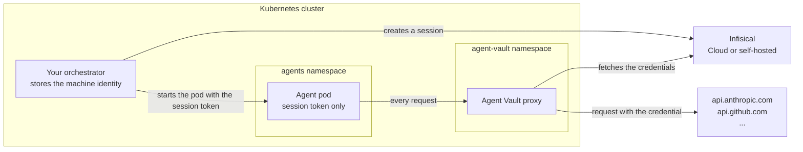

You can run AI agents on Kubernetes, with each agent run in its own pod. An agent runs commands that a prompt can influence, so if you give its pod an API key, such as from a Kubernetes Secret, the key can leak through a [prompt injection](/documentation/platform/agent-vault/why-agent-vault). With Agent Vault, agent pods contain no API keys. Each pod receives a [session](/documentation/platform/agent-vault/sessions) token instead, and sends its requests through an Agent Vault [proxy](/documentation/platform/agent-vault/proxies) that attaches the real credentials.

This page explains how the pieces fit together in a cluster and how to choose an isolation level for agent pods.

<Card title="Set up Agent Vault on Kubernetes" icon="ship" href="/documentation/platform/agent-vault/guides/kubernetes-setup" horizontal>
  Deploy the proxy, lock agent pods to it, and start an agent with its own session.
</Card>

## How the pieces fit together

| Piece | Where it runs | Credentials it stores |
|---|---|---|
| Agent Vault proxy | A Deployment in its own namespace | The proxy token |
| Agent pods | A namespace for agents, one pod per agent run | Only the session token for that run |
| Your orchestrator | Outside the agents namespace | A [machine identity](/documentation/platform/identities/machine-identities) that creates a session for each agent run |

You need an orchestrator: a program that starts each agent run. It can be a script, a job in your CI pipeline or job runner, or a Kubernetes controller.

For each agent run, your orchestrator does the following:

1. Creates a session for the run with the [Infisical API](/documentation/platform/agent-vault/sessions-api)
2. Starts the agent's pod with the session token
3. Revokes the session and deletes the pod when the agent finishes

<Warning>
  Agent pods can only be limited to the proxy if your cluster's network plugin enforces network policies, such as [Cilium](https://cilium.io) or [Calico](https://www.tigera.io/project-calico/). Some network plugins, such as Flannel, accept network policies without enforcing them.
</Warning>

<AccordionGroup>
  <Accordion title="Why does the proxy run in its own namespace?">
    A network policy applies to a whole pod. A proxy in the agent's pod would need a route to the internet that the agent could also use, and its proxy token would sit beside the agent.
  </Accordion>
  <Accordion title="Why can agent pods only reach the proxy?">
    Code in the agent's container can ignore `HTTPS_PROXY` and connect to an API directly. With a network policy that only allows the proxy, every request must go through Agent Vault. This also blocks your cloud's metadata service and the Kubernetes API.
  </Accordion>
  <Accordion title="Why does the machine identity stay out of agent pods?">
    Your orchestrator uses the machine identity to create sessions, and the machine identity can create a session for any access bundle it has access to. If the machine identity's credentials were in an agent's pod, the agent could use them to create a session for an access bundle it wasn't given. A separate container in the agent's pod doesn't keep the credentials out of reach, because gVisor and Kata isolate a pod from the node, not one container from another. An agent pod gets only a session token, which you can revoke and which expires.
  </Accordion>
  <Accordion title="Can I use Agent Sandbox instead of writing pod manifests?">
    Yes. [Agent Sandbox](https://github.com/kubernetes-sigs/agent-sandbox) is an official Kubernetes project with custom resources for agent sandboxes, such as `SandboxTemplate`, `SandboxClaim`, and `SandboxWarmPool`. Its sandboxes are pods, so the proxy and the agents namespace work the same way, with these differences:

    - **Session tokens:** a `SandboxTemplate` serves every claim, so your orchestrator has to deliver each sandbox's session token after its claim binds
    - **Warm pools:** pods in a `SandboxWarmPool` start before any session exists, so they also get their session token after the claim binds
    - **Network policies:** a network policy that the Agent Sandbox controller creates can allow traffic that the agents namespace's policy blocks, so turn it off or limit it to the proxy, then [check direct egress](/documentation/platform/agent-vault/guides/kubernetes-setup#step-7-verify-it-works)
  </Accordion>
</AccordionGroup>

## Choose an isolation level

A standard container shares the node's Linux kernel. If an agent ran code that exploited a bug in that kernel, the code could reach the node and every pod on it. To give agent pods a stronger boundary, run them with a different container runtime by setting `runtimeClassName` in the pod spec. Everything else on this page stays the same at every isolation level.

| | Standard runtime | gVisor | Kata Containers |
|---|---|---|---|
| Boundary | Shares the node's kernel | A kernel that runs in user space handles the agent's system calls | Each pod runs in its own lightweight virtual machine |
| Use it when | Agents only run tools and code you trust | Agents run generated or downloaded code | Agents run code from untrusted sources, or from several customers on the same nodes |
| What the nodes need | Nothing | [gVisor](https://gvisor.dev/docs/user_guide/containerd/quick_start/) installed and registered with containerd, and a RuntimeClass | Hardware virtualization, [Kata Containers](https://github.com/kata-containers/kata-containers/blob/main/docs/install/README.md) installed, and a RuntimeClass |
| Managed options | Every cluster | [GKE Sandbox](https://cloud.google.com/kubernetes-engine/docs/concepts/sandbox-pods) | [AKS Pod Sandboxing](https://learn.microsoft.com/en-us/azure/aks/use-pod-sandboxing) |
| Costs | None | Slower file and network I/O, and some system calls aren't supported, so some software won't run | More memory per pod and slower pod startup |

<Warning>
  Kata Containers only runs on nodes with hardware virtualization (KVM), and most cloud VMs don't provide it:

  - **Supported:** bare metal nodes, such as EC2 `.metal` instance types, and VMs with nested virtualization turned on, such as Google Compute Engine N2 or C3 VMs created with `--enable-nested-virtualization`
  - **Not supported:** standard EC2 instance types, EKS on Fargate, and GKE Autopilot

  To check a node, run `ls /dev/kvm` on it. If the file doesn't exist, Kata pods can't start on that node.
</Warning>

An isolation level limits what a process can reach after it escapes its container. It doesn't limit what requests the agent can make with its session's access. Agent Vault and the network policies control that access.

## Next steps

<CardGroup cols={2}>
  <Card title="Set up on Kubernetes" icon="ship" href="/documentation/platform/agent-vault/guides/kubernetes-setup">
    Deploy the proxy, lock agent pods to it, and start an agent with its own session.
  </Card>
  <Card title="Create sessions with the API" icon="code" href="/documentation/platform/agent-vault/sessions-api">
    Create and revoke a session for each agent run from your orchestrator.
  </Card>
</CardGroup>
