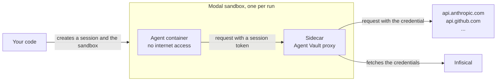

import MachineIdentitySetup from "/snippets/agent-vault/MachineIdentitySetup.mdx";

[Modal sandboxes](https://modal.com/docs/guide/sandboxes) are containers you create from code to run an agent. The agent in a sandbox runs commands that a prompt can influence, so any API key you give the sandbox can leak through a [prompt injection](/documentation/platform/agent-vault/why-agent-vault).

With Agent Vault, you don't give the sandbox any API keys. Each sandbox runs an Agent Vault [proxy](/documentation/platform/agent-vault/proxies) in a [sidecar](https://modal.com/docs/guide/sandbox-sidecars), a second container in the same sandbox. The agent's container can't reach the internet directly, so every request it makes goes through the proxy, and the proxy attaches the real credential to requests for the APIs you allowed.



For each run, your code does the following:

1. Creates an Agent Vault [session](/documentation/platform/agent-vault/sessions) for the run
2. Creates a sandbox with no internet access, and starts the proxy in a sidecar
3. Starts the agent in the sandbox with the session token
4. Revokes the session and terminates the sandbox when the agent finishes

Every sidecar starts its proxy from the same proxy token, so you create the proxy in Infisical once, no matter how many sandboxes you run.

<Accordion title="Why not run one proxy with every sandbox pointing at it?">
  A proxy outside the sandbox doesn't work well on Modal:

  - Modal can place sandboxes in the same region on different clouds, and its private network doesn't connect sandboxes across clouds, so a proxy in another sandbox can't reach every agent
  - A sandbox can only allow a hostname for HTTPS on port 443, and the proxy listens for plain HTTP on port 17323, so you'd have to allow the proxy by a fixed IPv4 address
  - If the proxy is reachable from the internet, anyone who gets a session token can use it from anywhere until the session ends

  A sidecar is only reachable from its own sandbox, so nothing outside the sandbox can send requests through it.
</Accordion>

## Prerequisites

- The **Admin** role in [Agent Vault](/documentation/platform/agent-vault/access-control#product-membership)
- A [Modal](https://modal.com) account, with a [Modal token](https://modal.com/docs/reference/cli/token) on the machine that runs your code (run `modal setup`, or set `MODAL_TOKEN_ID` and `MODAL_TOKEN_SECRET`)
- The Modal SDK for your language: the [`modal`](https://pypi.org/project/modal/) and [`requests`](https://pypi.org/project/requests/) packages for Python, the [`modal`](https://www.npmjs.com/package/modal) package for TypeScript, or the [Modal Go SDK](https://pkg.go.dev/github.com/modal-labs/modal-client/go)
- The API keys your agent uses, such as your Anthropic API key

## Step 1: Set up Agent Vault

### Create an access bundle

Create an [access bundle](/documentation/platform/agent-vault/access-bundles) that contains a [service](/documentation/platform/agent-vault/services) for each API the agent calls.

<Steps>
  <Step>
    In Infisical, open **Agent Vault** from the product switcher and go to **Access Bundles**.
  </Step>
  <Step>
    Select **Create Access Bundle**. Give the access bundle a **Name**, such as `modal-agent`, then select **Create Access Bundle**.
  </Step>
  <Step>
    Select the access bundle you just created, then select **Add Service**.
  </Step>
  <Step>
    On the **Choose a template** panel, pick the template for the API, such as **Anthropic**, or select **Custom**.
  </Step>
  <Step>
    On the **Details** step, check the hosts the service covers, or enter the API's host if you selected **Custom**, then select **Continue**.
  </Step>
  <Step>
    On the **Credential** step, paste the real API key.

    <Note>
      If the API expects the key somewhere other than a header, such as in the URL, [add a substitution](/documentation/platform/agent-vault/services#add-a-substitution) instead, and have the agent send the placeholder you enter in **Replace**.
    </Note>
  </Step>
  <Step>
    Select **Add Service**. Repeat from the third step for each remaining API.
  </Step>
</Steps>

### Create a proxy

<Steps>
  <Step>
    In Agent Vault, go to **Proxies** and select **Create Proxy**.
  </Step>
  <Step>
    Enter a **Name**, such as `modal-sandboxes`, and expand **Advanced Options**. Under **Traffic Policy**, choose **Access bundle hosts only**, and add any hosts the agent needs without a credential to **Exceptions**, such as `registry.npmjs.org`.

    The sidecar can reach the internet, so with **Any host**, the agent could send requests through the proxy to any host. Learn more about the [traffic policy](/documentation/platform/agent-vault/proxies#traffic-policy).
  </Step>
  <Step>
    Select **Create**, then copy the proxy token from the **Proxy Token** dialog. Infisical shows the token only once.
  </Step>
</Steps>

### Create a machine identity for your code

Your code creates a session for each run as a [machine identity](/documentation/platform/identities/machine-identities). Give the machine identity the **Member** role and access to only this access bundle, because an Agent Vault admin can create sessions for every access bundle.

<MachineIdentitySetup />

## Step 2: Store the credentials

The proxy token and the machine identity's credentials stay out of the agent's container.

### Store the proxy token in Modal

In the Modal dashboard, create a [custom secret](https://modal.com/docs/guide/secrets) named `agent-vault-proxy` with this key, set to the proxy token:

```text
INFISICAL_AGENT_VAULT_PROXY_TOKEN
```

Only the sidecar gets the `agent-vault-proxy` secret. Modal runs each sidecar in its own container with its own kernel, so the agent can't read the sidecar's environment or files.

<Info>
If you use EU Cloud or self-host Infisical, add this key as well:

```text
INFISICAL_DOMAIN
```

Set the key to `https://eu.infisical.com` for EU Cloud, or the URL of your self-hosted instance.
</Info>

### Give your code the machine identity's credentials

Set `INFISICAL_UNIVERSAL_AUTH_CLIENT_ID` and `INFISICAL_UNIVERSAL_AUTH_CLIENT_SECRET` in the environment of the code that starts your sandboxes.

## Step 3: Build the sandbox image

The agent's container and the sidecar use the same image, which has the [Infisical CLI](/cli/overview) and your agent. This example installs Claude Code:

<CodeGroup>

```python Python
# sandbox_image.py
import modal

app = modal.App.lookup("agent-vault-sandboxes", create_if_missing=True)

image = modal.Image.from_registry("node:24-bookworm-slim").dockerfile_commands(
    [
        "RUN apt-get update && apt-get install -y --no-install-recommends ca-certificates curl && rm -rf /var/lib/apt/lists/*",
        "RUN npm install -g @infisical/cli@<cli-version> @anthropic-ai/claude-code",
        "RUN useradd --create-home --uid 2000 agent",
    ]
).build(app)
```

```typescript TypeScript
// sandboxImage.ts
import { ModalClient } from "modal";

export const modal = new ModalClient();

export const app = await modal.apps.fromName("agent-vault-sandboxes", { createIfMissing: true });

export const image = await modal.images
  .fromRegistry("node:24-bookworm-slim")
  .dockerfileCommands([
    "RUN apt-get update && apt-get install -y --no-install-recommends ca-certificates curl && rm -rf /var/lib/apt/lists/*",
    "RUN npm install -g @infisical/cli@<cli-version> @anthropic-ai/claude-code",
    "RUN useradd --create-home --uid 2000 agent",
  ])
  .build(app);
```

```go Go
// sandbox_image.go
package main

import (
	"context"

	modal "github.com/modal-labs/modal-client/go"
)

func buildImage(ctx context.Context, mc *modal.Client) (*modal.App, *modal.Image, error) {
	app, err := mc.Apps.FromName(ctx, "agent-vault-sandboxes", &modal.AppFromNameParams{CreateIfMissing: true})
	if err != nil {
		return nil, nil, err
	}
	image, err := mc.Images.FromRegistry("node:24-bookworm-slim", nil).DockerfileCommands([]string{
		"RUN apt-get update && apt-get install -y --no-install-recommends ca-certificates curl && rm -rf /var/lib/apt/lists/*",
		"RUN npm install -g @infisical/cli@<cli-version> @anthropic-ai/claude-code",
		"RUN useradd --create-home --uid 2000 agent",
	}, nil).Build(ctx, app, nil)
	if err != nil {
		return nil, nil, err
	}
	return app, image, nil
}
```

</CodeGroup>

- **Infisical CLI:** replace `<cli-version>` with `<min-cli-version>` or later, because earlier versions can't start a proxy from a proxy token
- **The `agent` user:** Modal runs commands as root, and Claude Code won't skip its permission prompts as root, so the agent runs as this user
- **Building the image first:** Modal can't build a sidecar's image when it starts the sidecar, so the code builds the image before it creates any sandbox

## Step 4: Run an agent in a sandbox

This function runs one prompt in a new sandbox. Replace `<access-bundle-name>` at the top with your access bundle's name. If you use EU Cloud or self-host Infisical, also replace `https://app.infisical.com` with `https://eu.infisical.com` for EU Cloud or the URL of your self-hosted instance:

<CodeGroup>

```python Python expandable
# run_agent.py
import os

import modal
import requests

from sandbox_image import app, image

INFISICAL_URL = "https://app.infisical.com"
ACCESS_BUNDLE = "<access-bundle-name>"

WAIT_FOR_PROXY = (
    "for i in $(seq 60); do "
    "curl -fs http://agent-proxy:17323/_agent-vault/ca > /dev/null && exit 0; "
    "sleep 0.5; done; exit 1"
)

# Reads the session token from the first line of stdin, and leaves the rest of
# stdin, the prompt, for Claude Code.
START_AGENT = r"""
IFS= read -r INFISICAL_AGENT_VAULT_SESSION_TOKEN
export INFISICAL_AGENT_VAULT_SESSION_TOKEN
exec infisical agent-vault run --telemetry=false --proxy agent-proxy:17323 \
  -- claude -p --permission-mode bypassPermissions
"""

AGENT_ENV = {
    # Claude Code won't start without a key; the proxy replaces this one.
    "ANTHROPIC_API_KEY": "agent-vault",
    # Makes the fetch built into Node.js send requests through the proxy.
    "NODE_USE_ENV_PROXY": "1",
    # Skips Claude Code's update checks and telemetry, which fail without internet access.
    "CLAUDE_CODE_DISABLE_NONESSENTIAL_TRAFFIC": "1",
    "DISABLE_AUTOUPDATER": "1",
}


def run_agent(prompt: str) -> str:
    # The machine identity's credentials stay here and never enter the sandbox.
    login = requests.post(
        f"{INFISICAL_URL}/api/v1/auth/universal-auth/login",
        json={
            "clientId": os.environ["INFISICAL_UNIVERSAL_AUTH_CLIENT_ID"],
            "clientSecret": os.environ["INFISICAL_UNIVERSAL_AUTH_CLIENT_SECRET"],
        },
        timeout=30,
    )
    login.raise_for_status()
    headers = {"Authorization": f"Bearer {login.json()['accessToken']}"}

    # One session per run. The ttl outlasts the sandbox's 15-minute timeout, so
    # the agent can't lose access mid-run.
    created = requests.post(
        f"{INFISICAL_URL}/api/v1/agent-vault/sessions",
        headers=headers,
        json={"accessBundles": [ACCESS_BUNDLE], "ttl": "20m"},
        timeout=30,
    )
    created.raise_for_status()
    session = created.json()["session"]

    sandbox = None
    try:
        sandbox = modal.Sandbox.create(
            "sleep",
            "infinity",
            app=app,
            image=image,
            timeout=15 * 60,
            # An empty allowlist blocks the internet but not the sidecar.
            outbound_cidr_allowlist=[],
        )
        # The agent reaches the proxy at agent-proxy:17323. Nothing outside the
        # sandbox can reach it.
        proxy = sandbox._experimental_sidecars.create(
            "sh",
            "-c",
            # If the proxy exits, the sidecar stays up so its log can still be read.
            "infisical agent-vault proxy > /tmp/proxy.log 2>&1 || sleep 600",
            name="agent-proxy",
            image=image,
            secrets=[modal.Secret.from_name("agent-vault-proxy")],
        )
        # The proxy serves only after it has loaded its settings from Infisical.
        if sandbox.exec("sh", "-c", WAIT_FOR_PROXY).wait() != 0:
            log = proxy.filesystem.read_text("/tmp/proxy.log")
            raise RuntimeError(f"The Agent Vault proxy didn't start:\n{log}")

        # Claude Code won't skip its permission prompts as root, which is how
        # Modal runs commands.
        agent = sandbox.exec(
            "runuser", "-u", "agent", "--", "sh", "-c", START_AGENT,
            env=AGENT_ENV,
            workdir="/home/agent",
        )
        # Modal shows each command's arguments in its dashboard, so the token
        # and the prompt go on stdin instead.
        agent.stdin.write(session["token"] + "\n" + prompt)
        agent.stdin.write_eof()
        agent.stdin.drain()
        output = agent.stdout.read()
        if agent.wait() != 0:
            raise RuntimeError(f"The agent failed:\n{agent.stderr.read()}")
        return output
    finally:
        # Revoke first, so the session ends even if terminating fails.
        try:
            requests.post(
                f"{INFISICAL_URL}/api/v1/agent-vault/sessions/{session['id']}/revoke",
                headers=headers,
                timeout=30,
            ).raise_for_status()
        finally:
            if sandbox:
                sandbox.terminate()
```

```typescript TypeScript expandable
// runAgent.ts
import type { Sandbox } from "modal";

import { app, image, modal } from "./sandboxImage.js";

const INFISICAL_URL = "https://app.infisical.com";
const ACCESS_BUNDLE = "<access-bundle-name>";

const WAIT_FOR_PROXY =
  "for i in $(seq 60); do " +
  "curl -fs http://agent-proxy:17323/_agent-vault/ca > /dev/null && exit 0; " +
  "sleep 0.5; done; exit 1";

// Reads the session token from the first line of stdin, and leaves the rest of
// stdin, the prompt, for Claude Code.
const START_AGENT = String.raw`
IFS= read -r INFISICAL_AGENT_VAULT_SESSION_TOKEN
export INFISICAL_AGENT_VAULT_SESSION_TOKEN
exec infisical agent-vault run --telemetry=false --proxy agent-proxy:17323 \
  -- claude -p --permission-mode bypassPermissions
`;

const AGENT_ENV = {
  // Claude Code won't start without a key; the proxy replaces this one.
  ANTHROPIC_API_KEY: "agent-vault",
  // Makes the fetch built into Node.js send requests through the proxy.
  NODE_USE_ENV_PROXY: "1",
  // Skips Claude Code's update checks and telemetry, which fail without internet access.
  CLAUDE_CODE_DISABLE_NONESSENTIAL_TRAFFIC: "1",
  DISABLE_AUTOUPDATER: "1",
};

async function infisical(path: string, { token, body }: { token?: string; body?: unknown } = {}) {
  const headers: Record<string, string> = {};
  if (token) headers.Authorization = `Bearer ${token}`;
  if (body !== undefined) headers["Content-Type"] = "application/json";
  const response = await fetch(`${INFISICAL_URL}${path}`, {
    method: "POST",
    headers,
    body: body === undefined ? undefined : JSON.stringify(body),
    signal: AbortSignal.timeout(30_000),
  });
  if (!response.ok) throw new Error(`Infisical returned ${response.status}: ${await response.text()}`);
  return response.json();
}

export async function runAgent(prompt: string): Promise<string> {
  // The machine identity's credentials stay here and never enter the sandbox.
  const { accessToken } = await infisical("/api/v1/auth/universal-auth/login", {
    body: {
      clientId: process.env.INFISICAL_UNIVERSAL_AUTH_CLIENT_ID,
      clientSecret: process.env.INFISICAL_UNIVERSAL_AUTH_CLIENT_SECRET,
    },
  });

  // One session per run. The ttl outlasts the sandbox's 15-minute timeout, so
  // the agent can't lose access mid-run.
  const { session } = await infisical("/api/v1/agent-vault/sessions", {
    token: accessToken,
    body: { accessBundles: [ACCESS_BUNDLE], ttl: "20m" },
  });

  let sandbox: Sandbox | undefined;
  try {
    sandbox = await modal.sandboxes.create(app, image, {
      command: ["sleep", "infinity"],
      timeoutMs: 15 * 60 * 1000,
      // An empty allowlist blocks the internet but not the sidecar.
      outboundCidrAllowlist: [],
    });
    // The agent reaches the proxy at agent-proxy:17323. Nothing outside the
    // sandbox can reach it.
    const proxy = await sandbox.experimentalSidecars.create("agent-proxy", image, {
      // If the proxy exits, the sidecar stays up so its log can still be read.
      command: ["sh", "-c", "infisical agent-vault proxy > /tmp/proxy.log 2>&1 || sleep 600"],
      secrets: [await modal.secrets.fromName("agent-vault-proxy")],
    });
    // The proxy serves only after it has loaded its settings from Infisical.
    const wait = await sandbox.exec(["sh", "-c", WAIT_FOR_PROXY]);
    if ((await wait.wait()) !== 0) {
      const log = await proxy.filesystem.readText("/tmp/proxy.log");
      throw new Error(`The Agent Vault proxy didn't start:\n${log}`);
    }

    // Claude Code won't skip its permission prompts as root, which is how
    // Modal runs commands.
    const agent = await sandbox.exec(["runuser", "-u", "agent", "--", "sh", "-c", START_AGENT], {
      env: AGENT_ENV,
      workdir: "/home/agent",
    });
    // Modal shows each command's arguments in its dashboard, so the token
    // and the prompt go on stdin instead.
    await agent.stdin.writeText(`${session.token}\n${prompt}`);
    await agent.stdin.close();
    const output = await agent.stdout.readText();
    if ((await agent.wait()) !== 0) {
      throw new Error(`The agent failed:\n${await agent.stderr.readText()}`);
    }
    return output;
  } finally {
    // Revoke first, so the session ends even if terminating fails.
    try {
      await infisical(`/api/v1/agent-vault/sessions/${session.id}/revoke`, { token: accessToken });
    } finally {
      await sandbox?.terminate();
    }
  }
}
```

```go Go expandable
// run_agent.go
package main

import (
	"bytes"
	"context"
	"encoding/json"
	"errors"
	"fmt"
	"io"
	"net/http"
	"os"
	"time"

	modal "github.com/modal-labs/modal-client/go"
)

const (
	infisicalURL = "https://app.infisical.com"
	accessBundle = "<access-bundle-name>"
)

const waitForProxy = "for i in $(seq 60); do " +
	"curl -fs http://agent-proxy:17323/_agent-vault/ca > /dev/null && exit 0; " +
	"sleep 0.5; done; exit 1"

// Reads the session token from the first line of stdin, and leaves the rest of
// stdin, the prompt, for Claude Code.
const startAgent = `
IFS= read -r INFISICAL_AGENT_VAULT_SESSION_TOKEN
export INFISICAL_AGENT_VAULT_SESSION_TOKEN
exec infisical agent-vault run --telemetry=false --proxy agent-proxy:17323 \
  -- claude -p --permission-mode bypassPermissions
`

var agentEnv = map[string]string{
	// Claude Code won't start without a key; the proxy replaces this one.
	"ANTHROPIC_API_KEY": "agent-vault",
	// Makes the fetch built into Node.js send requests through the proxy.
	"NODE_USE_ENV_PROXY": "1",
	// Skips Claude Code's update checks and telemetry, which fail without internet access.
	"CLAUDE_CODE_DISABLE_NONESSENTIAL_TRAFFIC": "1",
	"DISABLE_AUTOUPDATER":                      "1",
}

func infisical(ctx context.Context, path, token string, body, out any) error {
	var reader io.Reader
	if body != nil {
		encoded, err := json.Marshal(body)
		if err != nil {
			return err
		}
		reader = bytes.NewReader(encoded)
	}
	ctx, cancel := context.WithTimeout(ctx, 30*time.Second)
	defer cancel()
	req, err := http.NewRequestWithContext(ctx, http.MethodPost, infisicalURL+path, reader)
	if err != nil {
		return err
	}
	if token != "" {
		req.Header.Set("Authorization", "Bearer "+token)
	}
	if body != nil {
		req.Header.Set("Content-Type", "application/json")
	}
	resp, err := http.DefaultClient.Do(req)
	if err != nil {
		return err
	}
	defer resp.Body.Close()
	if resp.StatusCode >= 300 {
		text, _ := io.ReadAll(resp.Body)
		return fmt.Errorf("infisical returned %d: %s", resp.StatusCode, text)
	}
	if out == nil {
		return nil
	}
	return json.NewDecoder(resp.Body).Decode(out)
}

func runAgent(ctx context.Context, mc *modal.Client, app *modal.App, image *modal.Image, prompt string) (output string, err error) {
	// The machine identity's credentials stay here and never enter the sandbox.
	var login struct {
		AccessToken string `json:"accessToken"`
	}
	err = infisical(ctx, "/api/v1/auth/universal-auth/login", "", map[string]string{
		"clientId":     os.Getenv("INFISICAL_UNIVERSAL_AUTH_CLIENT_ID"),
		"clientSecret": os.Getenv("INFISICAL_UNIVERSAL_AUTH_CLIENT_SECRET"),
	}, &login)
	if err != nil {
		return "", err
	}

	// One session per run. The ttl outlasts the sandbox's 15-minute timeout, so
	// the agent can't lose access mid-run.
	var created struct {
		Session struct {
			ID    string `json:"id"`
			Token string `json:"token"`
		} `json:"session"`
	}
	err = infisical(ctx, "/api/v1/agent-vault/sessions", login.AccessToken, map[string]any{
		"accessBundles": []string{accessBundle},
		"ttl":           "20m",
	}, &created)
	if err != nil {
		return "", err
	}
	session := created.Session

	var sandbox *modal.Sandbox
	// Deferred calls run last-in, first-out, so the session is revoked first
	// and ends even if terminating fails.
	defer func() {
		if sandbox != nil {
			_, terminateErr := sandbox.Terminate(context.Background(), nil)
			err = errors.Join(err, terminateErr)
		}
	}()
	defer func() {
		revokeErr := infisical(context.Background(), "/api/v1/agent-vault/sessions/"+session.ID+"/revoke", login.AccessToken, nil, nil)
		err = errors.Join(err, revokeErr)
	}()

	sandbox, err = mc.Sandboxes.Create(ctx, app, image, &modal.SandboxCreateParams{
		Command: []string{"sleep", "infinity"},
		Timeout: 15 * time.Minute,
		// An empty allowlist blocks the internet but not the sidecar.
		OutboundCIDRAllowlist: &modal.Allowlist{},
	})
	if err != nil {
		return "", err
	}

	proxySecret, err := mc.Secrets.FromName(ctx, "agent-vault-proxy", nil)
	if err != nil {
		return "", err
	}
	// The agent reaches the proxy at agent-proxy:17323. Nothing outside the
	// sandbox can reach it.
	proxy, err := sandbox.ExperimentalSidecars.Create(ctx, "agent-proxy", image, &modal.SidecarCreateParams{
		// If the proxy exits, the sidecar stays up so its log can still be read.
		Command: []string{"sh", "-c", "infisical agent-vault proxy > /tmp/proxy.log 2>&1 || sleep 600"},
		Secrets: []*modal.Secret{proxySecret},
	})
	if err != nil {
		return "", err
	}
	// The proxy serves only after it has loaded its settings from Infisical.
	wait, err := sandbox.Exec(ctx, []string{"sh", "-c", waitForProxy}, nil)
	if err != nil {
		return "", err
	}
	if code, err := wait.Wait(ctx, nil); err != nil || code != 0 {
		log, _ := proxy.Filesystem.ReadText(ctx, "/tmp/proxy.log", nil)
		return "", fmt.Errorf("the Agent Vault proxy didn't start: %v\n%s", err, log)
	}

	// Claude Code won't skip its permission prompts as root, which is how
	// Modal runs commands.
	agent, err := sandbox.Exec(ctx, []string{"runuser", "-u", "agent", "--", "sh", "-c", startAgent}, &modal.SandboxExecParams{
		Env:     agentEnv,
		Workdir: "/home/agent",
	})
	if err != nil {
		return "", err
	}
	// Modal shows each command's arguments in its dashboard, so the token
	// and the prompt go on stdin instead.
	if _, err := io.WriteString(agent.Stdin, session.Token+"\n"+prompt); err != nil {
		return "", err
	}
	if err := agent.Stdin.Close(); err != nil {
		return "", err
	}
	stdout, err := io.ReadAll(agent.Stdout)
	if err != nil {
		return "", err
	}
	code, err := agent.Wait(ctx, nil)
	if err != nil {
		return "", err
	}
	if code != 0 {
		stderr, _ := io.ReadAll(agent.Stderr)
		return "", fmt.Errorf("the agent failed with exit code %d:\n%s", code, stderr)
	}
	return string(stdout), nil
}
```

</CodeGroup>

For more about creating sessions from code, see [Create sessions with the API](/documentation/platform/agent-vault/sessions-api). For the flags the agent starts with, see the [`agent-vault run` CLI reference](/cli/reference#agent-vault-run).

To run a different agent, install it in [the image](#step-3-build-the-sandbox-image), replace the `claude` command in the script that starts the agent with the agent's non-interactive command, such as `codex exec`, and replace the Claude Code settings in the agent's environment variables. For an agent you built yourself, run it the same way, or set the proxy in its HTTP client as [Connect your own agent](/documentation/platform/agent-vault/guides/custom-agent#step-4-send-requests-through-the-proxy) describes.

<Note>
  Modal sidecars are in beta, and Modal may change the sidecar API, so pin the version of the Modal SDK your code uses.
</Note>

## Step 5: Verify it works

Call the function with a prompt that needs an API in the access bundle:

<CodeGroup>

```python Python
# main.py
from run_agent import run_agent

print(run_agent("Reply with the word OK."))
```

```typescript TypeScript
// main.ts
import { runAgent } from "./runAgent.js";
import { modal } from "./sandboxImage.js";

console.log(await runAgent("Reply with the word OK."));
modal.close();
```

```go Go expandable
// main.go
package main

import (
	"context"
	"fmt"
	"log"

	modal "github.com/modal-labs/modal-client/go"
)

func main() {
	ctx := context.Background()
	mc, err := modal.NewClient()
	if err != nil {
		log.Fatal(err)
	}
	defer mc.Close()

	app, image, err := buildImage(ctx, mc)
	if err != nil {
		log.Fatal(err)
	}
	output, err := runAgent(ctx, mc, app, image, "Reply with the word OK.")
	if err != nil {
		log.Fatal(err)
	}
	fmt.Println(output)
}
```

</CodeGroup>

Claude Code replies, even though its sandbox has no Anthropic API key and can't reach the internet.

<Check>
  Each run now gets its own sandbox, proxy, and session. The only credential in the agent's container is a session token, and your code revokes the session when the run ends.
</Check>

To check which requests the agent made, [set up session logs](/documentation/platform/agent-vault/session-logs#setting-up-session-logs), then [view the session's logs](/documentation/platform/agent-vault/sessions#view-session-logs) in Agent Vault. Requests that got a credential have the outcome **Brokered**.

## Security considerations

### Network access from the sandbox

The agent's container can't connect to the internet directly, but it has two kinds of network access:

- **DNS:** Modal answers DNS lookups in a sandbox even with an empty allowlist, so the agent can look up hostnames
- **Hosts through the proxy:** with **Access bundle hosts only**, the agent can reach the hosts that services in the session's access bundle cover, and the proxy's exceptions

### Compromised sandboxes

Each sidecar has a copy of the proxy token. If you think someone took control of a sandbox, [rotate the proxy's token](/documentation/platform/agent-vault/proxies#rotate-a-proxys-token), then put the new token in the `agent-vault-proxy` secret in Modal.

## Troubleshooting

<AccordionGroup>
  <Accordion title="The proxy doesn't start in the sidecar">
    The function's error includes the proxy's log. If the log says `The provided access token is malformed`, the proxy token is wrong. Check the following:

    - The `agent-vault-proxy` secret in Modal has the current proxy token (a token stops working when you rotate it)
    - If you use EU Cloud or self-host Infisical, the secret has `INFISICAL_DOMAIN`
    - The image has an Infisical CLI version that can start a proxy from a proxy token

    Modal doesn't show a sidecar's output, and it removes a sidecar as soon as its command exits. That's why the code starts the proxy with `|| sleep 600`: if the proxy exits, the sidecar keeps running, and the function can read the proxy's log.
  </Accordion>
  <Accordion title="Requests fail with a 403 partway through a run">
    The session expired or was revoked. Set the session's `ttl` a few minutes longer than the sandbox's `timeout`, so the session lasts as long as the sandbox can run.
  </Accordion>
  <Accordion title="Requests to a host fail with a 403 from the start">
    The proxy's traffic policy blocks hosts that no service in the access bundle covers. Add a service for the host, or add the host to the proxy's [exceptions](/documentation/platform/agent-vault/proxies#exceptions).
  </Accordion>
  <Accordion title="Can I use Modal's `proxy_traffic_via_sidecar` option instead?">
    No. That option sends the agent's HTTPS connections to the sidecar without a session token, and the proxy needs the session token to know which credentials to attach. Use `infisical agent-vault run`, or set the proxy in the agent's HTTP client.
  </Accordion>
</AccordionGroup>

## Next steps

<CardGroup cols={2}>
  <Card title="Create sessions with the API" icon="key-round" href="/documentation/platform/agent-vault/sessions-api">
    Create a session for each agent run from your own code.
  </Card>
  <Card title="Session logs" icon="list" href="/documentation/platform/agent-vault/session-logs">
    Record every request an agent makes during a session.
  </Card>
</CardGroup>
