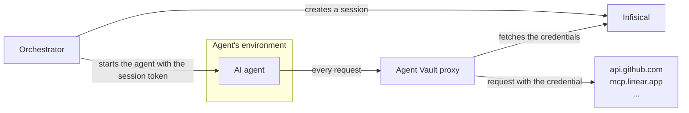

Agent Vault lets an AI agent make authenticated API calls without ever holding the real credentials. Instead, the agent routes its API calls through an Agent Vault proxy, which attaches the credentials on the way out.

## Architecture

<Tip>
To find the architecture that best fits what you're building, [plan your setup](/documentation/platform/agent-vault/plan-your-setup).
</Tip>

Every Agent Vault setup has an orchestrator that creates a session and starts the agent. Then, the agent sends every request through the proxy:



| Piece | What it does | Credentials it stores |
|---|---|---|
| Orchestrator | Creates a session and starts the agent with the session token | Your Infisical login, or a [machine identity](/documentation/platform/identities/machine-identities) that can create sessions |
| Agent | Does the task, in an environment such as a container, a virtual machine (VM), a Kubernetes pod, or a managed sandbox | Only the session token |
| Proxy | Attaches the real credentials to the agent's requests, from its own container or machine | The proxy token |
| Infisical | Stores your services and access bundles | The real credentials |

### Orchestrators

An orchestrator is the program (or person) that creates a session and starts an agent with the session token. Agent Vault works with any orchestrator, such as:

- **Your own service:** a backend service [uses the Infisical API to create a session](/documentation/platform/agent-vault/sessions-api) and starts an agent for each task. It can call the API directly or through the [Python SDK](/sdks/languages/python#agent_vault-sessions). For example: an internal coding agent that picks up tickets, or a product feature that starts an agent when a customer asks for something
- **A scheduled job:** a cron job or CI pipeline [uses the Infisical CLI to create a session](/documentation/platform/agent-vault/sessions-cli) and starts the agent. For example: an agent that labels new issues every hour
- **You:** a person who [creates a session in the Infisical dashboard](/documentation/platform/agent-vault/sessions#create-a-session) and starts an agent with the session token. For example: a coding agent on a dev box, or an assistant on a home server

The orchestrator decides which access bundle each session gets, and the agent can't change it. For example, a service can give most sessions a read-only access bundle, and give a session the access bundle with your deployment API only when an on-call engineer makes the request.

<Warning>
Keep the credentials that the orchestrator uses out of the agent's environment. A machine identity can create a session for any access bundle it has access to, so if an agent read the machine identity's credentials, it could give itself more access.
</Warning>

### Session duration

How long each session lasts is up to you. A session lasts until it expires or the orchestrator revokes it, so it can last:

- Until the agent finishes a task, with the orchestrator revoking the session when the task ends
- For a fixed amount of time that you [set when you create the session](/documentation/platform/agent-vault/sessions-api#choose-how-long-a-session-lasts)
- With no expiry, until someone revokes it

<Note>
An agent keeps its access until its session expires or you revoke it. If a session token leaks, anyone with the token has the same access until then. [Revoke the session](/documentation/platform/agent-vault/sessions#revoke-a-session) when the agent no longer needs it, or if you think the token leaked.
</Note>

### Agent environment

The agent can run anywhere: a [Kubernetes pod](/documentation/platform/agent-vault/guides/kubernetes), a [Docker container](/documentation/platform/agent-vault/guides/docker), a managed sandbox such as [Modal](/documentation/platform/agent-vault/guides/modal) or [Daytona](/documentation/platform/agent-vault/guides/daytona), or a VM, such as an Amazon EC2 instance. Wherever it runs, we recommend that:

- The proxy [runs separately from the agent](#proxy-placement), such as in its own container, so the agent can't read the proxy token
- The agent's network only reaches the proxy, so the agent can't skip the proxy and connect to an API directly

<Warning>
We don't recommend running the agent on your own computer. The proxy would have to run on a second machine, and the agent would still run as your user account, with access to your files and your Infisical CLI login. A container, a VM, or a sandbox keeps the agent away from both.
</Warning>

### Proxy placement

You can run one proxy for several agents, or give each agent its own proxy. Which one fits depends on where your agents run.

#### Common proxy

In this setup, one proxy runs on its own machine (or in its own [Kubernetes namespace](/documentation/platform/agent-vault/guides/kubernetes)), and every agent sends its requests to that proxy. Use this setup if your agents run on a network you control, such as on your own servers, in a Kubernetes cluster, or on self-hosted CI runners.

#### One proxy per agent

When the orchestrator creates a sandbox or container for a task, it also starts a proxy in a separate container, on a private network that only the agent and its proxy share. When the task ends, the orchestrator deletes both. Only the agent can reach its proxy, so nothing outside the task can send requests through it.

<Note>
On a managed sandbox platform like Modal or Daytona, each sandboxed agent needs its own proxy. This is because the platform might provision the sandboxes on a different cloud provider than the proxy, where the sandboxes can't reach the proxy over a private network. To share one proxy, you'd have to expose the proxy to the internet, and anyone with a session token could then use the proxy from anywhere.
</Note>

Each platform has its own way to run the proxy:

- **Modal:** a [sidecar](https://modal.com/docs/guide/sandbox-sidecars) in the agent's sandbox (see the [Modal guide](/documentation/platform/agent-vault/guides/modal))
- **Daytona:** a [linked sandbox](https://www.daytona.io/docs/en/sandboxes/#linked-sandboxes) (see the [Daytona guide](/documentation/platform/agent-vault/guides/daytona))
- **Docker:** a second container in each run's Docker Compose project (see the [Docker guide](/documentation/platform/agent-vault/guides/docker))

You [create the proxy in Infisical](/documentation/platform/agent-vault/proxies#create-a-proxy-and-start-it) once and start every copy with the same proxy token.

## Access model

Agent Vault uses four primitives to create secure sessions for AI agents:

- [**Services**](#services): The APIs, MCP servers, and anything else the agent talks to, with any credentials to add
- [**Access bundles**](#access-bundles): Groups of services, granted as a unit
- [**Sessions**](#sessions): Time-bound access grants that an agent uses to authenticate to the proxy for the services in an access bundle
- [**Proxies**](#proxies): The forward proxy that intercepts an agent's outbound traffic and attaches real credentials to authorized requests

Here's how the four primitives connect:

<Steps>
  <Step>
    The access bundle groups the services (external APIs or MCP servers) you want your agent to reach.

    ```mermaid
    flowchart LR
      subgraph bundle["Access bundle"]
        s1["Service"]
        s2["Service"]
        s3["Service"]
      end
    ```
  </Step>
  <Step>
    The orchestrator creates a session for the bundle. Infisical returns a session token scoped to that bundle until the session expires or is revoked.

    ```mermaid
    flowchart LR
      token["Session token"] -->|"scoped to"| bundle
      subgraph bundle["Access bundle"]
        s1["Service"]
        s2["Service"]
        s3["Service"]
      end
    ```
  </Step>
  <Step>
    The orchestrator starts the agent with the session token, and the agent uses the token to authenticate to the Agent Vault proxy on every outbound request.

    ```mermaid
    flowchart LR
      agent["AI agent"] -->|"holds"| token["Session token"]
      token -->|"scoped to"| bundle
      subgraph bundle["Access bundle"]
        s1["Service"]
        s2["Service"]
        s3["Service"]
      end
    ```
  </Step>
  <Step>
    Every outbound request goes through the proxy, with the session token attached as the proxy credential.

    ```mermaid
    flowchart LR
      agent["AI agent"] -->|"outbound request with session token"| proxy["Proxy"]
      agent -->|"holds"| token["Session token"]
      token -->|"scoped to"| bundle
      subgraph bundle["Access bundle"]
        s1["Service"]
        s2["Service"]
        s3["Service"]
      end
    ```
  </Step>
  <Step>
    The proxy reads the matching service's credential from the access bundle, attaches the credential, and forwards the request to the upstream host.

    ```mermaid
    flowchart LR
      agent["AI agent"] -->|"outbound request with session token"| proxy["Proxy"]
      agent -->|"holds"| token["Session token"]
      proxy -->|"request with real credentials"| apis["External API"]
      proxy -->|"reads credentials from"| bundle
      token -->|"scoped to"| bundle
      subgraph bundle["Access bundle"]
        s1["Service"]
        s2["Service"]
        s3["Service"]
      end
    ```
  </Step>
</Steps>

## Concepts

### Services

A service represents one external system that an agent can reach, such as GitHub's REST API or Linear's MCP server. Each service holds:

- **Target**: Where the system is, such as the host `api.github.com` or the server URL `https://mcp.linear.app/mcp`
- **Credential**: The real token, username and password, or OAuth authorization that the proxy attaches to the agent's requests, if the service uses one
- **Rules** (HTTP APIs): The HTTP methods and paths the service allows
- **Custom headers**: Extra headers the proxy adds to each request
- **Substitutions** (HTTP APIs): Placeholders the proxy replaces with real values

Agent Vault supports two types of service: [HTTP APIs](/documentation/platform/agent-vault/http-apis) and [MCP servers](/documentation/platform/agent-vault/mcp-servers).

You don't hand services to an agent directly. An agent reaches a service only through an access bundle.

<Card title="Services" icon="plug" href="/documentation/platform/agent-vault/services">
  Anything an AI agent talks to during a session, such as an API or an MCP server.
</Card>

### Access bundles

An access bundle groups a set of services under one name. A **code-review** bundle might hold services for GitHub, Slack, and Anthropic. An **on-call** bundle might hold services for PagerDuty, Datadog, and Slack.

You grant a bundle to a user, group, or machine identity. Anyone holding that grant can create sessions that reference it.

<Card title="Access bundles" icon="box" href="/documentation/platform/agent-vault/access-bundles">
  Lists of services that AI agents can access during a session.
</Card>

### Sessions

A session is a time-bound access grant that's scoped to one access bundle. Infisical returns a session token that identifies the session; the agent uses that token to authenticate to the Agent Vault proxy on every outbound request.

When the orchestrator creates a session, it picks one access bundle and sets when the session expires. The agent never sees the real credentials inside the bundle. All it has is the session token, which the proxy only accepts while the session is live.

Even if an attacker stole the session token, they could only reach the hosts, methods, and paths that the access bundle's services allow, and only until the session expires or you revoke it.

<Card title="Sessions" icon="monitor" href="/documentation/platform/agent-vault/sessions">
  Time-bound grants that let AI agents access services without holding real credentials.
</Card>

### Proxies

A proxy runs outside the agent's environment. It intercepts every outbound request, authorizes the request against the session's access bundle, attaches the matching service's credential as a header, and forwards the request to the upstream host. If the request breaks the matching service's [method or path rules](/documentation/platform/agent-vault/http-apis#methods-and-paths), the proxy refuses it instead.

<Card title="Proxies" icon="server" href="/documentation/platform/agent-vault/proxies">
  Forward proxies that intercept an AI agent's requests and attach real credentials on the way out.
</Card>

## Example flows

### GitHub API

Here's what happens when an agent calls `api.github.com` through an Agent Vault session:

1. The agent's HTTPS client routes the request through the [proxy](#proxies) (because the `HTTPS_PROXY` environment variable points at it), including the [session](#sessions) token as the proxy credential.
2. The proxy looks up the session with Infisical, checking if it's still live and which [access bundle](#access-bundles) it carries.
3. The proxy looks inside the session's access bundle and finds a [service](#services) whose host pattern covers `api.github.com`. If the service limits methods or paths, the proxy refuses a request that doesn't match them. The proxy reads the real GitHub token from that service.
4. The proxy opens a new HTTPS connection to `api.github.com`, attaches the real token in the authorization header, and forwards the request.
5. GitHub responds. The proxy pipes the response back to the agent.

<Note>
If the agent asks for a host that isn't covered by any service in the access bundle (like `api.internal.example.com`), the proxy either forwards the request without credentials or refuses it outright, depending on its [traffic policy](/documentation/platform/agent-vault/proxies#traffic-policy).
</Note>

### Linear MCP server

Here's what happens when an agent calls a tool on Linear's MCP server through an Agent Vault session. The agent has the server's real URL, `https://mcp.linear.app/mcp`, and no credential for it:

1. The agent's MCP client sends the tool call to `mcp.linear.app` through the [proxy](#proxies), with the [session](#sessions) token as the proxy credential.
2. The proxy finds the MCP [service](#services) in the session's [access bundle](#access-bundles) that covers `mcp.linear.app`, and reads the OAuth access token Infisical holds for it.
3. The proxy records the tool's name for the session log, attaches the access token, and forwards the request.
4. Linear responds, and the proxy pipes the response back to the agent.

Infisical refreshes the access token before it expires. If Linear rejects the token anyway, the proxy gets a fresh one from Infisical and retries the request once. The agent never signs in to Linear itself.

## Why no code changes are needed

Agent Vault uses the `HTTPS_PROXY` environment variable, which `curl`, `git`, `gh`, Python's `requests`, and most SDKs already read. Any HTTP client that reads it sends its requests through the proxy without code changes.

`infisical agent-vault run` sets `HTTPS_PROXY` for the agent, trusts the proxy's certificate authority, and passes the session token as the proxy credential.

<Note>
  Node.js's built-in `fetch` (undici-backed) doesn't read `HTTPS_PROXY` by default. If your agent uses it directly, run Node with `--use-env-proxy` or set `NODE_USE_ENV_PROXY=1` (Node 24 or later). Third-party clients like `axios`, `node-fetch`, and `got` read the environment variable without extra flags.
</Note>
