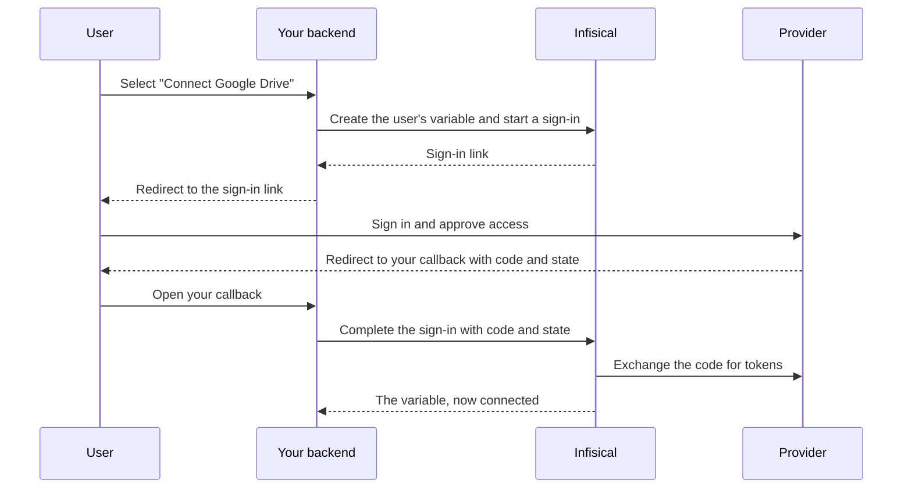

If your app runs agents for its own users, and each agent has to act as its user's account with a provider such as Google, your backend can keep one [OAuth variable](/documentation/platform/agent-vault/oauth-variables) for each user. Your users sign in on your own OAuth app's consent screen and come back to a page in your app, so they never see Infisical. Infisical stores each user's tokens and renews them, and the agent never holds them.

A user's sign-in goes through your backend like this:



Later, when your backend starts an agent for the user, it creates a session whose service uses the user's variable.

## Prerequisites

- A machine identity with the **Admin** role in an [Agent Vault project](/documentation/platform/agent-vault/access-control#product-membership) (to set one up, follow [Step 1 of Create sessions with the API](/documentation/platform/agent-vault/sessions-api#step-1-set-up-a-machine-identity) and choose **Admin** in **Role**)
- An access token for the machine identity, from [Step 2 of Create sessions with the API](/documentation/platform/agent-vault/sessions-api#step-2-log-in-as-the-machine-identity)
- An OAuth app with the provider, with its client ID and client secret, and a redirect URI that points at a page of your app, such as `https://app.example.com/oauth/google/callback`
- A running [proxy](/documentation/platform/agent-vault/proxies) in the same project, which the agent's machine can reach

## Step 1: Create the user's variable and start the sign-in

When a user selects your app's button to connect their account, call the [Create variable](/api-reference/endpoints/agent-vault-variables/create) endpoint with the provider's settings and `signIn`. In this example, the variable signs in to Google Drive for the user with the ID `123`:

```bash
curl -X POST https://app.infisical.com/api/v1/agent-vault/variables \
  -H "Authorization: Bearer <access-token>" \
  -H "Content-Type: application/json" \
  -d '{
    "projectId": "<project-id>",
    "scope": "global",
    "key": "GDRIVE_U123",
    "type": "oauth",
    "oauth": {
      "authorizationEndpoint": "https://accounts.google.com/o/oauth2/v2/auth",
      "tokenEndpoint": "https://oauth2.googleapis.com/token",
      "clientId": "<client-id>",
      "scopes": ["https://www.googleapis.com/auth/drive.readonly"],
      "redirectUri": "https://app.example.com/oauth/google/callback"
    },
    "signIn": {"clientSecret": "<client-secret>"}
  }'
```

- `key` is the variable's name, which you choose for each user and keep in your own records (it can be up to 64 characters and use only uppercase letters, numbers, and underscores)
- `oauth` holds your OAuth app's client ID, the scopes your agents need, and the provider's endpoints from the provider's OAuth documentation
- `redirectUri` is the page in your app where the provider sends the user back. It's required when a machine identity starts the sign-in
- `signIn.clientSecret` is your OAuth app's client secret, which Infisical stores with the tokens and never returns

The response includes the variable and the sign-in link in `signIn.authorization.authorizeUrl`:

```json
{
  "variable": {
    "id": "<variable-id>",
    "key": "GDRIVE_U123",
    "scope": "global",
    "type": "oauth",
    "oauth": {"status": "not-connected", "...": "..."},
    "usedByServices": []
  },
  "signIn": {
    "authorization": {
      "id": "<authorization-id>",
      "authorizeUrl": "https://accounts.google.com/o/oauth2/v2/auth?...",
      "expiresAt": "2026-11-18T10:10:00.000Z"
    },
    "registrationRequired": false,
    "manualSetupRequired": false,
    "prefill": null,
    "redirectUri": "https://app.example.com/oauth/google/callback"
  }
}
```

Save the variable's ID with the user's record, then redirect the user's browser to `authorizeUrl`. The link works for 10 minutes, so create it when the user selects the button, not in advance.

<Note>
  If the provider lets apps register themselves as OAuth clients, as many MCP servers do, you can send the provider's URL instead of your own OAuth app (see [Let Infisical register a client](#let-infisical-register-a-client)).
</Note>

## Step 2: Complete the sign-in from your callback

After the user approves access, the provider redirects them to your `redirectUri` with `code` and `state` in the query string, and `iss` if the provider sends one. If the user declined or the provider refused, the query string has `error` and `error_description` instead.

Your callback must:

1. Require the user to be logged in to your app
2. Look up the logged-in user's variable ID in your own records (never take the variable ID from the request)
3. Send what the redirect carried to the [Complete variable sign-in](/api-reference/endpoints/agent-vault-variables/complete-sign-in) endpoint

Infisical refuses the sign-in if its `state` belongs to another variable. So when the callback picks the variable from the logged-in user, a sign-in link that someone else made can't connect their account to your user's variable.

```bash
curl -X POST https://app.infisical.com/api/v1/agent-vault/variables/<variable-id>/authorizations/complete \
  -H "Authorization: Bearer <access-token>" \
  -H "Content-Type: application/json" \
  -d '{"state": "<state>", "code": "<code>", "iss": "<iss>"}'
```

Forward `iss` exactly as the provider sent it, and leave it out if the redirect had none. If the redirect carried an error, send `{"state": "<state>", "error": "<error>", "errorDescription": "<error_description>"}` instead.

Only the machine identity that started the sign-in can complete it. The endpoint responds with:

- `200`: The variable, with `oauth.status` set to `connected` (also if the sign-in had already been completed)
- `400`: The provider refused the sign-in, or the response didn't match the sign-in, and the message says why (start a new sign-in)
- `404`: The sign-in expired, was started by someone else, or doesn't exist (start a new sign-in)
- `409`: The sign-in is still being completed, or the variable's provider settings changed after the sign-in started

## Step 3: Start a session that uses the variable

When your backend starts an agent for the user, call the [Create session](/api-reference/endpoints/agent-vault-sessions/create) endpoint with an [inline service](/documentation/platform/agent-vault/inline-services) whose credential names the user's variable:

```bash
curl -X POST https://app.infisical.com/api/v1/agent-vault/sessions \
  -H "Authorization: Bearer <access-token>" \
  -H "Content-Type: application/json" \
  -d '{
    "projectId": "<project-id>",
    "ttl": "1h",
    "label": "drive summary for user 123",
    "services": [
      {
        "type": "http",
        "name": "gdrive",
        "hostPattern": "www.googleapis.com",
        "credential": {"type": "oauth", "variable": "GDRIVE_U123"}
      }
    ]
  }'
```

The proxy sends the variable's access token to `www.googleapis.com` as `Authorization: Bearer <access-token>`. [Start the agent with the session token](/documentation/platform/agent-vault/sessions-api#step-4-start-the-agent-with-the-session-token) from the response.

<Warning>
  Anyone with the **Admin** role in the project can make a service send a variable's access token to any host, through the project's services or a session's inline services. Give the **Admin** role only to the people and machine identities you trust with every user's account.
</Warning>

If you delete the variable while the session is live, the proxy refuses the agent's requests to the service.

## Reconnect an account

If the provider stops accepting a user's sign-in, for example because the user revoked access, the variable's `oauth.status` changes to `needs-reauthorization`. The proxy then answers the agent's requests to the service with a `401` response that says the sign-in has expired. If the service needs scopes that the sign-in didn't grant, the status is `needs-additional-scopes` and the response is a `403`.

To check a user's status, call the [List variables](/api-reference/endpoints/agent-vault-variables/list) endpoint with the variable's key in `keys`.

To send the user through the sign-in again, call the [Start variable sign-in](/api-reference/endpoints/agent-vault-variables/start-sign-in) endpoint when they select your button. The response has the same `authorization` as in [Step 1](#step-1-create-the-users-variable-and-start-the-sign-in). Redirect the user to `authorizeUrl`, and complete the sign-in from your callback as in [Step 2](#step-2-complete-the-sign-in-from-your-callback).

```bash
curl -X POST https://app.infisical.com/api/v1/agent-vault/variables/<variable-id>/authorizations \
  -H "Authorization: Bearer <access-token>" \
  -H "Content-Type: application/json" \
  -d '{"clientSecret": "<client-secret>"}'
```

## Import tokens you already have

If your app already holds a user's tokens, you can store them in the variable instead of sending the user through the sign-in. Call the [Create variable](/api-reference/endpoints/agent-vault-variables/create) endpoint with `tokens` instead of `signIn`, or the [Update variable](/api-reference/endpoints/agent-vault-variables/update) endpoint with `tokens` to replace the tokens of an existing variable:

```json
{
  "projectId": "<project-id>",
  "scope": "global",
  "key": "GDRIVE_U123",
  "type": "oauth",
  "oauth": {
    "authorizationEndpoint": "https://accounts.google.com/o/oauth2/v2/auth",
    "tokenEndpoint": "https://oauth2.googleapis.com/token",
    "clientId": "<client-id>",
    "scopes": ["https://www.googleapis.com/auth/drive.readonly"]
  },
  "tokens": {
    "accessToken": "<access-token>",
    "refreshToken": "<refresh-token>",
    "expiresAt": "2026-11-18T11:00:00Z",
    "clientSecret": "<client-secret>"
  }
}
```

Infisical stores the tokens as you send them, and the provider first checks them when an agent uses the service. Without a `refreshToken`, the variable stops working when the access token expires. Infisical refreshes the tokens it's given, so if the provider rotates refresh tokens, the copy you sent stops working once Infisical renews it. Tokens can only be imported into a variable with the endpoints and client ID set as in this example.

## Let Infisical register a client

Some providers, including many MCP servers, let apps register themselves as OAuth clients. For these providers, you can create the variable with `serverUrl` set to the provider's URL, such as the MCP server's URL, and leave out the endpoints and `clientId`. Infisical finds the endpoints from that URL and registers a client at each sign-in:

- The provider lists a new client for each sign-in, so a provider that limits its number of clients may refuse registrations once you have many users
- The provider's consent screen shows the client's name, which you set in `clientName` (it defaults to the name of your Agent Vault project)
- The provider redirects to your `redirectUri`, the same as with your own OAuth app

If `signIn.authorization` in the response is `null`, Infisical couldn't start the sign-in:

- `registrationRequired` is `true` if the provider doesn't let apps register (set your own OAuth app's `clientId` on the variable)
- `manualSetupRequired` is `true` if Infisical couldn't find endpoints it can trust (check the endpoints in `prefill`, and set them on the variable)

To change the variable's settings, call the [Update variable](/api-reference/endpoints/agent-vault-variables/update) endpoint, then [start the sign-in again](#reconnect-an-account).

## Limits

- Each project holds up to 500 global variables, OAuth variables included, so plan for one variable for each user who connects an account
- If the provider is on a private network and you self-host Infisical on that network, set [`ALLOW_INTERNAL_IP_CONNECTIONS`](/self-hosting/configuration/envars#param-allow-internal-ip-connections) to `true`, since Infisical connects to the provider to complete sign-ins and to renew tokens

## Next steps

<CardGroup cols={2}>
  <Card title="OAuth variables" icon="key" href="/documentation/platform/agent-vault/oauth-variables">
    Create and reauthorize OAuth variables in the Infisical dashboard.
  </Card>
  <Card title="Inline services" icon="plug" href="/documentation/platform/agent-vault/inline-services">
    Send services and their credentials with each session.
  </Card>
</CardGroup>
