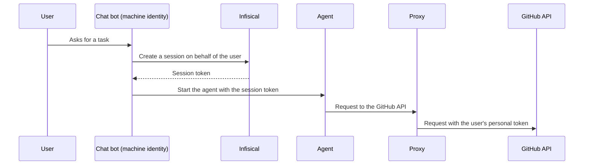

A delegation lets a [machine identity](/documentation/platform/identities/machine-identities) create [sessions](/documentation/platform/agent-vault/sessions) on behalf of users in Agent Vault. A session created on behalf of a user belongs to that user, so the [proxy](/documentation/platform/agent-vault/proxies) uses the user's own [personal values](/documentation/platform/agent-vault/services#member-provided-values). The session can use an [access bundle](/documentation/platform/agent-vault/access-bundles) only if both the user and the machine identity can use the bundle.

Use a delegation when one service starts agents for many people, such as a chat bot that runs an agent for each message, or a task runner that runs an agent for each ticket. Each agent then gets no more access than the person who asked for it.



## Prerequisites

- The **Admin** role in [Agent Vault](/documentation/platform/agent-vault/access-control#product-membership), or an Agent Vault admin who can [set up the delegation](#set-up-a-delegation) for you
- A machine identity that's a member of Agent Vault and can log in with [Universal Auth](/documentation/platform/identities/universal-auth), as [Step 1 of Create sessions with the API](/documentation/platform/agent-vault/sessions-api#step-1-set-up-a-machine-identity) describes
- A [grant](/documentation/platform/agent-vault/access-bundles#manage-access-to-access-bundles) for the machine identity on each access bundle its sessions use
- Users who are [members of Agent Vault](/documentation/platform/agent-vault/access-control#product-membership) and have a grant on the access bundles their agents use

## Set up a delegation

<Tabs>
  <Tab title="Dashboard">
    <Steps>
      <Step>
        In Agent Vault, go to **Access Control**, select the **Machine Identities** tab, and select the machine identity.
      </Step>
      <Step>
        In the **Delegation** section, select **Add Users or Groups**.

        <Frame>
          
        </Frame>
      </Step>
      <Step>
        In **Users and Groups**, select the users and groups to add, then select **Add**. A group covers every member of the group.

        To cover every current and future user in Agent Vault instead, turn on **All Agent Vault Members** and select **Allow All Members**.
      </Step>
    </Steps>
  </Tab>
  <Tab title="API">
    Call [the endpoint that sets a delegation](/api-reference/endpoints/agent-vault-delegations/set) with the machine identity's ID:

    ```bash
    curl -X PUT https://app.infisical.com/api/v1/agent-vault/delegations/<machine-identity-id> \
      -H "Authorization: Bearer <access-token>" \
      -H "Content-Type: application/json" \
      -d '{"scope": "selected", "groupIds": ["<group-id>"]}'
    ```

    Set `scope` to `all-members` to cover every Agent Vault member, or to `selected` with `userIds`, `groupIds`, or both. The request replaces any delegation the machine identity already has.
  </Tab>
</Tabs>

You can add only users and groups that are members of Agent Vault. If a user is in Agent Vault only through a group, add the group.

To take a user or group out of the delegation, select the actions menu on its row in the **Delegation** section, select **Remove**, then select **Remove** again to confirm. If you remove the last user or group, or the **All Agent Vault Members** row, the machine identity can no longer act on behalf of anyone.

<Warning>
  If a machine identity has a delegation, anyone who can log in as the machine identity can send requests with the personal values of every user the delegation covers. Protect the machine identity's credentials as carefully as you'd protect those users' own credentials.
</Warning>

## Create a session on behalf of a user

Log in as the machine identity, as [Step 2 of Create sessions with the API](/documentation/platform/agent-vault/sessions-api#step-2-log-in-as-the-machine-identity) describes. Then call [the endpoint that creates a session](/api-reference/endpoints/agent-vault-sessions/create), and name the user in `onBehalfOf`:

```bash
curl -X POST https://app.infisical.com/api/v1/agent-vault/sessions \
  -H "Authorization: Bearer <access-token>" \
  -H "Content-Type: application/json" \
  -d '{"accessBundles": ["<access-bundle-name>"], "onBehalfOf": {"userEmail": "<user-email>"}, "ttl": "15m"}'
```

- In `onBehalfOf`, set either `userEmail` or `userId`, not both
- In `accessBundles`, name a bundle that both the user and the machine identity can use
- `ttl` defaults to `1h`, instead of the `7d` default for other sessions

Start the agent with the session token from the response, and revoke the session when the agent finishes, as [Step 4 of Create sessions with the API](/documentation/platform/agent-vault/sessions-api#step-4-start-the-agent-with-the-session-token) describes.

## What the session can reach

A session created on behalf of a user can use an access bundle only if both the user and the machine identity can use the bundle, and the session uses the user's personal values:

- The user can use the access bundles granted to them, directly or through a group (if the user is an Agent Vault admin, every bundle)
- The machine identity can use the access bundles granted to it, directly or through a group (if the machine identity is an Agent Vault admin, every bundle)
- The proxy refuses the session's requests to a service until the user [sets up their personal values](/documentation/platform/agent-vault/access-bundles#set-up-your-personal-values) for it

If a user or group in the delegation can use an access bundle that isn't granted to the machine identity, their row in the machine identity's **Delegation** section shows the number of excluded bundles, and hovering over the number lists them. Through the API, [the endpoint that reads a delegation](/api-reference/endpoints/agent-vault-delegations/get) returns the same bundles in `missingAccessBundles`. To let the machine identity create sessions over one of them, [grant the bundle](/documentation/platform/agent-vault/access-bundles#manage-access-to-access-bundles) to the machine identity.

## When the session stops working

Infisical checks the delegation again each time the proxy polls, once every [poll interval](/documentation/platform/agent-vault/proxies#poll-interval) (60 seconds by default). The proxy refuses every request on the session if any of these happen:

- An admin removes the delegation, or edits it so it no longer covers the user
- The delegation covered the user only through a group, and the user leaves that group
- An admin removes the machine identity from Agent Vault, which also deletes its delegation
- Someone deletes the machine identity (the session then shows as **Revoked**)

If an admin sets up the delegation again, or adds the user back to it, the session works again. To end a session for good, [revoke it](/documentation/platform/agent-vault/sessions#revoke-a-session).

If the user or the machine identity can no longer use the access bundle, the session stops getting credentials for the bundle, as [Access changes](/documentation/platform/agent-vault/sessions#access-changes) describes.

## Track sessions created on behalf of users

These people and identities can see the session and revoke it:

- The user, under **My Sessions**
- The machine identity, through the endpoints that [read a session](/api-reference/endpoints/agent-vault-sessions/get) and [revoke a session](/api-reference/endpoints/agent-vault-sessions/revoke)
- Admins, under **All Sessions**

On the **Sessions** page, the **Identity** column shows the user, followed by "via" and the machine identity's name. The session's details list the machine identity under **Started By**.

When the machine identity creates the session, Infisical writes an audit event with the machine identity as the actor and the user in `onBehalfOfUserId`, `onBehalfOfUserName`, and `onBehalfOfUserEmail`. Infisical also writes an audit event when an admin sets up, changes, or removes a delegation.

## Troubleshooting

<AccordionGroup>
  <Accordion title="Creating the session fails with &quot;This machine identity isn't allowed to start sessions on behalf of users&quot;">
    The machine identity has no delegation. [Set one up](#set-up-a-delegation), or ask an Agent Vault admin to.
  </Accordion>
  <Accordion title="Creating the session fails with &quot;No access bundle named ... is granted to this machine identity&quot;">
    The access bundle isn't granted to the machine identity, or no access bundle has that name. [Grant the bundle](/documentation/platform/agent-vault/access-bundles#manage-access-to-access-bundles) to the machine identity, or name a bundle the machine identity already has.
  </Accordion>
  <Accordion title="Creating the session fails with &quot;This machine identity can't start sessions on behalf of ...&quot;">
    The delegation doesn't cover the user, or no active member of your organization has that email or ID. Check the email or ID you sent, then check the users and groups in the machine identity's delegation.
  </Accordion>
  <Accordion title="Creating the session fails with &quot;No access bundle named ... is granted to '...'&quot;">
    The access bundle isn't granted to the user. [Grant the bundle](/documentation/platform/agent-vault/access-bundles#manage-access-to-access-bundles) to the user, or name a bundle the user already has.
  </Accordion>
</AccordionGroup>

## Next steps

<CardGroup cols={2}>
  <Card title="Create sessions with the API" icon="code" href="/documentation/platform/agent-vault/sessions-api">
    Create, use, and revoke a session from your own code.
  </Card>
  <Card title="Services" icon="plug" href="/documentation/platform/agent-vault/services#member-provided-values">
    Leave part of a service's credential to each member.
  </Card>
</CardGroup>
