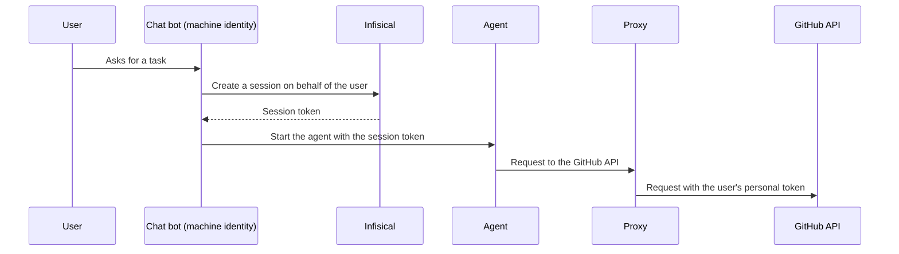

A delegation lets a [machine identity](/documentation/platform/identities/machine-identities) create [sessions](/documentation/platform/agent-vault/sessions) on behalf of users in an [Agent Vault project](/documentation/platform/agent-vault/projects). If the machine identity sends a user's email or ID in `onBehalfOf`, it creates the session on behalf of that user. Otherwise, it creates the session as itself.

For a session created on behalf of a user, the [proxy](/documentation/platform/agent-vault/proxies) uses the user's own [personal values](/documentation/platform/agent-vault/http-apis#member-provided-values), not the machine identity's. The session can only use the [access bundles](#access-bundles-and-personal-values) that both the user and the machine identity have access to.

Use a delegation when one service starts agents for many people, such as a chat bot that runs an agent for each message, or a task runner that runs an agent for each ticket. Each agent then gets no more access than the person who asked for it.



## Prerequisites

- The **Admin** role in the [Agent Vault project](/documentation/platform/agent-vault/access-control#roles), or a [custom role](/documentation/platform/agent-vault/access-control#create-a-custom-role) with **Sessions on Behalf of Users** and **Edit** on machine identities (or someone with one of these roles who can [set up the delegation](#set-up-a-delegation) for you)
- A machine identity that's a member of the project and can log in with [Universal Auth](/documentation/platform/identities/universal-auth)
- A [role](/documentation/platform/agent-vault/access-bundles#who-can-use-an-access-bundle) for the machine identity that can use each access bundle its sessions use
- Users who are [members of the project](/documentation/platform/agent-vault/access-control#roles) and have a role that can use the access bundles their agents use

## Set up a delegation

<Tabs>
  <Tab title="Dashboard">
    <Steps>
      <Step>
        In your Agent Vault project, go to **Access Control**, select the **Machine Identities** tab, and select the machine identity.

        <Frame>
          
        </Frame>
      </Step>
      <Step>
        In the **Delegation** section, select **Manage Delegation**.

        <Frame>
          
        </Frame>
      </Step>
      <Step>
        Expand **Not in Delegation**, then select **Add** next to each user or group to add. A group covers every member of the group. If someone isn't listed, search for them by name. Changes save as you make them.

        To cover every current and future user in the project instead, turn on **All Project Members** and select **Allow All Members**.

        <Frame>
          
        </Frame>
      </Step>
    </Steps>
  </Tab>
  <Tab title="API">
    Call the [Set delegation](/api-reference/endpoints/agent-vault-delegations/set) endpoint with the machine identity's ID and your [project's ID](/documentation/platform/agent-vault/projects#find-the-project-id):

    ```bash
    curl -X PUT "https://app.infisical.com/api/v1/agent-vault/delegations/<machine-identity-id>?projectId=<project-id>" \
      -H "Authorization: Bearer <access-token>" \
      -H "Content-Type: application/json" \
      -d '{"scope": "selected", "groupIds": ["<group-id>"]}'
    ```

    Set `scope` to `all-members` to cover every member of the project, or to `selected` with `userIds`, `groupIds`, or both. The request replaces any delegation the machine identity already has.

    To add users and groups without sending the whole list, call the [Add users and groups](/api-reference/endpoints/agent-vault-delegations/add-subjects) endpoint.
  </Tab>
</Tabs>

## Remove a user or group from a delegation

<Tabs>
  <Tab title="Dashboard">
    <Steps>
      <Step>
        On the machine identity's page, select **Manage Delegation**.
      </Step>
      <Step>
        Select **In Delegation** on the user's or group's row, then select **Remove**.
      </Step>
      <Step>
        Select **Remove** again to confirm.
      </Step>
    </Steps>
  </Tab>
  <Tab title="API">
    Call the [Remove users and groups](/api-reference/endpoints/agent-vault-delegations/remove-subjects) endpoint with the machine identity's ID and your [project's ID](/documentation/platform/agent-vault/projects#find-the-project-id), and list the users and groups to take out in `userIds`, `groupIds`, or both:

    ```bash
    curl -X DELETE "https://app.infisical.com/api/v1/agent-vault/delegations/<machine-identity-id>/subjects?projectId=<project-id>" \
      -H "Authorization: Bearer <access-token>" \
      -H "Content-Type: application/json" \
      -d '{"userIds": ["<user-id>"]}'
    ```
  </Tab>
</Tabs>

If you remove the last user or group, or turn off **All Project Members**, the machine identity can no longer act on behalf of anyone.

## Create a session on behalf of a user

[Log in as a machine identity](/documentation/platform/agent-vault/create-a-session#create-a-session-with-the-api), then call the [Create session](/api-reference/endpoints/agent-vault-sessions/create) endpoint with the ID of your Agent Vault project ([find the project ID](/documentation/platform/agent-vault/projects#find-the-project-id)), and name the user in `onBehalfOf`:

```bash
curl -X POST https://app.infisical.com/api/v1/agent-vault/sessions \
  -H "Authorization: Bearer <access-token>" \
  -H "Content-Type: application/json" \
  -d '{"projectId": "<project-id>", "accessBundle": "<access-bundle-name>", "onBehalfOf": {"userEmail": "<user-email>"}, "ttl": "15m"}'
```

- In `onBehalfOf`, set either `userEmail` or `userId`, not both
- In `accessBundle`, name a bundle that both the user and the machine identity can use
- In `services`, list services that [both of them can use](#access-bundles-and-personal-values)
- In `skills`, list skills that [both of them can use](#access-bundles-and-personal-values), or [send skills with the session](/documentation/platform/agent-vault/skills#send-skills-with-a-session)
- `ttl` defaults to `1h`, instead of the `7d` default for other sessions

<Tip>
  You can also create the session with [the Python SDK](/sdks/languages/python#create-a-session-on-behalf-of-a-user) or [the Node.js SDK](/sdks/languages/node#create-a-session-on-behalf-of-a-user).
</Tip>

[Start the agent](/documentation/platform/agent-vault/create-a-session#start-the-agent) with the session token from the response, and [revoke the session](/documentation/platform/agent-vault/revoke-a-session) when the agent finishes.

### Find the access bundles a session can use

To choose an access bundle for the user, call the [List access bundles](/api-reference/endpoints/agent-vault-access-bundles/list) endpoint as the machine identity with the project's ID, and name the user in `onBehalfOfUserEmail` or `onBehalfOfUserId`:

```bash
curl "https://app.infisical.com/api/v1/agent-vault/access-bundles?projectId=<project-id>&onBehalfOfUserEmail=<user-email>" \
  -H "Authorization: Bearer <access-token>"
```

The response lists only the access bundles that both the user and the machine identity can use. For each bundle, `servicesRequiringSetup` lists the services the user hasn't set up their personal values for yet. The proxy refuses the session's requests to those services, so add `requiresSetup=false` to list only the bundles the user has set up.

### Find the services a session can use

To choose services for the user, call the [List services](/api-reference/endpoints/agent-vault-services/list) endpoint as the machine identity with the project's ID, and name the user in `onBehalfOfUserEmail` or `onBehalfOfUserId`:

```bash
curl "https://app.infisical.com/api/v1/agent-vault/services?projectId=<project-id>&onBehalfOfUserEmail=<user-email>" \
  -H "Authorization: Bearer <access-token>"
```

The response lists only the services that both the user and the machine identity can use, directly or through an access bundle that both can use. These are the services a session on the user's behalf can use. For each service, `personalValues` shows whether the user has set up their personal values for it. Add `requiresSetup=false` to list only the services the user has set up.

### Find the skills a session can use

To choose skills for the user, call the [List skills](/api-reference/endpoints/agent-vault-skills/list) endpoint as the machine identity with the project's ID, and name the user in `onBehalfOfUserEmail` or `onBehalfOfUserId`:

```bash
curl "https://app.infisical.com/api/v1/agent-vault/skills?projectId=<project-id>&onBehalfOfUserEmail=<user-email>" \
  -H "Authorization: Bearer <access-token>"
```

The response lists only the skills that both the user and the machine identity can use, directly or through an access bundle that both can use. These are the skills a session on the user's behalf can use.

## Access bundles and personal values

A session created on behalf of a user can use an access bundle only if both the user and the machine identity can use the bundle, and the session uses the user's personal values:

- The user can use the access bundles that their roles can use, directly or through a group (if the user is an admin of the project, every bundle)
- The machine identity can use the access bundles that its roles can use, directly or through a group (if the machine identity is an admin of the project, every bundle)
- The proxy refuses the session's requests to a service until the user [sets up their personal values](/documentation/platform/agent-vault/access-bundles#set-up-your-personal-values) for it

The user and the machine identity also have to be able to use each service you list in `services` and each skill you list in `skills` the same way: directly, or through one access bundle that both can use. If both are admins of the project, you can list any of its services and skills. Skills you send with the session don't need to be in an access bundle.

If a user or group in the delegation can use an access bundle that the machine identity can't use, Infisical shows the bundle in two places:

- In the machine identity's **Delegation** section, the row for the user or group shows the number of excluded bundles, and hovering over the number lists them
- The [Get delegation](/api-reference/endpoints/agent-vault-delegations/get) endpoint returns the bundles in `missingAccessBundles` (only the bundles that the caller can see)

To let the machine identity create sessions over one of them, give the machine identity a [role that can use the bundle](/documentation/platform/agent-vault/access-bundles#who-can-use-an-access-bundle).

## Delegation changes

Infisical checks the delegation again each time the proxy polls, once every [poll interval](/documentation/platform/agent-vault/proxies#poll-interval) (60 seconds by default). The proxy refuses every request on the session if any of these happen:

- Someone removes the delegation, or edits it so it no longer covers the user
- The delegation covered the user only through a group, and either the user leaves that group or the group is removed from the project
- The user is removed from the project or from your organization, which also takes the user out of the delegation
- The user or the machine identity is deactivated in your organization
- Someone removes the machine identity from the project, which also deletes its delegation
- Someone deletes the machine identity or the user (the session then shows as **Revoked**)

If someone sets up the delegation again, adds the user back to it, or reactivates the user or the machine identity, the session works again. To end a session for good, [revoke it](/documentation/platform/agent-vault/revoke-a-session).

If the user or the machine identity can no longer use the access bundle, the session [stops getting credentials](/documentation/platform/agent-vault/sessions#access-changes) for the bundle. The same goes for each service you listed. For a skill you listed, agents that start with the session afterwards don't get it.

## Track sessions created on behalf of users

A session created on behalf of a user belongs to the machine identity, not the user. Only the following can see the session and read its [session logs](/documentation/platform/agent-vault/session-logs):

- The machine identity, through the [Get session](/api-reference/endpoints/agent-vault-sessions/get) and [List session logs](/api-reference/endpoints/agent-vault-session-logs/list) endpoints
- Members whose roles can view everyone's sessions, such as admins, under **All Sessions** on the **Sessions** page

The machine identity can revoke the session with the [Revoke session](/api-reference/endpoints/agent-vault-sessions/revoke) endpoint, and so can members whose roles can revoke everyone's sessions.

On the **Sessions** page, the **Identity** column shows the machine identity's name, followed by "on behalf of" and the user's name. The session's details list the user under **On Behalf Of**.

### Audit events

When the machine identity creates the session, Infisical writes an audit event with the machine identity as the actor and the user in `onBehalfOfUserId`, `onBehalfOfUserName`, and `onBehalfOfUserEmail`. The audit events for changing the session's label and revoking the session include the same three fields. Infisical also writes an audit event when someone sets up, changes, or removes a delegation.

## Considerations

### Machine identity access

A delegation lets a machine identity use other people's personal values, so protect who can set one and who can use one:

- If a machine identity has a delegation, anyone who can log in as the machine identity can send requests with the personal values of every user the delegation covers (protect the machine identity's credentials as carefully as those users' own credentials)
- If a machine identity has the **Admin** role, or another role that allows **Sessions on Behalf of Users** and **Edit** on machine identities, it can set delegations, including one for itself that covers every member and project admin (give a machine identity such a role only if it needs it)

### Project membership

- You can add only users and groups that are members of the project
- If a user is in the project only through a group, add the group
- If a user or group leaves the project, Infisical takes them out of the delegation, and adding them back to the project doesn't add them back to the delegation

## Troubleshooting

<AccordionGroup>
  <Accordion title="Creating the session fails with &quot;This machine identity isn't allowed to start sessions on behalf of users&quot;">
    The machine identity has no delegation. [Set one up](#set-up-a-delegation), or ask an admin of the project to.
  </Accordion>
  <Accordion title="Creating the session fails with &quot;This machine identity can't use an access bundle named ...&quot;">
    None of the machine identity's roles can use the access bundle, or no access bundle has that name. Give the machine identity a [role that can use the bundle](/documentation/platform/agent-vault/access-bundles#who-can-use-an-access-bundle), or name a bundle the machine identity can already use.
  </Accordion>
  <Accordion title="Creating the session fails with &quot;This machine identity can't use any access bundle, service or skill in this project&quot;">
    None of the machine identity's roles can use anything in the project. A session on a user's behalf needs the machine identity to be able to use at least one access bundle, service, or skill, even if the session sends only inline skills. Give the machine identity a [role that can use an access bundle](/documentation/platform/agent-vault/access-bundles#who-can-use-an-access-bundle).
  </Accordion>
  <Accordion title="Creating the session fails with &quot;This machine identity can't start sessions on behalf of ...&quot;">
    The delegation doesn't cover the user, or no active member of your organization has that email or ID. Check the email or ID you sent, then check the users and groups in the machine identity's delegation.
  </Accordion>
  <Accordion title="Creating the session fails with &quot;'...' can't use an access bundle named ...&quot;">
    None of the user's roles can use the access bundle. Give the user a [role that can use the bundle](/documentation/platform/agent-vault/access-bundles#who-can-use-an-access-bundle), or name a bundle the user can already use.
  </Accordion>
  <Accordion title="Creating the session fails with &quot;This machine identity can't use a service called ...&quot;">
    None of the machine identity's roles can use the service, directly or through an access bundle, or no service has that name. Give the machine identity a [role that can use the service](/documentation/platform/agent-vault/access-control#use-an-access-bundle-service-or-skill), or choose a service the machine identity can already use.
  </Accordion>
  <Accordion title="Creating the session fails with &quot;'...' can't use a service called ...&quot;">
    None of the user's roles can use the service, directly or through an access bundle. Give the user a [role that can use the service](/documentation/platform/agent-vault/access-control#use-an-access-bundle-service-or-skill), or choose a service the user can already use.
  </Accordion>
  <Accordion title="Creating the session fails with &quot;This machine identity and '...' don't both reach the service ... the same way&quot;">
    The user and the machine identity can each use the service, but in different ways, such as through different access bundles. A session on the user's behalf can use a service only if both can use it directly, or through one access bundle that both can use.

    To see which services the session can use, [list the services on the user's behalf](#find-the-services-a-session-can-use). To use this service, give the user and the machine identity roles that can use one access bundle that holds it.
  </Accordion>
</AccordionGroup>

## Next steps

<CardGroup cols={2}>
  <Card title="Create a session" icon="plus" href="/documentation/platform/agent-vault/create-a-session">
    Create a session and start an agent with its token.
  </Card>
  <Card title="HTTP APIs" icon="plug" href="/documentation/platform/agent-vault/http-apis#member-provided-values">
    Leave part of a service's credential to each member.
  </Card>
</CardGroup>
