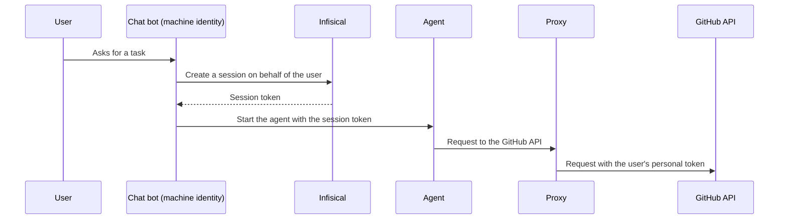

A delegation lets a [machine identity](/documentation/platform/identities/machine-identities) create [sessions](/documentation/platform/agent-vault/sessions) on behalf of users in Agent Vault. A session created on behalf of a user belongs to that user, so it reaches only the [access bundles](/documentation/platform/agent-vault/access-bundles) granted to the user, and the proxy uses the user's own [personal values](/documentation/platform/agent-vault/services#member-provided-values).

Use a delegation when one service starts agents for many people, such as a chat bot that runs an agent for each message, or a task runner that runs an agent for each ticket. Each agent then gets only the access of the person who asked for it, and uses that person's own credential wherever a service leaves part of its credential to members.



## Prerequisites

- The **Admin** role in [Agent Vault](/documentation/platform/agent-vault/access-control#product-membership), or an Agent Vault admin who can [set up the delegation](#set-up-a-delegation) for you
- A machine identity that's a member of Agent Vault and can log in with [Universal Auth](/documentation/platform/identities/universal-auth), as [Step 1 of Create sessions with the API](/documentation/platform/agent-vault/sessions-api#step-1-set-up-a-machine-identity) describes
- Users who are members of Agent Vault and have a grant on the access bundles their agents use

## Set up a delegation

<Tabs>
  <Tab title="Dashboard">
    <Steps>
      <Step>
        In Agent Vault, go to **Access Control**, select the **Machine Identities** tab, and select the machine identity.
      </Step>
      <Step>
        In the **Delegation** section, select **Set Up Delegation**.
      </Step>
      <Step>
        Select which users the machine identity can act on behalf of:

        - **Selected Users and Groups**: the users you pick, and every member of the groups you pick
        - **All Agent Vault Members**: every user in Agent Vault, including users added later
      </Step>
      <Step>
        For **Selected Users and Groups**, pick the users and groups in **Users and Groups**. Then select **Save Delegation**.
      </Step>
    </Steps>
  </Tab>
  <Tab title="API">
    Call [the endpoint that sets a delegation](/api-reference/endpoints/agent-vault-delegations/set) with the machine identity's ID:

    ```bash
    curl -X PUT https://app.infisical.com/api/v1/agent-vault/delegations/<machine-identity-id> \
      -H "Authorization: Bearer <access-token>" \
      -H "Content-Type: application/json" \
      -d '{"scope": "selected", "groupIds": ["<group-id>"]}'
    ```

    Set `scope` to `all-members` to cover every Agent Vault member, or to `selected` with `userIds`, `groupIds`, or both. The request replaces any delegation the machine identity already has.
  </Tab>
</Tabs>

You can pick only users and groups that are members of Agent Vault. If a user is in Agent Vault only through a group, pick the group.

To change the delegation later, select **Edit Delegation** in the same section. To remove it, select **Remove**, type `remove`, and select **Remove Delegation**.

<Warning>
  If a machine identity has a delegation, anyone who can log in as the machine identity can send requests with the personal values of every user the delegation covers. Protect the machine identity's credentials as carefully as you'd protect those users' own credentials.
</Warning>

## Create a session on behalf of a user

Log in as the machine identity, as [Step 2 of Create sessions with the API](/documentation/platform/agent-vault/sessions-api#step-2-log-in-as-the-machine-identity) describes. Then call [the endpoint that creates a session](/api-reference/endpoints/agent-vault-sessions/create), and name the user in `onBehalfOf`:

```bash
curl -X POST https://app.infisical.com/api/v1/agent-vault/sessions \
  -H "Authorization: Bearer <access-token>" \
  -H "Content-Type: application/json" \
  -d '{"accessBundles": ["<access-bundle-name>"], "onBehalfOf": {"userEmail": "<user-email>"}, "ttl": "15m"}'
```

- In `onBehalfOf`, set either `userEmail` or `userId`, not both
- In `accessBundles`, name a bundle that's granted to the user, not to the machine identity
- `ttl` defaults to `1h` and can be at most `24h`, so `never` isn't allowed

Start the agent with the session token from the response, and revoke the session when the agent finishes, as [Step 4 of Create sessions with the API](/documentation/platform/agent-vault/sessions-api#step-4-start-the-agent-with-the-session-token) describes.

## What the session can reach

A session created on behalf of a user gets the user's access, not the machine identity's:

- The session can use only the access bundles granted to the user, directly or through a group (if the user is an Agent Vault admin, every bundle)
- The proxy uses the user's personal values, and refuses the session's requests to a service until the user [sets up their personal values](/documentation/platform/agent-vault/access-bundles#set-up-your-personal-values) for it

## When the session stops working

Infisical checks the delegation again each time the proxy polls, once every [poll interval](/documentation/platform/agent-vault/proxies#poll-interval) (60 seconds by default). The proxy refuses every request on the session if any of these happen:

- An admin removes the delegation, or edits it so it no longer covers the user
- The delegation covered the user only through a group, and the user leaves that group
- An admin removes the machine identity from Agent Vault, which also deletes its delegation
- Someone deletes the machine identity (the session then shows as **Revoked**)

If an admin sets up the delegation again, or adds the user back to it, the session works again. To end a session for good, [revoke it](/documentation/platform/agent-vault/sessions#revoke-a-session).

Changes to the user's own access, such as losing a grant on the access bundle, affect the session the same way they affect the user's other sessions, as [Access changes](/documentation/platform/agent-vault/sessions#access-changes) describes.

## Track sessions created on behalf of users

These people and identities can see the session and revoke it:

- The user, under **My Sessions**
- The machine identity, through the API that [reads a session](/api-reference/endpoints/agent-vault-sessions/get) and the API that [revokes a session](/api-reference/endpoints/agent-vault-sessions/revoke)
- Admins, under **All Sessions**

On the **Sessions** page, the **Identity** column shows the user, followed by "via" and the machine identity's name. The session's details list the machine identity under **Started By**.

When the machine identity creates the session, the audit event names the machine identity as the actor, and records the user in `onBehalfOfUserId`, `onBehalfOfUserName`, and `onBehalfOfUserEmail`. Infisical also writes an audit event when an admin sets up, changes, or removes a delegation.

## Troubleshooting

<AccordionGroup>
  <Accordion title="Creating the session fails with &quot;This machine identity isn't allowed to start sessions on behalf of users&quot;">
    The machine identity has no delegation. [Set one up](#set-up-a-delegation), or ask an Agent Vault admin to.
  </Accordion>
  <Accordion title="Creating the session fails with &quot;This machine identity can't start sessions on behalf of ...&quot;">
    The delegation doesn't cover the user, or no active member of your organization has that email or ID. Check the email or ID you sent, then check the users and groups in the machine identity's delegation.
  </Accordion>
  <Accordion title="Creating the session fails with &quot;No access bundle named ... is granted to ...&quot;">
    The access bundle isn't granted to the user. [Grant the bundle](/documentation/platform/agent-vault/access-bundles#manage-access-to-access-bundles) to the user, or name a bundle the user already has.
  </Accordion>
  <Accordion title="Creating the session fails with &quot;A session started on behalf of a user lasts at most 24h&quot;">
    Set `ttl` to `24h` or less. If the agent runs longer than a day, create a new session before the old one expires, as [Choose how long a session lasts](/documentation/platform/agent-vault/sessions-api#choose-how-long-a-session-lasts) describes.
  </Accordion>
</AccordionGroup>

## Next steps

<CardGroup cols={2}>
  <Card title="Create sessions with the API" icon="code" href="/documentation/platform/agent-vault/sessions-api">
    Create, use, and revoke a session from your own code.
  </Card>
  <Card title="Services" icon="plug" href="/documentation/platform/agent-vault/services#member-provided-values">
    Leave part of a service's credential to each member.
  </Card>
</CardGroup>
