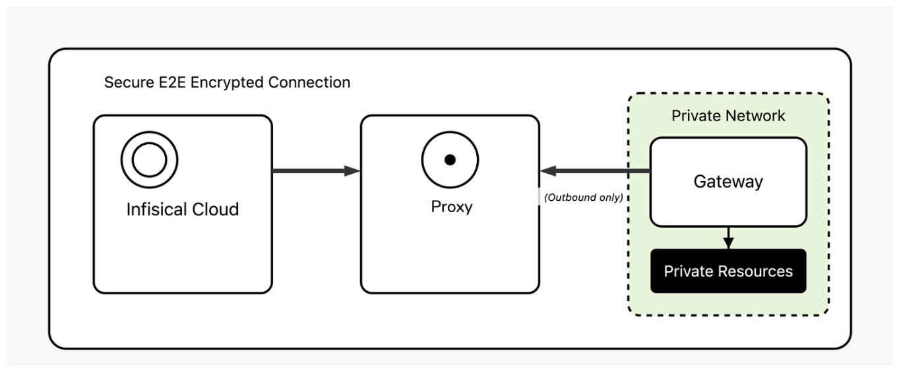

Some of the systems Infisical connects to aren't reachable from the internet: a database in a private subnet, an on-premises appliance, a server behind a corporate firewall. This section covers the two pieces that make those reachable.

<CardGroup cols={2}>
  <Card title="Gateways" icon="server" href="/documentation/platform/gateways/gateway-deployment">
    A lightweight service you run inside your own network, next to the resources Infisical needs to reach. It can connect out to a relay, or listen for Infisical to connect to it.
  </Card>
  <Card title="Relays" icon="route" href="/documentation/platform/gateways/relay-deployment/overview">
    The routing layer between Infisical and your gateways. Passes encrypted traffic through without storing or inspecting it. Use the managed relays, or run your own closer to your infrastructure.
  </Card>
</CardGroup>

If a target is reachable from the internet, app connections and dynamic secrets can reach it without a gateway by allowing [Infisical Cloud's IP addresses](/documentation/setup/networking) through your firewall. PAM always requires a gateway, as do HSM, ADCS, and discovery.

<Info>
  Gateway is a paid feature available under the Enterprise Tier for Infisical
  Cloud users. Self-hosted Infisical users can contact
  [sales@infisical.com](mailto:sales@infisical.com) to purchase an enterprise
  license.
</Info>

## How it works

A gateway runs in one of two modes, and they differ in which side opens the connection. See [Choose a connection mode](/documentation/platform/gateways/gateway-deployment#choose-a-connection-mode) for picking between them.

### Relay mode

The gateway uses an SSH reverse tunnel, so connectivity works without changing inbound firewall rules.

1. **Registration.** The gateway opens an outbound SSH reverse tunnel to a relay, using an SSH certificate issued by Infisical.
2. **Persistent connection.** The gateway holds that TCP connection open, giving Infisical a channel it can send requests down.
3. **Request routing.** When Infisical needs one of your resources, the request travels through the relay and into the tunnel that is already established.
4. **Resource access.** The gateway receives the request and connects to your private resource on Infisical's behalf.

### Direct listen mode

Infisical connects to the gateway, so there's no relay in the path. Available on self-hosted Infisical only.

1. **Registration.** The gateway registers the listen address you set, and Infisical issues it a server certificate for that address.
2. **Listening.** The gateway accepts inbound connections on that address, from the Infisical host only.
3. **Resource access.** Infisical connects over mutually authenticated TLS, and the gateway connects to your private resource on its behalf.

## Health checks

Gateways send a heartbeat every 3 minutes, each carrying a TTL that says how long the gateway should be treated as healthy. If no heartbeat arrives before the TTL expires, the gateway is marked unhealthy.

A gateway running both modes is probed on each transport separately, so it stays healthy while either one works. Its detail page shows the two transports individually, which is how you tell a relay outage from a direct listen one.

It also shows the Infisical CLI version the gateway last reported. Gateways on releases older than v0.43.131 show as older than v0.43.131, so upgrade them to see the exact version.

Relays send a heartbeat every 30 minutes and are marked unhealthy after an hour without one.

Infisical sends organization admins an in-app notification when a gateway or relay in the organization becomes unhealthy.

### Get alerted when a gateway goes offline

Set up a **Gateway Offline** alert to notify your team through email, Slack, a webhook, or PagerDuty when a gateway becomes unhealthy. The alert covers every gateway in your organization, including gateways you add later.

Infisical sends one notification when a gateway misses two check-ins in a row, so a single failed check-in doesn't notify anyone. If the gateway stays offline, Infisical doesn't send another notification until the gateway is back online and then goes offline again. Infisical sends at most one notification per gateway per hour, even if the gateway keeps going offline and coming back. Organization admins get the in-app notification on the same schedule, whether or not an alert is set up.

To create an alert, your [organization role](/documentation/platform/access-controls/role-based-access-controls) needs the **List Gateways** and **Edit Gateways** actions on the **Gateways** policy.

<Steps>
    <Step>
        Go to **Networking**, select the **Gateways** tab, and select **Alerts**. If alerts already exist, select **Add Alert** at the bottom of the list.
    </Step>
    <Step>
        Enter a **Name** for the alert and select the **Gateway Offline** event.
    </Step>
    <Step>
        Select **Add channel** and set up at least one [notification channel](/documentation/platform/identities/machine-identities#notification-channels).
    </Step>
    <Step>
        Select **Create Alert**.
    </Step>
</Steps>

## High availability

- **Relay failover.** Gateways set to select a relay automatically will move to a healthy relay if the current one becomes unreachable. No configuration needed.
- **Gateway pools.** For production, group gateways into a [pool](/documentation/platform/gateways/gateway-pools) so the platform routes through a healthy member when one goes down.
