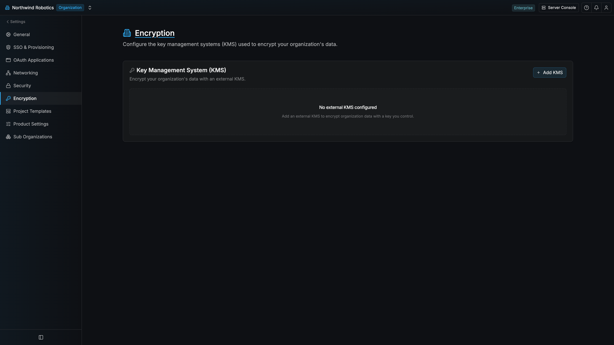
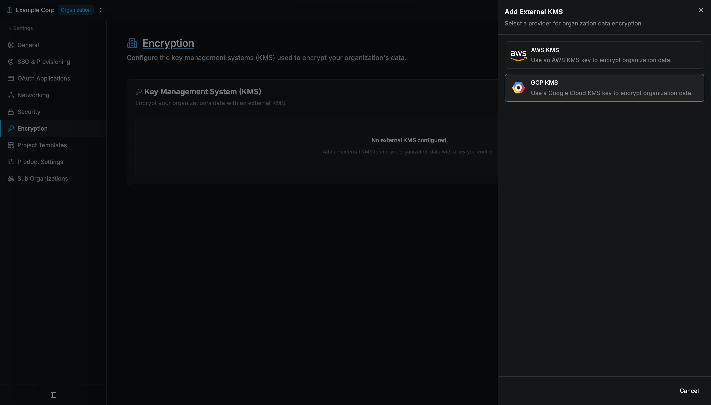
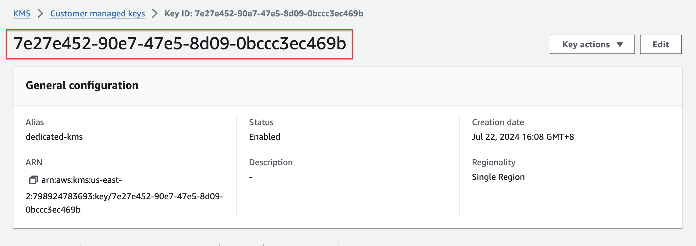

To enhance the security of your Infisical projects, you can now encrypt your secrets using an external Key Management Service (KMS).
When external KMS is configured for your project, all encryption and decryption operations will be handled by the chosen KMS.
This guide will walk you through the steps needed to configure external KMS support with AWS KMS.

## Prerequisites

- An AWS KMS Key configured as a `Symmetric` key and with `Encrypt and Decrypt` key usage.
  

Before you begin, you'll first need to choose a method of authentication with AWS from below.

<Tabs>
  <Tab title="Method 1: Assume Role (Recommended)">
  <Steps>
    <Step title="Create the Managing User IAM Role">
      1. Navigate to the [Create IAM Role](https://console.aws.amazon.com/iamv2/home#/roles/create?step=selectEntities) page in your AWS Console.
        

      2. Select **AWS Account** as the **Trusted Entity Type**.
      3. Select **Another AWS Account** and provide the appropriate Infisical AWS Account ID: use **381492033652** for the **US region**, and **345594589636** for the **EU region**. This restricts the role to be assumed only by Infisical. If you're self-hosting, provide the AWS account number where Infisical is hosted.
      <Note>
        **For Dedicated Instances**: Your AWS account ID differs from the one provided above. Please reach out to Infisical support to obtain your AWS account ID.
      </Note>
      4. Enable **Require external ID** and enter your Organization ID. It's shown under **Organization ID** in your organization's **Settings**.

      Infisical sends this ID every time it assumes the role, so the role only works for external KMS keys in your organization. This protects your AWS account from the [confused deputy problem](https://docs.aws.amazon.com/IAM/latest/UserGuide/confused-deputy.html).

      For the US region, the role's trust policy looks like this:

      ```json
      {
        "Version": "2012-10-17",
        "Statement": [
          {
            "Effect": "Allow",
            "Principal": { "AWS": "arn:aws:iam::381492033652:root" },
            "Action": "sts:AssumeRole",
            "Condition": {
              "StringEquals": { "sts:ExternalId": "<your-organization-id>" }
            }
          }
        ]
      }
      ```

      <Note>
        If you added the key before Infisical required your Organization ID, see [Update the external ID of an existing AWS KMS key](#update-the-external-id-of-an-existing-aws-kms-key).
      </Note>
    </Step>
    <Step title="Add Required Permissions for the IAM Role">
      Use the following custom policy to grant the minimum permissions required by Infisical to integrate with AWS KMS

      ```json
      {
        "Version": "2012-10-17",
        "Statement": [
          {
            "Sid": "AllowKMSAccess",
            "Effect": "Allow",
              "Action": [
                "kms:Decrypt",
                "kms:Encrypt",
                "kms:DescribeKey"
            ],
            "Resource": "*"
          }
        ]
      }
      ```
    </Step>

  </Steps>
  </Tab>
  <Tab title="Method 2: Access Key">
      Navigate to your IAM user and add a policy to grant the following permissions:
      ```json
      {
        "Version": "2012-10-17",
        "Statement": [
          {
            "Sid": "AllowKMSAccess",
            "Effect": "Allow",
              "Action": [
                "kms:Decrypt",
                "kms:Encrypt",
                "kms:DescribeKey"
            ],
            "Resource": "*"
          }
        ]
      }
      ```
  </Tab>
</Tabs>

## Setup AWS KMS in the organization settings

Next, you'll need to follow the steps listed below to add AWS KMS for your organization.

<Steps>
  <Step title="Open the Encryption settings">
    Go to **Settings**, select **Encryption**, then select **Add KMS**.
	
  </Step>
  <Step title="Select AWS KMS">
	
     Choose **AWS KMS** from the list of encryption providers.
  </Step>
  <Step title="Provide the inputs for AWS KMS">
    Selecting AWS as the provider will require you input the following fields.

    <ParamField path="Alias" type="string" required>
    	Name for referencing the AWS KMS key within the organization.
    </ParamField>

    <ParamField path="Description" type="string">
        Short description of the AWS KMS key.
    </ParamField>

    <ParamField path="Authentication Mode" type="string" required>
    	Authentication mode for AWS, either "AWS Assume Role" or "Access Key".
    </ParamField>

    <ParamField path="IAM Role ARN For Role Assumption" type="string">
        ARN of the AWS role to assume for providing Infisical access to the AWS KMS Key (required if Authentication Mode is "AWS Assume Role")
    </ParamField>

    <ParamField path="Assume Role External ID" type="string">
    	Your Organization ID. Infisical sends it as the external ID when it assumes the role, so the role's trust policy must require it in the `sts:ExternalId` condition. The Infisical UI fills it in for you. Through the API or Terraform, set it to your Organization ID; any other value is rejected.
    </ParamField>

    <ParamField path="Access Key ID" type="string">
    	AWS IAM Access Key ID for authentication (required if Authentication Mode is "Access Key").
    </ParamField>

    <ParamField path="Secret Access Key" type="string">
        AWS IAM Secret Access Key for authentication (required if Authentication Mode is "Access Key").
    </ParamField>

    <ParamField path="AWS Region" type="string" required>
    	AWS region where the AWS KMS Key is located.
    </ParamField>
    <ParamField path="AWS KMS Key ID" type="string">
    	Key ID of the AWS KMS Key. If left blank, Infisical will generate and use a new AWS KMS Key in the specified region.
        
    </ParamField>

  </Step>
  <Step title="Save the configuration">
    Select **Save** to apply the settings.
  </Step>
</Steps>

You now have an AWS KMS Key configured at the organization level. You can assign these AWS KMS keys to existing Infisical projects from the project's **Settings** page.

## Assign AWS KMS key to an existing project

To assign the AWS KMS key you added to your organization, follow the steps below.

<Steps>
  <Step title="Open the project's Encryption settings">
    Open the project, go to **Settings**, and select **Encryption**.
    
  </Step>
  <Step title="Select the key under Key Management">
    
    Choose the AWS KMS key you configured earlier.
  </Step>
  <Step title="Save the change">
    Once you have selected the KMS of choice, select **Save**.
  </Step>
</Steps>

## Update the external ID of an existing AWS KMS key

If you added an AWS KMS key with an external ID other than your Organization ID, or without one, the key keeps working with that setting, and Infisical shows a warning when you open the key's credentials. When you update the credentials, Infisical switches the key to your Organization ID. If the role's trust policy has no `sts:ExternalId` condition, any Infisical organization could configure the role.

If the external ID is another organization's ID or the ID of a project in another organization, Infisical refuses to use the key. Update its credentials as described below.

To move the key to your Organization ID without interrupting encryption, follow the steps for the key's current setup:

<Tabs>
  <Tab title="Another external ID">
    <Steps>
      <Step>
        In the AWS Console, open the IAM role and select **Trust relationships** > **Edit trust policy**. In the `sts:ExternalId` condition, add your Organization ID next to the existing value, then save the policy.
      </Step>
      <Step>
        In Infisical, go to **Settings** > **Encryption**, open the menu next to the key, and select **Edit Credentials**. Select **Update Credentials**, and Infisical switches the key to your Organization ID.
      </Step>
      <Step>
        Edit the trust policy again and remove the old value.
      </Step>
    </Steps>
  </Tab>
  <Tab title="No external ID">
    <Steps>
      <Step>
        In Infisical, go to **Settings** > **Encryption**, open the menu next to the key, and select **Edit Credentials**. Select **Update Credentials**, and Infisical switches the key to your Organization ID. The role accepts the new ID because its trust policy has no `sts:ExternalId` condition yet.
      </Step>
      <Step>
        In the AWS Console, open the IAM role and select **Trust relationships** > **Edit trust policy**. Add an `sts:ExternalId` condition with your Organization ID, then save the policy.
      </Step>
    </Steps>
  </Tab>
</Tabs>
