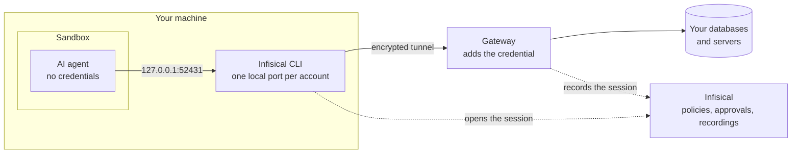

AI agents often need privileged access; for example, a coding agent that reads production data to trace a bug, or an agent you built that runs a nightly task against a database. If you put a connection string in the agent's environment, the agent holds a long-lived credential while it reads untrusted input.

Agentic access lets an agent use your PAM [accounts](/documentation/platform/pam/accounts/overview) without ever receiving their credentials. One command opens the accounts the agent can use, gives the agent instructions for reaching them, and starts the agent in a [sandbox](#sandbox):

```bash
infisical pam agentic access -- claude
```

You can run any agent this way. The CLI recognizes Claude Code, Codex, and Gemini by name, and an agent you build yourself can read the same instructions from [a file](#agents-you-build-yourself).

## How it works

The CLI opens one port on `127.0.0.1` for each account the agent can use. The agent connects to a port the same way it connects to any database or server, and the [Gateway](/documentation/platform/gateways/overview) adds the account's credential to the connection:



1. The CLI opens the ports and starts the agent
2. When the agent first connects to an account, Infisical checks the role, the duration, and any [approval](/documentation/platform/pam/access-requests/overview) the account requires, then opens a [session](/documentation/platform/pam/sessions/overview)
3. The Gateway adds the credential to the connection before it reaches the database or server, so the agent never receives the credential
4. Infisical records the session under whoever the run authenticated as, the same way it records a person's session

<Note>
If the agent never connects to an account, Infisical doesn't open a session for it.
</Note>

## Prerequisites

- The [Infisical CLI](/cli/install), logged in with `infisical login` or able to authenticate as a [machine identity](/documentation/platform/pam/ai-agents/unattended)
- The Connector, Operator, or Admin [role](/documentation/platform/pam/concepts/access-control) on the folders or accounts the agent needs, held by whoever the run authenticates as
- macOS, or Linux with [bubblewrap](https://github.com/containers/bubblewrap) installed, for the [sandbox](#sandbox) (on any other host, such as Windows, you must [turn the sandbox off](#turn-the-sandbox-off))

## Who the agent runs as

An agent has no access of its own. It uses the roles of whoever starts the run, and Infisical attributes its sessions and access requests to that user or machine identity:

- **You:** Log in with `infisical login` before you start the agent (for a coding agent that you work with in your terminal)
- **A machine identity:** Give the agent its own identity (for an agent that runs on a schedule or on a server), as described in [Run unattended](/documentation/platform/pam/ai-agents/unattended)

## Start an agent

Everything after `--` is the command that starts your agent. By default, the agent can use every account you can launch a session on. To give the agent only the accounts its task needs, add `--account` once for each account:

```bash
infisical pam agentic access --account prod/orders-db --account prod/bastion -- claude
```

Before the agent starts, the CLI prints the accounts the agent can use:

```text
  Infisical PAM proxies ready for claude

    127.0.0.1:52431  prod/orders-db (PostgreSQL)
    127.0.0.1:52432  prod/bastion (SSH)
    127.0.0.1:52433  prod/payments-db (PostgreSQL)  [awaiting approval]

  Not started:
    prod/legacy-db: you don't have permission to launch sessions for this account
```

If you don't pass `--account`, the CLI lists each account it left out under **Not started**, with the reason. If you pass `--account` and a named account can't be used, the command stops and prints the reason.

If an account's [template](/documentation/platform/pam/templates/overview) has **Require Reason** turned on, pass the reason with `--reason`. The CLI can't ask for a reason while the agent is running in the terminal.

<Tip>
For all flags available with the `infisical pam agentic access` command, check out the [CLI reference](/cli/reference#pam-agentic-access).
</Tip>

### Supported account types

Agents can use the following account types:

- **Databases:** [PostgreSQL](/documentation/platform/pam/accounts/postgresql), [MySQL](/documentation/platform/pam/accounts/mysql), [Microsoft SQL Server](/documentation/platform/pam/accounts/mssql), [MongoDB](/documentation/platform/pam/accounts/mongodb), and [Redis](/documentation/platform/pam/accounts/redis)
- **Servers:** [SSH](/documentation/platform/pam/accounts/ssh) and [Windows](/documentation/platform/pam/accounts/windows) over RDP
- **Clusters:** [Kubernetes](/documentation/platform/pam/accounts/kubernetes)

For Kubernetes accounts, the CLI configures `kubectl` inside the run without changing your own kubeconfig.

<Note>
  Agents can't use accounts whose template has **Require MFA** turned on. To use one of those accounts yourself, run [`infisical pam access`](/cli/reference#pam-access), which asks you to complete MFA in your browser.
</Note>

## Sandbox

The CLI runs the agent in a sandbox that the operating system enforces. The sandbox stops the agent from reading your Infisical login, so the agent can't open sessions on accounts beyond the ones the run started with. The operating system applies the sandbox to the agent and to every process the agent starts, and the agent can't turn the sandbox off from inside it.

### What the agent can access

| The agent can | The agent can't |
|---|---|
| Read and write files in your working directory | Read your Infisical login or credential store |
| Use its own tools, subprocesses, and state | Open PAM sessions on other accounts |
| Connect to the accounts the run started with | Use Docker or another container runtime |

The agent can still read common development files such as `~/.aws`, `~/.ssh`, and `~/.kube`, so tasks like `git` over SSH keep working. The sandbox protects your access to PAM, not every secret on the machine.

### Limits of the sandbox

The sandbox adds protection, but it doesn't guarantee that an agent can't reach your secrets:

- No operating system sandbox blocks every way to read files on the host, so an agent that is built or tricked into searching for secrets might find a way past it
- The agent keeps its network access, so the sandbox doesn't stop the agent from sending data off the machine

Whether or not the sandbox stops an agent, the account credentials never reach the machine. Each connection is a [session](/documentation/platform/pam/sessions/overview) that you can watch and terminate, and the agent's access is limited by role, duration, and [approval](/documentation/platform/pam/access-requests/overview).

For a sensitive task, [run the agent as its own machine identity](/documentation/platform/pam/ai-agents/unattended) on a dedicated machine. The identity's roles then limit what the agent can reach, even if the agent gets past the sandbox.

### Turn the sandbox off

To run the agent without the sandbox, pass `--no-sandbox`:

```bash
infisical pam agentic access --no-sandbox -- claude
```

Without the sandbox, the agent can read your Infisical login and every other credential file on the machine. Keep the sandbox on wherever your operating system supports it.

## Instructions for the agent

The CLI writes an instruction file for each run. The file lists the accounts the agent can use and tells the agent that it doesn't need credentials, that Infisical records everything it runs, and that it shouldn't connect to anything else.

The CLI delivers the instructions in a format each agent reads:

| Agent | Where the instructions go |
|---|---|
| `claude` | Passed to Claude Code directly, without changing your repository |
| `codex` | A block in `AGENTS.md`, removed when the run ends |
| `gemini` | A block in `GEMINI.md`, removed when the run ends |
| Any other agent | A block in `AGENTS.md`, removed when the run ends |

<Note>
If your agent runs under a wrapper script, the CLI can't recognize it by name. Pass `--agent` with `claude`, `codex`, `gemini`, or `generic` to choose the format.
</Note>

### Agents you build yourself

Every run sets the `INFISICAL_PAM_CONTEXT_FILE` environment variable to the path of the instruction file. To give your own agent the instructions, read the file and add its contents to your agent's system prompt:

```python
import os

with open(os.environ["INFISICAL_PAM_CONTEXT_FILE"]) as file:
    pam_context = file.read()  # add this to your agent's system prompt
```

## Accounts that need approval

If an account requires [approval](/documentation/platform/pam/access-requests/overview), the CLI still opens a port for it and marks it `[awaiting approval]`. The agent can't use the account until an approver approves a request.

The first time the agent connects to the account, the CLI files a request and the connection fails. After an approver approves the request, the agent's next connection works without restarting the run. If the approved access expires during the run, the same thing happens again: the CLI files a new request, and the account works after an approver approves it.

To stop the CLI from filing requests, pass `--no-approval-request`. The CLI then leaves accounts that need approval out of the run.

## Review what the agent did

Every connection the agent makes is a normal PAM session. To review the agent's work, open its [sessions](/documentation/platform/pam/sessions/overview) and check the queries or commands in each [recording](/documentation/platform/pam/sessions/session-recording). Sessions show whoever the run authenticated as. If that's a machine identity, its sessions and [audit log](/documentation/platform/pam/auditing) events show **Machine Identity** where a person's email would appear.

## Frequently asked questions

<AccordionGroup>
  <Accordion title="Why is an account missing from the list?">
    Check the **Not started** list that the CLI prints at the start of each run, which gives the reason for each account it left out. If the account isn't there either, whoever the run authenticated as can't launch sessions on it, so check their role on the folder or account.
  </Accordion>
  <Accordion title="Why does an account stay on awaiting approval?">
    The request is waiting for an approver. If the folder has no approvers on its **Approvals** tab, nobody can approve the request.
  </Accordion>
  <Accordion title="Can an agent approve an access request?">
    No. Only users and groups can approve requests, whoever the agent runs as.
  </Accordion>
  <Accordion title="Why won't the command start on Linux?">
    The sandbox isn't available, usually because bubblewrap isn't installed or the host restricts user namespaces. The error message says which. Install bubblewrap or allow user namespaces on the host, then run the command again.
  </Accordion>
  <Accordion title="How do I stop an agent quickly?">
    Remove the role that whoever the run authenticated as has on the folder or account, so the agent can't open new sessions. Then [terminate](/documentation/platform/pam/sessions/overview) the agent's active sessions on the **Sessions** page. If the account requires approval, [revoking the request](/documentation/platform/pam/access-requests/overview#revoke-access) also ends its sessions.
  </Accordion>
</AccordionGroup>

## Next steps

<CardGroup cols={2}>
  <Card title="Run unattended" icon="bot" href="/documentation/platform/pam/ai-agents/unattended">
    Run an AI agent as its own machine identity.
  </Card>
  <Card title="Session recording" icon="video" href="/documentation/platform/pam/sessions/session-recording">
    Review what happened during each session on your accounts.
  </Card>
</CardGroup>
