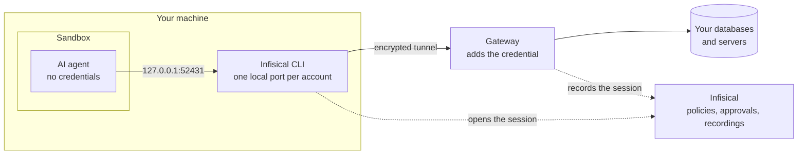

AI agents often need privileged access; for example, a coding agent that reads production data to trace a bug, or an agent you built that runs a nightly task against a database. If you put a connection string in the agent's environment, the agent holds a long-lived credential while it reads untrusted input.

Agentic access lets an agent use your PAM [accounts](/documentation/platform/pam/accounts/overview) without ever receiving their credentials. One command opens the accounts the agent can use, gives the agent instructions for reaching them, and starts the agent in a [sandbox](/documentation/platform/pam/ai-agents/run#sandbox):

```bash
infisical pam agentic access -- claude
```

You can run any agent this way. The CLI recognizes Claude Code, Codex, and Gemini by name, and an agent you build yourself can read the same instructions from [a file](/documentation/platform/pam/ai-agents/instructions#agents-you-build-yourself).

<CardGroup cols={2}>
  <Card title="Run an agent" icon="play" href="/documentation/platform/pam/ai-agents/run">
    Start an AI agent with access to the PAM accounts its task needs.
  </Card>
  <Card title="Agent instructions" icon="file-text" href="/documentation/platform/pam/ai-agents/instructions">
    Tell an AI agent which PAM accounts it can use and how to reach them.
  </Card>
  <Card title="Run unattended" icon="clock" href="/documentation/platform/pam/ai-agents/unattended">
    Run an AI agent as its own machine identity.
  </Card>
  <Card title="Review and stop an agent" icon="eye" href="/documentation/platform/pam/ai-agents/review">
    Check what an AI agent did with your accounts and remove its access.
  </Card>
</CardGroup>

## How it works

The CLI opens one port on `127.0.0.1` for each account the agent can use. The agent connects to a port the same way it connects to any database or server, and the [Gateway](/documentation/platform/gateways/overview) adds the account's credential to the connection:



1. The CLI opens the ports and starts the agent
2. When the agent first connects to an account, Infisical checks the role, the duration, and any [approval](/documentation/platform/pam/access-requests/overview) the account requires, then opens a [session](/documentation/platform/pam/sessions/overview)
3. The Gateway adds the credential to the connection before it reaches the database or server, so the agent never receives the credential
4. Infisical records the session under whoever the run authenticated as, the same way it records a person's session

<Note>
If the agent never connects to an account, Infisical doesn't open a session for it.
</Note>

## Who the agent runs as

An agent has no access of its own. It uses the roles of whoever starts the run, and Infisical attributes its sessions and access requests to that user or machine identity:

- **You:** Log in with `infisical login` before you start the agent (for a coding agent that you work with in your terminal)
- **A machine identity:** Give the agent its own identity (for an agent that runs on a schedule or on a server), as described in [Run unattended](/documentation/platform/pam/ai-agents/unattended)
