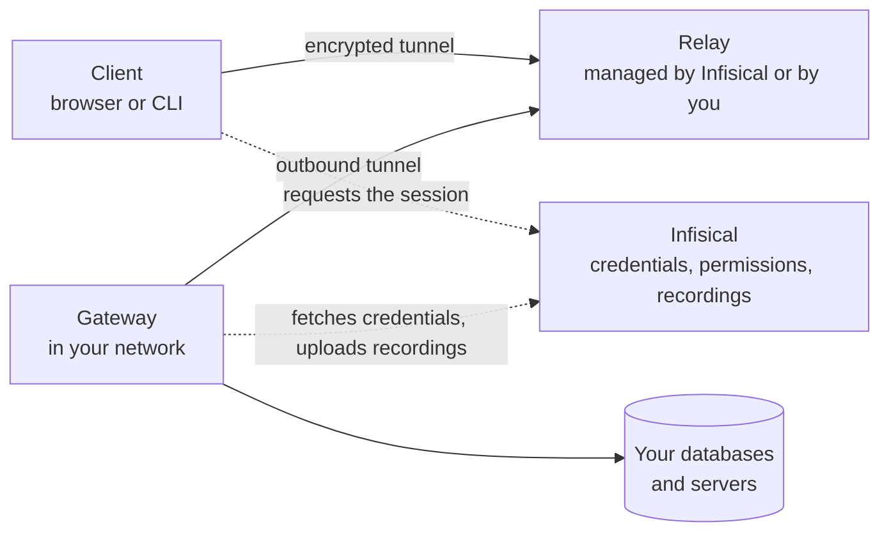

In Infisical PAM, people and agents never connect to your databases and servers directly. Every connection goes through [Gateway](/documentation/platform/gateways/overview) that you run in your own network. The Gateway adds the account's credentials and records the session, so the person or agent never holds the credentials.

## Components

- **Infisical**: Stores the account credentials, checks permissions and [template](/documentation/platform/pam/templates/overview) policies, and stores session recordings
- **Gateway**: A service you deploy in your private network that connects to your databases and servers, adds the credentials, and records each session
- **Relay**: A server that passes the client's connection to the Gateway over a tunnel that the Gateway opens outbound (Infisical runs relays for Infisical Cloud, or you can [run your own](/documentation/platform/gateways/relay-deployment/overview))
- **Client**: The browser for web access, or the [Infisical CLI](/cli/reference#pam), which opens an encrypted tunnel to the Gateway (for web access, Infisical opens the tunnel on the browser's behalf, and an [AI agent](/documentation/platform/pam/ai-agents/overview) connects through the CLI)
- **Actor**: The user or [machine identity](/documentation/platform/identities/machine-identities) that the session belongs to (Infisical checks the actor's permissions and records the actor in the audit log)

<Note>
A Gateway in [direct listen mode](#network-security) accepts connections itself, so it doesn't use a relay.
</Note>

[AWS IAM accounts](/documentation/platform/pam/accounts/aws-iam) are the one account type that doesn't use a Gateway. Infisical gives the user temporary credentials for the IAM role, and [AWS CloudTrail records what the user does](/documentation/platform/pam/accounts/aws-iam#track-activity-in-aws).

## How a connection works

When an actor connects to an [account](/documentation/platform/pam/accounts/overview), the connection goes through these steps:

1. The actor launches a session in the browser or runs a CLI command
2. Infisical checks that the actor has a [role](/documentation/platform/pam/concepts/access-control) that can launch sessions on the account
3. Infisical applies the template's policies, such as requiring a reason or MFA, and limiting the session's duration
4. If the account requires approval, Infisical checks that the actor has an approved [access request](/documentation/platform/pam/access-requests/overview)
5. The client opens an encrypted tunnel to the Gateway, through a relay or, in direct listen mode, straight to the Gateway
6. The Gateway fetches the account's credentials from Infisical and connects to the database or server with them
7. The actor works with the database or server through the Gateway, which records the session

The actor never sees the credentials, and the database or server only sees connections from the Gateway.

## Network security

How the Gateway connects to Infisical depends on its [connection mode](/documentation/platform/gateways/gateway-deployment#choose-a-connection-mode):

- **Relay mode**: The Gateway only makes outbound connections, so your firewall doesn't need to allow any inbound traffic
- **Direct listen mode**: Infisical connects to the Gateway, so the Gateway accepts inbound traffic from the Infisical host on its listen address

Either way, your databases and servers aren't exposed to the internet. Only the Gateway can reach them.

The connection mode also decides where the CLI can connect from. Web access works in either mode, because Infisical opens the connection to the Gateway. The CLI connects from the user's own machine, so in direct listen mode the machine must be able to reach the Gateway's listen address. If users connect from outside that network, they need a VPN into it, or you can [run a relay alongside direct listen](/documentation/platform/gateways/gateway-deployment#running-both-modes).

## Encryption

- **Client to Gateway**: An end-to-end encrypted tunnel, which the relay that routes it can't decrypt
- **Gateway to Infisical**: TLS
- **Session recordings**: Encrypted by the Gateway before it uploads them

## Recording

The Gateway records each session as the traffic passes through it:

1. The Gateway captures the session's events, such as queries or terminal input and output
2. The Gateway encrypts the events and saves them on its own disk
3. The Gateway uploads the events while the session runs, so admins can watch active sessions
4. If the Gateway loses its connection to Infisical, it keeps the events on disk and uploads them when the connection comes back

The template decides whether Infisical stores the recording in its own database or in [your S3-compatible bucket](/documentation/platform/pam/sessions/external-storage).

## Deployment options

| Setup | When to use it |
| --- | --- |
| One Gateway | All your accounts are in one network |
| One Gateway per network | Your accounts are spread across several VPCs or data centers |
| [Gateway pool](/documentation/platform/gateways/gateway-pools) | You need connections to keep working when one Gateway fails |

Each template sets the Gateway or Gateway pool for the accounts that use it, and you can override it on a single account. To deploy a Gateway, see [Deploy a Gateway](/documentation/platform/gateways/gateway-deployment).
