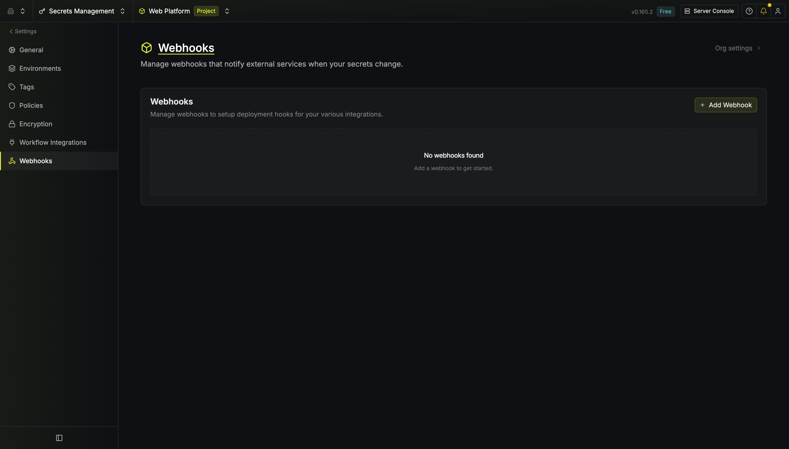
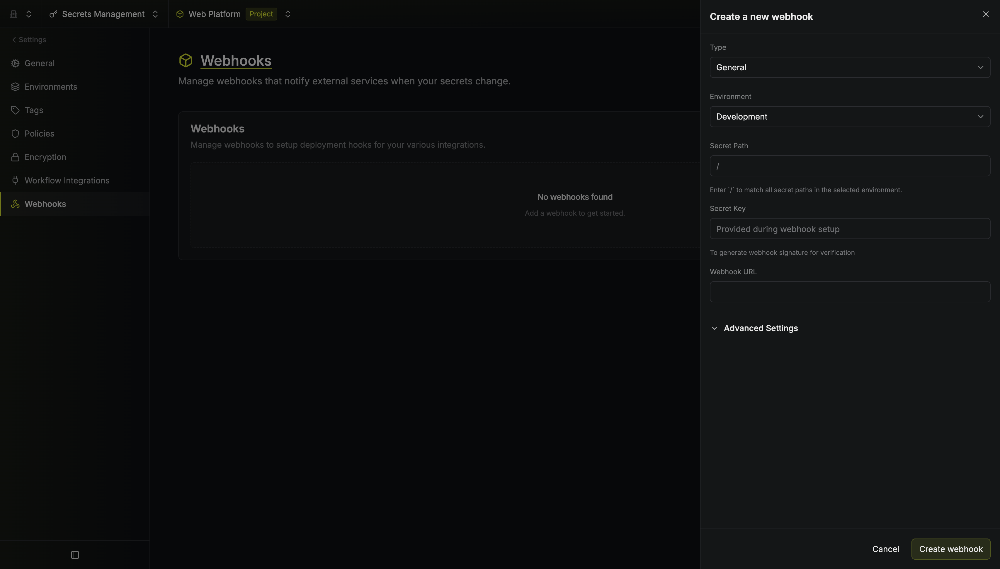

Webhooks can be used to trigger changes to your integrations when secrets are modified, providing smooth integration with other third-party applications.



To create a webhook for a particular project, go to `Project Settings > Webhooks`.

Infisical supports three webhook types: General, Slack, and Microsoft Teams. Use General for any HTTPS endpoint; use Slack with [Incoming Webhook](https://api.slack.com/messaging/webhooks); use Microsoft Teams with an [incoming webhook (with Workflows)](https://support.microsoft.com/en-us/office/create-incoming-webhooks-with-workflows-for-microsoft-teams-8ae491c7-0394-4861-ba59-055e33f75498). When you create a webhook, you can limit it to an environment and optional folder path so it runs only when secrets change in that scope.



## Secret key verification

To enable verification, select **Add Webhook**, choose **General** as the **Type**, and enter a **Secret Key**.

Infisical signs the JSON request body with HMAC-SHA256 and sends the lowercase hexadecimal signature in the `x-infisical-signature` header. The header has the form `t=<timestamp>;<signature>`, where `t` is the body's `timestamp` in epoch milliseconds.

Verify the raw request body before parsing it. The header timestamp isn't signed, so compare it with the timestamp in the verified body and check that the body timestamp is recent. This Node.js example uses a five-minute window:

```js
import { createHmac, timingSafeEqual } from "node:crypto";

function verifyInfisicalWebhook(rawBody, signatureHeader, secretKey) {
  const match = /^t=(\d+);([0-9a-f]{64})$/.exec(signatureHeader ?? "");
  if (!match) throw new Error("Invalid webhook signature");

  const expected = createHmac("sha256", secretKey).update(rawBody).digest();
  const received = Buffer.from(match[2], "hex");
  if (!timingSafeEqual(expected, received)) throw new Error("Invalid webhook signature");

  const payload = JSON.parse(rawBody.toString("utf8"));
  if (
    !Number.isSafeInteger(payload.timestamp) ||
    payload.timestamp !== Number(match[1]) ||
    Math.abs(Date.now() - payload.timestamp) > 5 * 60_000
  ) {
    throw new Error("Webhook timestamp is invalid or expired");
  }
  return payload;
}
```

Pass the unmodified HTTP body as a `Buffer`, the `x-infisical-signature` header, and the configured secret key to this function.

The example accepts timestamps within five minutes of your server's clock. To reject exact request replays, check for and store each accepted signature as one operation, and reject signatures already stored. Keep each signature until five minutes after its signed body timestamp.

## Event filtering

By default, webhooks trigger on every supported event. You can narrow this down under **Advanced Settings** when creating a webhook, and only receive the events you care about. You can also change the events on existing webhooks by selecting **Edit** and selecting the events you want.

Supported events:

- **Secret Modified** (`secrets.modified`): triggered when secrets in the configured scope are created, updated, or deleted.
- **Secret Rotation Failed** (`secrets.rotation-failed`): triggered when a secret rotation in the configured scope fails.
- **Honey Token Triggered** (`honey-token.triggered`): triggered when a honey token is activated.
- **Change Request Modified** (`secrets.change-request.modified`): triggered when a secret change request in the configured scope is created, reviewed, closed, reopened, or merged.
- **Access Request Modified** (`secrets.access-request.modified`): triggered when an access request is created, edited, reviewed, or revoked.

### Webhook payload format

Every payload has a top-level `timestamp` field, in epoch milliseconds, set to when Infisical sent the webhook.

```json
{
	"event": "secrets.modified",
	"project": {
		"workspaceId": "the workspace id",
		"environment": "project environment (slug)",
		"environmentName": "project environment (name)",
		"secretPath": "project folder path",
		"changedBy": "Actor that changed the secret",
		"changedByActorType": "The actor type that triggered the change. Possible values: `service`, `user`, `identity`."
	},
	"timestamp": 1787222520000
}
```


```json
{
	"event": "secrets.rotation-failed",
	"project": {
		"projectId": "the project id",
		"projectName": "the project name",
		"environment": "project environment",
		"environmentName": "project environment (name)",
		"secretPath": "project folder path",
		"rotationName": "name of the failed rotation",
		"errorMessage": "error details",
		"triggeredManually": false
	},
	"timestamp": 1787222520000
}
```

```json
{
	"event": "honey-token.triggered",
	"project": {
		"projectId": "the project id",
		"projectName": "the project name",
		"environment": "project environment (slug)",
		"environmentName": "project environment (name)",
		"secretPath": "project folder path"
	},
	"honeyToken": {
		"name": "name of the honey token",
		"eventName": "the AWS event that triggered the honey token",
		"sourceIp": "IP address of the caller",
		"awsRegion": "AWS region where the event occurred"
	},
	"timestamp": 1787222520000
}
```

```json
{
	"event": "secrets.change-request.modified",
	"action": "merged",
	"project": {
		"id": "b4f1e2a0-6c3d-4f2b-9a1e-7d8c6b5a4f3e",
		"name": "Payments Platform"
	},
	"request": {
		"id": "2a7c9e10-4b3d-4f5a-8c6b-1d2e3f4a5b6c",
		"slug": "k3Bq7ZxP1r",
		"url": "https://app.infisical.com/organizations/<org-id>/projects/secret-management/<project-id>/approval?requestId=<request-id>",
		"target": {
			"environment": {
				"name": "Production",
				"slug": "prod"
			},
			"secretPath": "/backend"
		},
		"status": "close",
		"hasMerged": true,
		"isBypassed": false,
		"policy": {
			"id": "b1c2d3e4-f5a6-4b7c-8d9e-0f1a2b3c4d5e",
			"name": "Production secrets",
			"enforcementLevel": "hard"
		},
		"requestedBy": {
			"type": "user",
			"id": "d4e5f6a7-b8c9-4d0e-9f1a-2b3c4d5e6f7a",
			"name": "Priya Natarajan",
			"email": "priya@example.com"
		},
		"createdAt": "2026-08-20T10:00:00.000Z",
		"updatedAt": "2026-08-20T10:42:00.000Z"
	},
	"timestamp": 1787222520000
}
```

```json
{
	"event": "secrets.access-request.modified",
	"action": "reviewed",
	"project": {
		"id": "b4f1e2a0-6c3d-4f2b-9a1e-7d8c6b5a4f3e",
		"name": "Payments Platform"
	},
	"request": {
		"id": "f3e2d1c0-9b8a-4c7d-8e6f-5a4b3c2d1e0f",
		"url": "https://app.infisical.com/organizations/<org-id>/projects/secret-management/<project-id>/approval?selectedTab=resource-requests&requestId=<request-id>",
		"status": "approved",
		"isBypassed": false,
		"policy": {
			"id": "a9b8c7d6-e5f4-4a3b-8c2d-1e0f9a8b7c6d",
			"name": "Production access",
			"enforcementLevel": "soft",
			"hasSequencedApprovers": true
		},
		"requestedAccess": {
			"target": {
				"environment": {
					"name": "Production",
					"slug": "prod"
				},
				"secretPath": "/services/*"
			},
			"isTemporary": true,
			"temporaryRange": "1h",
			"permissions": [
				{ "subject": "secrets", "actions": ["read", "edit"] },
				{ "subject": "secret-folders", "actions": ["create"] }
			]
		},
		"requestedBy": {
			"type": "user",
			"id": "d4e5f6a7-b8c9-4d0e-9f1a-2b3c4d5e6f7a",
			"name": "Priya Natarajan",
			"email": "priya@example.com"
		},
		"expiresAt": "2026-08-21T10:00:00.000Z",
		"approvedAt": "2026-08-20T10:42:00.000Z",
		"revokedAt": null,
		"createdAt": "2026-08-20T10:00:00.000Z",
		"updatedAt": "2026-08-20T10:42:00.000Z"
	},
	"timestamp": 1787222520000
}
```
