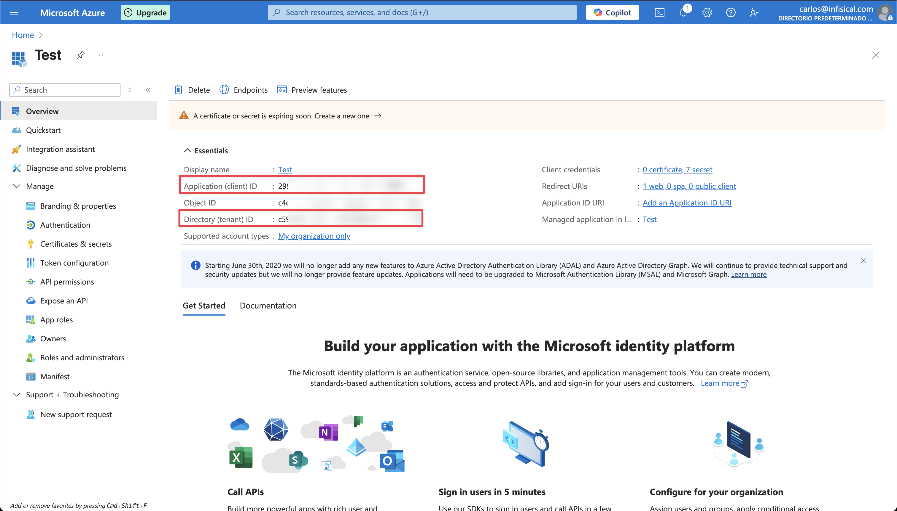
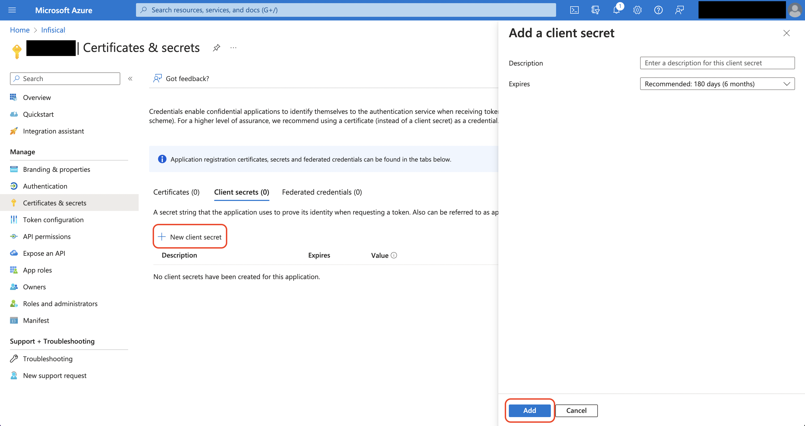
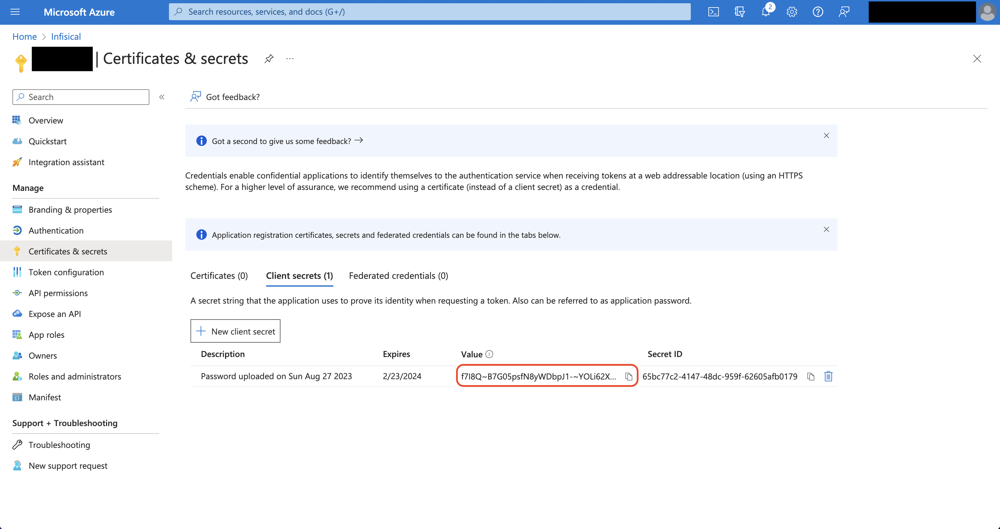
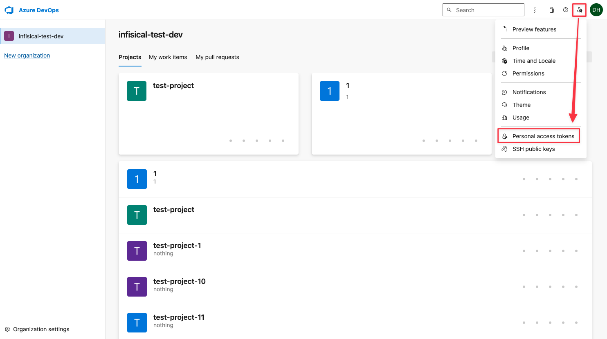
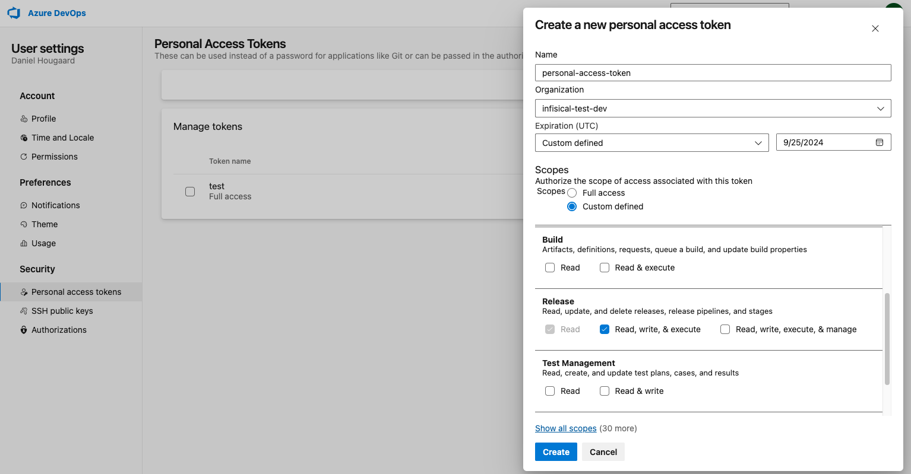
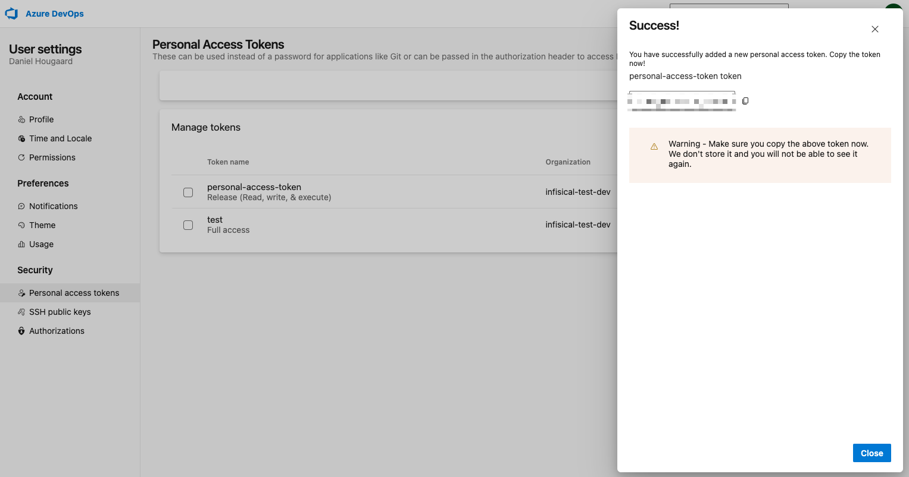

import AzureOAuthAppConfigurationServicePrincipal from "/snippets/app-connections/azure/oauth-app-configuration-service-principal.mdx";

Infisical supports four methods for connecting to Azure DevOps: OAuth, Azure DevOps personal access token, Client Secret, and Managed Identity.

<Accordion title="Azure OAuth on a Self-Hosted Instance">
  Using the Azure DevOps <b>OAuth connection</b> on a self-hosted instance of Infisical requires configuring an application in Azure
  and registering your instance with it.

  **Prerequisites:**

  - Set up Azure.

  <Steps>
    <Step title="Create an application in Azure">
      Navigate to Entra ID > App registrations to create a new application.

      <Info>
        Azure Active Directory is now Microsoft Entra ID.
      </Info>
      
      

      Create the application. As part of the form, set the **Redirect URI** to `https://your-domain.com/organization/app-connections/azure/oauth/callback`.
      <Tip>
        The domain you defined in the Redirect URI should be equivalent to the `SITE_URL` configured in your Infisical instance.
      </Tip>

      
    </Step>
    <Step title="Assign API permissions to the application">

      For the Azure Connection to work with DevOps Pipelines, you need to assign the following permission to the application.

      #### Azure DevOps permissions
    
      Set the API permissions of the Azure application to include the following permissions: 
        - Azure DevOps
          - `user_impersonation`
          - `vso.project_write`
          - `vso.variablegroups_manage`
          - `vso.variablegroups_write`

      

    </Step>
    <Step title="Add your application credentials to Infisical">
      Obtain the **Application (Client) ID** and **Directory (Tenant) ID** (this will be used later in the Infisical connection) in Overview and generate a **Client Secret** in Certificate & secrets for your Azure application.

      
      
      

      Back in your Infisical instance, add two new environment variables for the credentials of your Azure application.

      - `INF_APP_CONNECTION_AZURE_DEVOPS_CLIENT_ID`: The **Application (Client) ID** of your Azure application.
      - `INF_APP_CONNECTION_AZURE_DEVOPS_CLIENT_SECRET`: The **Client Secret** of your Azure application.

      Once added, restart your Infisical instance and use the Azure Client Secrets connection.
    </Step>
    </Steps>    

</Accordion>

<Accordion title="Azure DevOps personal access token (PAT)">
    #### Create a new Azure DevOps personal access token (PAT)
    When using the Azure DevOps <b>Access Token connection</b> you'll need to create a new personal access token (PAT) in order to authenticate Infisical with Azure DevOps.
    <Steps>
    <Step title="Navigate to Azure DevOps">
        
    </Step>
    <Step title="Create a new token">
        Make sure the newly created token has Read/Write access to the Release scope.
        

        <Note>
        Please make sure that the token has access to the following scopes: Variable Groups _(read, create, & manage)_, Release _(read/write)_, Project and Team _(read)_, Service Connections _(read & query)_
        </Note>
    </Step>
    <Step title="Copy the new access token">
        Copy the newly created token as this will be used to authenticate Infisical with Azure DevOps.
        
    </Step>
    </Steps>
</Accordion>

<Accordion title="Client Secret Authentication">
  To use client secret authentication, ensure your Azure Service Principal has the required permissions and is connected to the Azure DevOps organization and projects you want to use.

  **Prerequisites:**
  - Set up Azure and have an existing Azure DevOps organization.
  - The service principal must be connected to your target Azure DevOps organization and project(s)

  <Steps>
    <Step title="Assign API permissions to the service principal">

      Configure the required API permissions for your App Registration to interact with Azure DevOps:

      #### Azure DevOps permissions
    
      Set the API permissions of your Azure service principal to include the following Azure DevOps permissions: 
        - Azure DevOps
          - `user_impersonation`
          - `vso.project_write`
          - `vso.variablegroups_manage`
          - `vso.variablegroups_write`

      

      <Note>If you want to configure automatic client secret rotation for this App Connection, you also need to grant either `Application.ReadWrite.OwnedBy` or `Application.ReadWrite.All` permissions.</Note>
    </Step>
  </Steps>
</Accordion>

<Accordion title="Managed Identity Authentication">
  With managed identity authentication, Infisical connects as a [user-assigned managed identity](https://learn.microsoft.com/en-us/entra/identity/managed-identities-azure-resources/how-manage-user-assigned-managed-identities) with access to the Azure DevOps organization and projects you want to use, and doesn't store a secret for the connection.

  If you self-host Infisical, set `SITE_URL` to a URL that Azure can reach from the internet, because Azure fetches Infisical's signing keys from it.

  <Steps>
    <Step>
      In the Azure portal, go to **Managed Identities** and select **Create**. Choose a subscription, resource group, region, and name, then select **Review + create** and **Create**.
    </Step>
    <Step>
      Open the managed identity and copy the **Client ID** from its **Overview** page. Copy your **Tenant ID** from the **Overview** page of **Microsoft Entra ID**.
    </Step>
    <Step>
      In Azure DevOps, go to **Organization settings** > **Users** and select **Add users**. Search for your managed identity by name, set **Access level** to **Basic**, add it to the projects you want to sync to, and select **Add**.

      The organization must be connected to the same Microsoft Entra tenant as the managed identity, which you can check under **Organization settings** > **Microsoft Entra**.
    </Step>
  </Steps>
</Accordion>

## Setup Azure connection in Infisical

<Steps>
	<Step title="Navigate to App Connections">
		Navigate to the **Integrations** tab in the desired project, then select **App Connections**. 
	</Step>
	<Step title="Add Connection">
		Select the **Azure Connection** option from the connection options modal. 
	</Step>

    <Step title="Create Connection">
        <Tabs>
            <Tab title="OAuth">
            <Steps>
                <Step title="Fill in Connection Details">
                    Fill in the **Tenant ID** field with the Directory (Tenant) ID you obtained in the previous [step](#azure-oauth-on-a-self-hosted-instance). Also fill in the organization name of the Azure DevOps organization you want to connect to.
                    

                    <Tip>
                        You can find the **Organization Name** on https://dev.azure.com/
                    </Tip>

                    <AzureOAuthAppConfigurationServicePrincipal />
                </Step>
                <Step title="Grant Access">
                    You will then be redirected to Azure to grant Infisical access to your Azure account. Once granted,
                    you will be redirected back to Infisical's App Connections page. 
                </Step>
            </Steps>
            </Tab>
            <Tab title="Access Token">
                <Steps>
                    <Step title="Fill in Connection Details">
                        Fill in the **Access Token** field with the Access Token you obtained in the previous step. And the organization name of the Azure DevOps organization you want to connect to.
                        

                        <Tip>
                            You can find the **Organization Name** on https://dev.azure.com/
                        </Tip>
                    </Step>
                </Steps>
            </Tab>
            <Tab title="Client Secret">
                <Steps>
                    <Step title="Create Connection">
                        Fill in the **Tenant ID**, **Client ID**, **Client Secret** and **Organization Name** fields with the Directory (Tenant) ID, Application (Client) ID, Client Secret and the organization name you obtained in the previous step.
                        <Tip>
                            You can find the **Organization Name** on https://dev.azure.com/
                        </Tip>
                        

                        <Tip>
                            You can optionally enable **Automatic Credential Rotation** for this connection. See the [Automatic Credential Rotation](#automatic-credential-rotation) section below for details.
                        </Tip>
                    </Step>
                </Steps>
            </Tab>
            <Tab title="Managed Identity">
              <Steps>
                <Step>
                  Select the **Managed Identity** method and enter the **Tenant ID** and **Client ID** of your managed identity. Also enter the **Organization Name** of your Azure DevOps organization, such as `contoso` for `https://dev.azure.com/contoso`. Then select **Configure Federated Credential**. Infisical creates the connection and shows the **Issuer**, **Subject Identifier**, and **Audience** to add to the managed identity.
                </Step>
                <Step>
                  In the Azure portal, open your managed identity, go to **Settings** > **Federated credentials**, and select **Add Credential**. Choose the **Other issuer** scenario and fill in the form:

                  - **Issuer URL**: the **Issuer** from Infisical
                  - **Subject identifier**: the **Subject Identifier** from Infisical
                  - **Name**: any name, such as `infisical`
                  - **Audience**: the **Audience** from Infisical, which Azure fills in by default

                  Then select **Add**.
                </Step>
                <Step>
                  Back in Infisical, select **Verify Connection**. If verification fails right after you add the credential, wait a minute for Azure to apply it, then select **Retry Verification**.
                </Step>
              </Steps>

              <Tip>
                If you create the connection with the Azure DevOps connection [Create](/api-reference/endpoints/app-connections/azure-devops/create) endpoint, the response includes these values in `credentials.federatedCredential`.
              </Tip>
            </Tab>
        </Tabs>
    </Step>
	<Step title="Connection Created">
		Your **Azure DevOps Connection** is now available for use. 
	</Step>
</Steps>

## Automatic credential rotation

When using the **Client Secret** authentication method, Infisical can automatically rotate the Client Secret of your Azure application on a recurring schedule. When enabled, Infisical will immediately generate a new Client Secret on connection creation and revoke the original one, ensuring that no external party retains access using the credentials you provided.

<Note>
    Automatic Credential Rotation is only available for the **Client Secret** authentication method.
</Note>

<Steps>
    <Step title="Locate the Key ID of your Client Secret">
        Before enabling rotation, you'll need the **Key ID** of the Client Secret you're using to authenticate. Navigate to your App Registration in the Azure Portal, then go to **Certificates & secrets**. Copy the **Secret ID** (Key ID) of the secret you're providing to Infisical.

        
    </Step>
    <Step title="Enable Automatic Credential Rotation">
        When creating or editing your connection, toggle on the **Automatic Credential Rotation** switch.

        
    </Step>
    <Step title="Provide the Client Secret Key ID">
        Enter the **Key ID** you copied in the previous step into the **Client Secret Key ID** field. Infisical uses this to revoke your original secret after generating a new one.

        
    </Step>
    <Step title="Configure the Rotation Schedule">
        Set the **Rotation Interval** (in days) to define how often the credential should be rotated, and set **Rotate At** to the local time of day at which the rotation should occur.

        - **Rotation Interval** - How many days between each rotation.
        - **Rotate At** - The local time of day at which the rotation will be triggered.

        
    </Step>
</Steps>
