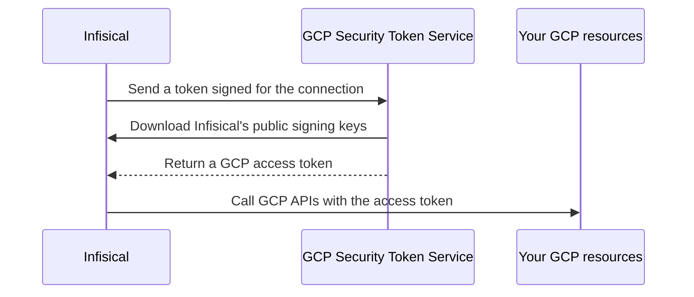

A GCP connection gives Infisical access to your Google Cloud projects, so Infisical can sync secrets and certificates to them, validate ACME DNS challenges in Cloud DNS, and rotate service account keys. You can authenticate the connection with one of two methods:

- **Workload Identity Federation** (recommended): GCP accepts short-lived tokens that Infisical signs for the connection, so you don't need a service account key or a grant to Infisical's service account
- **Service Account Impersonation**: Infisical's own service account [impersonates](https://cloud.google.com/iam/docs/service-account-impersonation) a service account in your project

Use workload identity federation for new connections. With service account impersonation, GCP sees only Infisical's service account and can't tell which connection is calling. As a result, anyone in your Infisical organization who can create a connection and knows a service account's email can use that service account. With workload identity federation, GCP checks which Infisical connection or project is calling before it grants access.

## Workload identity federation

With workload identity federation, Infisical acts as an OpenID Connect (OIDC) identity provider for your Infisical organization. Each time the connection calls GCP, Infisical signs a short-lived token for the connection, and GCP's Security Token Service exchanges that token for a GCP access token:



GCP only returns an access token if two settings in a GCP [workload identity pool](https://cloud.google.com/iam/docs/workload-identity-federation) allow it:

- The pool's provider trusts the issuer URL of your Infisical organization
- An IAM binding grants access to the connection, either directly or through a service account that the connection impersonates

You switch between GCP and Infisical during setup, because each one needs a value from the other. Infisical needs the name of the GCP provider when you create the connection. GCP needs the connection's subject identifier, which includes the connection ID that Infisical assigns when it creates the connection:

1. [Find your GCP project number](#step-1-find-your-gcp-project-number)
2. [Create the connection](#step-2-create-the-connection) in Infisical with the project number and the pool and provider IDs
3. [Configure GCP](#step-3-configure-gcp) with the values that Infisical shows for the connection
4. [Verify the connection](#step-4-verify-the-connection) in Infisical

### Prerequisites

- A GCP project where you can enable APIs, create workload identity pools, and grant IAM roles, for example through the `roles/serviceusage.serviceUsageAdmin`, `roles/iam.workloadIdentityPoolAdmin`, and `roles/iam.securityAdmin` roles
- The [gcloud CLI](https://cloud.google.com/sdk/docs/install), signed in to an account with that access
- If you self-host Infisical, `SITE_URL` set to your instance's public `https://` URL, because GCP downloads Infisical's signing keys from that URL over the internet (Infisical won't create the connection if `SITE_URL` isn't an `https://` URL)

### Step 1: Find your GCP project number

The workload identity pool and its provider live in an existing GCP project, and Infisical identifies them by that project's number. Pick the project, then look up its number. To find the project's ID, list the projects your account can access:

```bash
gcloud projects list --format="table(projectId, projectNumber, name)"
```

The `PROJECT_NUMBER` column has the number you need. If you already know the project's ID, you can look up the number directly:

```bash
gcloud projects describe <GCP_PROJECT_ID> --format="value(projectNumber)"
```

The pool and provider don't need to exist yet. When you create the connection in Infisical, the form suggests IDs for them, and the setup commands create them.

### Step 2: Create the connection

<Tabs>
    <Tab title="Infisical UI">
        <Steps>
            <Step>
                In the sidebar of your organization or project, select **Integrations**, then open the **App Connections** tab.

                
            </Step>
            <Step>
                Select **Add Connection** and choose **GCP**.
            </Step>
            <Step>
                Enter a **Name**, select the **Workload Identity Federation** method, then fill out the fields:

                - **Project Number**: the number you found in [Step 1](#step-1-find-your-gcp-project-number)
                - **Pool ID** and **Provider ID**: the IDs of the workload identity pool and its provider (the form suggests new IDs)
                - **Service Account Email** (optional): the email of a service account for the connection to impersonate (leave it empty to grant GCP roles to the connection itself)

                The setup commands create a pool and provider with the suggested IDs. To use a pool and provider that you already created, enter their IDs instead. Several GCP connections in the same Infisical organization can share one pool and provider.

                Enter a service account if the roles your integrations need are already granted to one. Then select **Create Connection**.
            </Step>
            <Step>
                Infisical creates the connection without contacting GCP. The form then shows a **Federated Credential** section with the values you need in [Step 3](#step-3-configure-gcp):

                - **Issuer**: the URL that GCP downloads Infisical's signing keys from
                - **Subject Identifier**: the connection's identity in GCP, `app-connection:<CONNECTION_ID>`
                - **Audience**: the audience of the tokens that Infisical signs for the connection (GCP accepts it by default, so you don't enter it in GCP)
                - **Setup Commands**: the `gcloud` commands that create the pool and provider and grant access, with your values filled in

                Keep the form open, because you'll [verify the connection](#step-4-verify-the-connection) from it.
            </Step>
        </Steps>
    </Tab>
    <Tab title="API">
        Call the GCP Connections [Create](/api-reference/endpoints/app-connections/gcp/create) endpoint with `method` set to `workload-identity-federation`. Set `credentials.workloadIdentityProvider` to the provider's full resource name, which uses the project number, not the project ID:

        ```
        projects/<GCP_PROJECT_NUMBER>/locations/global/workloadIdentityPools/<POOL_ID>/providers/<PROVIDER_ID>
        ```

        Choose new pool and provider IDs, or use the IDs of a pool and provider that you already created. Each ID is 4 to 32 lowercase letters, digits, and hyphens.

        The response returns the values you need in [Step 3](#step-3-configure-gcp) in `credentials.federatedCredential`:

        <ResponseField name="issuerUrl" type="string">
            The URL that GCP downloads Infisical's signing keys from, `<SITE_URL>/api/v1/oidc-issuer/organizations/<ORG_ID>`
        </ResponseField>

        <ResponseField name="subjectIdentifier" type="string">
            The connection's identity in GCP, `app-connection:<CONNECTION_ID>`
        </ResponseField>

        <ResponseField name="audience" type="string">
            The audience of the tokens that Infisical signs for the connection, `https://iam.googleapis.com/<WORKLOAD_IDENTITY_PROVIDER>` (GCP accepts it by default, so you don't enter it in GCP)
        </ResponseField>
    </Tab>
</Tabs>

### Step 3: Configure GCP

In GCP, create the workload identity pool and a provider that trusts Infisical's issuer URL, then grant the connection access. The **Setup Commands** in the connection's form contain the same commands as steps 2 to 5 of this procedure, with your pool, provider, issuer, and IAM member filled in.

<Steps>
    <Step>
        Enable the IAM, IAM Service Account Credentials, and Security Token Service APIs:

        ```bash
        gcloud services enable iam.googleapis.com iamcredentials.googleapis.com sts.googleapis.com --project <GCP_PROJECT_ID>
        ```
    </Step>
    <Step>
        Create the workload identity pool (skip this step if you're reusing a pool):

        ```bash
        gcloud iam workload-identity-pools create <POOL_ID> --project <GCP_PROJECT_ID> --location global --display-name "Infisical"
        ```
    </Step>
    <Step>
        Create an OIDC provider in the pool with the **Issuer** from Infisical (skip this step if you're reusing a provider):

        ```bash
        gcloud iam workload-identity-pools providers create-oidc <PROVIDER_ID> \
          --project <GCP_PROJECT_ID> --location global --workload-identity-pool <POOL_ID> \
          --issuer-uri "<ISSUER_URL>" \
          --attribute-mapping "google.subject=assertion.sub,attribute.project_id=assertion.project_id"
        ```

        The attribute mapping uses the connection's subject as the GCP subject. It also copies the Infisical project ID from the token, so you can grant access to every connection in a project.
    </Step>
    <Step>
        Choose the IAM member to grant access to:

        <Tabs>
            <Tab title="One connection">
                To grant access to this connection only, use the connection's **Subject Identifier** from Infisical. The connection's form shows this member as **Principal**:

                ```
                principal://iam.googleapis.com/projects/<GCP_PROJECT_NUMBER>/locations/global/workloadIdentityPools/<POOL_ID>/subject/app-connection:<CONNECTION_ID>
                ```
            </Tab>
            <Tab title="Every connection in a project">
                This member only covers connections that you create inside an Infisical project. If you created the connection in your organization's **Integrations** instead, its tokens don't carry a project ID, so use the **One connection** member.

                To grant access to every connection in one Infisical project, use the project's ID, which you can copy from the **Project ID** field in the project's settings:

                ```
                principalSet://iam.googleapis.com/projects/<GCP_PROJECT_NUMBER>/locations/global/workloadIdentityPools/<POOL_ID>/attribute.project_id/<INFISICAL_PROJECT_ID>
                ```

                If you created the connection inside a project, the connection's form also builds this member for you. Set **Grant Access To** to **Any connection in this Infisical project**, and the form shows the member as **Principal Set**. The form doesn't show **Grant Access To** for connections that you create in your organization's **Integrations**.
            </Tab>
        </Tabs>

        <Warning>
            Never grant access to the whole pool (`principalSet://iam.googleapis.com/projects/<GCP_PROJECT_NUMBER>/locations/global/workloadIdentityPools/<POOL_ID>/*`). The provider accepts a token from any connection in your Infisical organization, so the IAM member is the only thing that limits which connections can use your GCP resources.
        </Warning>
    </Step>
    <Step>
        Grant the member access, replacing `<MEMBER>` with the member you chose in the previous step:

        <Tabs>
            <Tab title="Through a service account">
                If you entered a **Service Account Email**, let the member impersonate that service account:

                ```bash
                gcloud iam service-accounts add-iam-policy-binding <SERVICE_ACCOUNT_EMAIL> \
                  --project <GCP_PROJECT_ID> \
                  --role roles/iam.workloadIdentityUser \
                  --member "<MEMBER>"
                ```

                Then grant the service account the [roles your integrations need](#configure-service-account-for-infisical). The service account's ID doesn't need the organization ID suffix that service account impersonation requires.
            </Tab>
            <Tab title="Directly">
                If you left **Service Account Email** empty, grant the roles your integrations need to the member itself. Run this command once for each role, replacing `<ROLE>` with the role. The connection's **Setup Commands** show the same command with your member filled in:

                ```bash
                gcloud projects add-iam-policy-binding <GCP_PROJECT_ID> \
                  --role <ROLE> \
                  --member "<MEMBER>"
                ```

                Grant the roles on the GCP project that holds the resources Infisical manages, such as the project you sync secrets to:

                | Integration | Roles |
                | --- | --- |
                | [Secret syncs](/integrations/secret-syncs/gcp-secret-manager) | `roles/secretmanager.admin`, `roles/serviceusage.serviceUsageViewer` |
                | [Certificate syncs](/documentation/platform/pki/applications/certificate-syncs/gcp-certificate-manager) | `roles/certificatemanager.editor`, `roles/serviceusage.serviceUsageViewer`, `roles/browser` |
                | [ACME DNS validation](/documentation/platform/pki/ca/acme-ca) | `roles/dns.admin`, `roles/serviceusage.serviceUsageViewer` |
                | [Service account key rotation](/documentation/platform/secret-rotation/gcp-service-account-key) | `roles/iam.serviceAccountKeyAdmin` |

                If a certificate sync removes certificates or uses a certificate map, also grant `roles/certificatemanager.owner`. To limit key rotation to specific service accounts, grant `roles/iam.serviceAccountKeyAdmin` on [each of those service accounts](/documentation/platform/secret-rotation/gcp-service-account-key#step-1-configure-the-service-account-for-infisical) instead of the project. Certificate syncs and ACME DNS validation also need some GCP APIs enabled, which [Configure service account for Infisical](#configure-service-account-for-infisical) lists for each integration.

                <Note>
                    Without a service account, each GCP operation that Infisical runs gets a token that's valid for at least 5 minutes, which is enough for a typical sync. If an operation can take longer, use a service account.

                    Verifying the connection also checks only that the provider trusts Infisical, not which roles the member has. A missing role shows up at the first sync.
                </Note>
            </Tab>
        </Tabs>
    </Step>
</Steps>

### Step 4: Verify the connection

Back in Infisical, select **Verify Connection** on the connection's form. If you closed the form, open the connection's menu, select **Edit Credentials**, then select **Verify Connection**. Infisical requests a token from GCP and, if you entered a service account, impersonates that service account.

<Note>
    GCP can take a few minutes to apply IAM changes. If verification fails right after you grant access, wait a few minutes, then select **Retry Verification**.
</Note>

<Check>
    Your GCP app connection is ready to use.
</Check>

### Troubleshooting

<AccordionGroup>
    <Accordion title="GCP workload identity provider rejected the connection's token">
        GCP rejected the token because the provider doesn't exist, is disabled, or trusts a different issuer. Check the following in GCP:

        - The provider that the connection's **Project Number**, **Pool ID**, and **Provider ID** name exists and is enabled
        - The provider's issuer URI is the **Issuer** that Infisical shows for the connection
    </Accordion>
    <Accordion title="GCP denied the connection access to service account">
        The member doesn't have the `roles/iam.workloadIdentityUser` role on the service account. Grant the role to the connection's subject or to its project with the `gcloud iam service-accounts add-iam-policy-binding` command in [Step 3](#step-3-configure-gcp).
    </Accordion>
</AccordionGroup>

## Service account impersonation

With service account impersonation, Infisical's own service account impersonates a service account that you create in your GCP project.

<Accordion title="Self-Hosted Instance">
    Using service account impersonation on a self-hosted instance of Infisical requires configuring a service account on GCP and
    configuring your instance to use it.

    <Steps>
        <Step title="Enable the IAM Service Account Credentials API">
            Enable the IAM Service Account Credentials API for the project containing the service account that will be impersonated. You can do this from the Google Cloud Console or via the command line.
            
            
            
            To enable via command line, run the following command, replacing `projectId` with your GCP project ID:
            ```bash
            gcloud services enable iamcredentials.googleapis.com --project=projectId
            ```
            
            Verify the API is enabled by running:
            ```bash
            gcloud services list --enabled --project=projectId | grep iamcredentials
            ```
        </Step>
        <Step title="Navigate to IAM & Admin > Service Accounts in Google Cloud Console">
            
        </Step>
        <Step title="Create a Service Account">
            Create a new service account that will be used to impersonate other GCP service accounts for your app connections.
            

            Press "DONE" after creating the service account.
        </Step>
        <Step title="Generate Service Account Key">
            Download the JSON key file for your service account. This will be used to authenticate your instance with GCP.
            
        </Step>
        <Step title="Configure Your Instance">
            1. Copy the entire contents of the downloaded JSON key file.
            2. Set it as a string value for the `INF_APP_CONNECTION_GCP_SERVICE_ACCOUNT_CREDENTIAL` environment variable.
            3. Restart your Infisical instance to apply the changes.
            4. You can now use GCP integration with service account impersonation.

            <Note>
                Your instance can also authenticate to GCP through workload identity federation. This setting is separate from the [workload identity federation](#workload-identity-federation) connection method, which doesn't use the instance's service account. Instead of a service account key, you may
                set `INF_APP_CONNECTION_GCP_SERVICE_ACCOUNT_CREDENTIAL` to an `external_account` credential
                configuration JSON (the file produced by `gcloud iam workload-identity-pools create-cred-config`).
                Infisical detects the credential type from the `type` field automatically. The federated identity
                needs the `roles/iam.serviceAccountTokenCreator` role on the service accounts it impersonates.

                For **AWS** providers, Infisical resolves the instance's AWS credentials through the standard AWS
                SDK credential chain, so federation works on EC2, ECS/Fargate, EKS (IRSA), and Lambda, or from
                `AWS_ACCESS_KEY_ID` / `AWS_SECRET_ACCESS_KEY` environment variables. The region defaults to
                `us-east-1`; set `AWS_REGION` (or `AWS_DEFAULT_REGION`) to use a specific regional STS endpoint.

                For other providers, the referenced credential source (a mounted file or URL) must be reachable
                from the Infisical instance at runtime.
            </Note>
        </Step>
    </Steps>

</Accordion>

### Configure service account for Infisical

<Steps>
    <Step title="Navigate to IAM & Admin > Service Accounts in Google Cloud Console">
        
    </Step>
    <Step title="Create Service Account">
        Create a new service account with an ID that follows this requirement:
        
        Your service account ID must end with the first two sections of your Infisical organization ID.
        
        Example:
        - Infisical organization ID: `df92581a-0fe9-42b5-b526-0a1e88ec8085`
        - Required service account ID suffix: `df92581a-0fe9`

        
    </Step>
    <Step title="Configure Service Account Permissions">
        <Tabs>
            <Tab title="Secret Sync">
                Add the **Secret Manager Admin** (`roles/secretmanager.admin`) and **Service Usage Viewer** (`roles/serviceusage.serviceUsageViewer`) roles for [secret syncs](/integrations/secret-syncs/gcp-secret-manager). Secret Manager Admin lets Infisical manage the synced secrets. Service Usage Viewer lets Infisical check which projects have the Secret Manager API enabled, so those projects appear in the sync form. Service Usage Admin also works, but Infisical doesn't need its extra permissions.
                

                Instead of Secret Manager Admin on the whole project, you can [limit the service account to the secrets a GCP Secret Manager sync manages](/integrations/secret-syncs/gcp-secret-manager#least-privilege-permissions).
            </Tab>
            <Tab title="Certificate Sync">
                Add the required permissions for [certificate syncs](/documentation/platform/pki/applications/certificate-syncs/gcp-certificate-manager):
                

                Grant these roles on the project that holds your certificates, and enable the three APIs Infisical calls on that same project:

                ```bash
                gcloud services enable \
                    certificatemanager.googleapis.com \
                    cloudresourcemanager.googleapis.com \
                    serviceusage.googleapis.com \
                    --project=PROJECT_ID
                ```

                Certificate Manager Owner is needed if you enable certificate removal on a sync, or if you attach a sync to a certificate map. `roles/certificatemanager.editor` grants no delete permissions, and maintaining a map entry replaces or removes it.
            </Tab>
            <Tab title="ACME DNS validation">
                Add the required permissions for [ACME certificate authorities](/documentation/platform/pki/ca/acme-ca) that validate domains through Google Cloud DNS.

                Grant the **DNS Administrator** (`roles/dns.admin`) and **Service Usage Viewer** (`roles/serviceusage.serviceUsageViewer`) roles on the project that holds your public managed zone. DNS Administrator lets Infisical list your projects and zones and create and delete the challenge TXT records. Service Usage Viewer lets Infisical check which projects have the Cloud DNS API enabled.

                Then enable the Google Cloud APIs that Infisical uses on that same project:

                ```bash
                gcloud services enable \
                    dns.googleapis.com \
                    cloudresourcemanager.googleapis.com \
                    serviceusage.googleapis.com \
                    --project=PROJECT_ID
                ```
            </Tab>
            <Tab title="Secret Rotation">
                Add the **Service Account Key Admin** role so Infisical can create and delete keys for [GCP service account key rotations](/documentation/platform/secret-rotation/gcp-service-account-key).

                If you add the role here, it applies to every service account in the project. To allow rotation for specific service accounts only, skip the role here and grant it on each of those service accounts, as described in [the rotation guide](/documentation/platform/secret-rotation/gcp-service-account-key#step-1-configure-the-service-account-for-infisical).
            </Tab>
        </Tabs>
        After configuring the appropriate roles, press "DONE".
    </Step>
    <Step title="Enable Service Account Impersonation">
        To enable service account impersonation, you'll need to grant the **Service Account Token Creator** role to the Infisical instance's service account. This configuration allows Infisical to securely impersonate the new service account.

        1. Navigate to the **IAM & Admin > Service Accounts** section in your Google Cloud Console.
        2. Select the newly created service account.
        3. Click on the **PERMISSIONS** tab.
        4. Click **Grant Access** to add a new principal.
        5. In the **New principals** field, enter the Infisical service account email for your environment:
            - **Infisical Cloud US:** `infisical-us@infisical-us.iam.gserviceaccount.com`
            - **Infisical Cloud EU:** `infisical-eu@infisical-eu.iam.gserviceaccount.com`
            - **Self-hosted:** use the service account you created for your instance (the one whose credentials are set in `INF_APP_CONNECTION_GCP_SERVICE_ACCOUNT_CREDENTIAL`).
        6. In the **Role** field, select **Service Account Token Creator**.
        7. Click **Save**.

        

        <Note>
            **Troubleshooting: "One or more users named in the policy do not belong to a permitted customer."**

            If granting access fails with the error *"One or more users named in the policy do not belong to a permitted customer."*, your Google Cloud organization has the Domain Restricted Sharing organization policy (`iam.allowedPolicyMemberDomains`) enabled. This policy only permits identities that belong to allowlisted Google organizations, so the Infisical service account is rejected until it is explicitly allowed.

            To resolve this, add Infisical's Google Cloud Customer ID to the policy's allowed values **before** granting the service account a role:

            1. In the Google Cloud Console, navigate to **IAM & Admin > Organization Policies**.
            2. Search for and open the **Domain restricted sharing** (`iam.allowedPolicyMemberDomains`) policy.
            3. Under **Custom values**, add a new allowed value containing Infisical's Google Cloud Customer ID:

                ```
                C03rsjmyl
                ```

                This is **Infisical's Google Cloud Customer ID**, not your own. Infisical uses a single Google Cloud organization, so this one Customer ID covers both the US and EU service accounts.

                Enter the bare Customer ID (`C03rsjmyl`) in the Console UI. If you manage this policy with `gcloud`, a policy YAML file, or Terraform instead, use the prefixed form `is:C03rsjmyl`.
            4. Save the policy, then return to **Step 4 (Grant Access)** in the main instructions above and complete steps 4–7 to add the Infisical service account as a principal.
        </Note>
    </Step>

</Steps>

### Setup GCP connection in Infisical

<Steps>
  <Step title="Navigate to App Connections">
    Navigate to the **Integrations** tab in the desired project, then select **App Connections**. 
  </Step>
  <Step title="Add Connection">
    Select the **GCP Connection** option from the connection options modal.
    
  </Step>
  <Step title="Authorize Connection">
    Select the **Service Account Impersonation** method and click **Connect to
    GCP**. 
  </Step>
  <Step title="Connection Created">
    Your **GCP Connection** is now available for use. 
  </Step>
</Steps>
